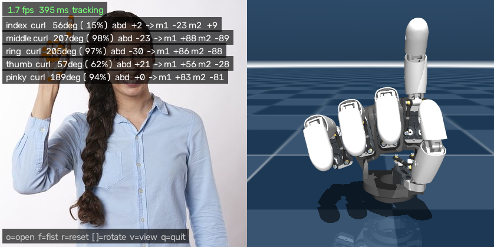
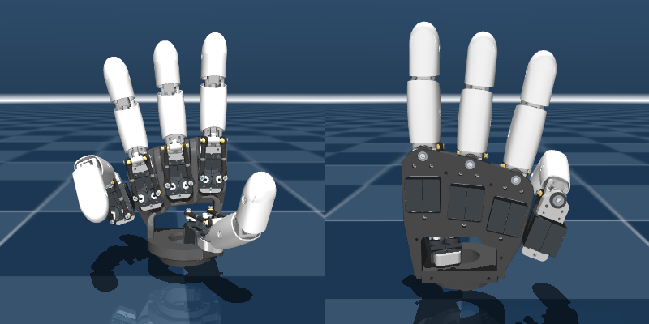

# AmazingHand webcam teleop (sim)

This drives a simulated AmazingHand from your webcam. The default model has 5 digits: the stock index, middle, ring and thumb, plus a cloned pinky.



## Run it on the Mac

```bash
cd Demo/Teleop
python3 -m venv .venv && source .venv/bin/activate
pip install -r requirements.txt
python build_model.py          # copies the stock model into models/AH_Right and builds scene_4f/5f.xml
python teleop.py               # 5-digit hand; use --fingers 4 for the stock hand
```

The first time you run it, macOS asks whether your terminal app may use the camera. Allow it, then run the script again.
Plain `python` works here. You don't need `mjpython` because the sim is rendered offscreen into the same OpenCV window.

**Calibrate:** hold your hand flat with the fingers together and press `o`, then make a fist and press `f`.
The other keys are `[` `]` to rotate the robot view, `v` to switch between the palm and back views, `r` to reset calibration, and `q` to quit.

Other options:
- `--camera 1 0` uses two cameras together (see "Two cameras" below). `--list-cameras` shows which index is which.
- `--tracker wilor` uses WiLoR instead of MediaPipe (see below).
- `--record hard.mp4` also saves the raw camera video, for `compare_trackers.py`.
- `--video clip.mp4` or `--image hand.jpg` use a file instead of the webcam.
- `--log motors.csv` records the servo commands.
- `--hand right|left` picks which of your hands to track.

The top line of the overlay shows which tracker is running and whether your palm or the back of your hand faces the camera.

## Two cameras (webcam + iPhone)

One camera can't see fingers hidden behind the back of your hand. With two cameras at different angles, one usually sees the palm or the side when the other doesn't. Joint angles are measured in the hand's own frame, so each finger is merged from both views without calibrating the cameras. Each view is weighted by how well it sees the hand: palm-on or side views are trusted most for curl, back views least.

1. Run `python teleop.py --list-cameras` to see a snapshot from each camera index. On a Mac, the iPhone (Continuity Camera) often takes index 0.
2. Place the cameras about 60 to 90 degrees apart. For example, use the laptop webcam in front, and the iPhone on a stand to the side or low on the desk, angled up at your palm.
3. Run `python teleop.py --camera 1 0`. The first index is the main view, which shows the angle readout, and whose hand the other camera follows.

Each camera panel shows whether it sees your palm, side or back, and how much it's trusted right now.
`--record session.mp4` saves `session_cam0.mp4` and `session_cam1.mp4`, which you can replay with `--video session_cam0.mp4 session_cam1.mp4`.
If the iPhone image keeps reframing itself, turn off Center Stage in Control Center under Video Effects.

## WiLoR tracker (more robust, heavier)

MediaPipe guesses at fingers it can't see, so it struggles when the back of your hand faces the camera or in a tight fist. [WiLoR](https://github.com/warmshao/WiLoR-mini) fits a full 3D hand model (MANO), which keeps hidden fingers plausible and handles unusual views much better. It runs on the Mac GPU (MPS) but is slower than MediaPipe.

Use a separate environment with Python 3.11 or 3.12, because wilor-mini needs torch 2.5 or older:

```bash
python3.12 -m venv .venv-wilor && source .venv-wilor/bin/activate
pip install -r requirements.txt
pip install --no-build-isolation "chumpy @ git+https://github.com/mattloper/chumpy"
pip install -r requirements-wilor.txt
python teleop.py --tracker wilor
```

The first run downloads about 1 GB of weights from Hugging Face. `WILOR_FP16=1 python teleop.py --tracker wilor` tries half precision, which should be faster; switch back if the keypoints look wrong.
MANO, which WiLoR uses, is licensed for non-commercial research only.

## Comparing trackers on your own motions

```bash
python teleop.py --record hard.mp4        # do the hard stuff: fist, wide spread, pinches, flip your hand
python compare_trackers.py hard.mp4 --trackers mediapipe wilor
```

This writes `compare.mp4` with the trackers side by side, and prints for each tracker:
- the detection rate on palm-facing and back-facing frames,
- the range of curl each digit reaches,
- the frame-to-frame jitter,
- milliseconds per frame.

## How it works

1. **Tracking:** MediaPipe HandLandmarker (Tasks API) or WiLoR gives 21 keypoints in metres (`trackers.py`). A One Euro filter smooths them.
2. **Angles:** for each digit, the script measures:
   - **curl:** the sum of flexion at its three joints.
   - **abduction:** the signed angle of the proximal bone in the palm plane, positive towards the thumb.
   - For the thumb, abduction is instead the spread between the thumb and index metacarpals.
3. **Retargeting:** curl is normalised to 0..1 using your open and fist calibration, then mapped to a flex angle:
   - Fingers go from -35° (straight) to 90° (closed).
   - Abduction is scaled and faded out as the finger curls, because it is unreliable on a curled finger.
4. **Servos:** each AmazingHand digit has 2 servos in parallel, so `motor1 = flex + abd` and `motor2 = -flex + abd`. This matches Pollen's examples (open is (-35, 35) and closed is (90, -90)), and I checked the signs in sim.
5. **Simulation:** those angles become MuJoCo position-actuator targets, and the physics handles the closed-loop linkage.

The tuning constants are at the top of `teleop.py`: `FLEX_*`, `ABD_*` and the `Calibration` defaults.

Robot finger numbering is finger1 = index, finger2 = middle, finger3 = ring, finger4 = thumb, finger5 = pinky. The `--log` CSV uses this order.

## The pinky



`build_model.py` copies the ring finger, with its servos, frames, linkage constraints and actuators, and rotates it one more "fan step" (about 7.5° about the palm x axis) beyond the ring. It's a placeholder: it isn't the final 5-digit hand (`AH_Right_5F_3S_Wrist`, see [FIVE_FINGER.md](../../FIVE_FINGER.md)), which has its own pinky, 3-phalanx fingers and a powered wrist.
- `--pinky-extra-deg N` widens the fan.

## Credits

The model and meshes are the stock `AH_Right` from [pollen-robotics/AmazingHand](https://github.com/pollen-robotics/AmazingHand) under Apache-2.0 (see [Demo/LICENSE](../LICENSE)). Their own tracking demo uses dora-rs, Rust and `mediapipe<=0.10.15`. This repo is a lighter, single-script alternative that works with current MediaPipe.
