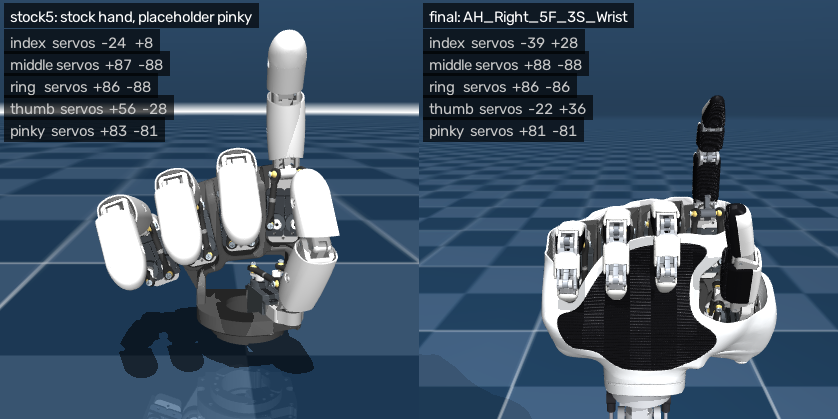

# AmazingHand webcam teleop (sim)

This drives a simulated AmazingHand from your webcam. By default it drives the final 5-digit hand, `AH_Right_5F_3S_Wrist` (see [FIVE_FINGER.md](../../FIVE_FINGER.md)): slim 3-phalanx fingers, the re-mounted thumb, a pinky and the powered wrist, which is held straight. `--model stock5` and `--model stock4` drive the stock hand instead, with or without a placeholder pinky.


*An earlier run on the stock hand. Below, the angles tracked in that run, replayed on the stock hand (left) and the final hand (right).*



## Run it on the Mac

```bash
cd Demo/Teleop
python3 -m venv .venv && source .venv/bin/activate
pip install -r requirements.txt
python teleop.py               # the final 5-digit hand
```

For the stock hand, run `python build_model.py` once (it copies the stock model into `models/AH_Right` and builds `scene_4f.xml` and `scene_5f.xml`), then `python teleop.py --model stock5` (with the placeholder pinky) or `--model stock4`.

The first time you run it, macOS asks whether your terminal app may use the camera. Allow it, then run the script again.
Plain `python` works here. You don't need `mjpython` because the sim is rendered offscreen into the same OpenCV window.

**Calibrate:** hold your hand flat with the fingers together and press `o`, then make a fist and press `f`.
The other keys are `[` `]` to rotate the robot view, `v` to switch between the palm and back views, `r` to reset calibration, and `q` to quit.

Other options:
- `--camera 1 0` uses two cameras together (see "Two cameras" below). `--list-cameras` shows which index is which.
- `--tracker wilor` uses WiLoR instead of MediaPipe (see below).
- `--record hard.mp4` also saves the raw camera video, for `compare_trackers.py`.
- `--video clip.mp4` or `--image hand.jpg` use a file instead of the webcam. Use a plain photo of a hand: `docs/example_pointing_up.png` is a saved output, and the overlay hides the hand from the tracker.
- `--log motors.csv` records the servo commands.
- `--hand right|left` picks which of your hands to track.

The top line of the overlay shows which tracker is running and whether your palm or the back of your hand faces the camera.

## Two cameras (webcam + iPhone)

One camera can't see fingers hidden behind the back of your hand. With two cameras at different angles, one usually sees the palm or the side when the other doesn't. Joint angles are measured in the hand's own frame, so each finger is merged from both views without calibrating the cameras. Each view is weighted by how well it sees the hand: palm-on or side views are trusted most for curl, back views least.

1. Run `python teleop.py --list-cameras` to see a snapshot from each camera index. On a Mac, the iPhone (Continuity Camera) often takes index 0.
2. Place the cameras about 60 to 90 degrees apart. For example, use the laptop webcam in front, and the iPhone on a stand to the side or low on the desk, angled up at your palm.
3. Run `python teleop.py --camera 1 0`. The first index is the main view, which shows the angle readout, and whose hand the other camera follows.

Each camera panel shows whether it sees your palm, side or back, and how much it's trusted right now.
`--record session.mp4` saves `session_cam0.mp4` and `session_cam1.mp4`, which you can replay with `--video session_cam0.mp4 session_cam1.mp4`.
If the iPhone image keeps reframing itself, turn off Center Stage in Control Center under Video Effects.

## WiLoR tracker (more robust, heavier)

MediaPipe guesses at fingers it can't see, so it struggles when the back of your hand faces the camera or in a tight fist. [WiLoR](https://github.com/warmshao/WiLoR-mini) fits a full 3D hand model (MANO), which keeps hidden fingers plausible and handles unusual views much better. It runs on the Mac GPU (MPS) but is slower than MediaPipe.

Use a separate environment with Python 3.11 or 3.12, because wilor-mini needs torch 2.5 or older:

```bash
python3.12 -m venv .venv-wilor && source .venv-wilor/bin/activate
pip install -r requirements.txt
pip install --no-build-isolation "chumpy @ git+https://github.com/mattloper/chumpy"
pip install -r requirements-wilor.txt
python teleop.py --tracker wilor
```

The first run downloads about 1 GB of weights from Hugging Face. `WILOR_FP16=1 python teleop.py --tracker wilor` tries half precision, which should be faster; switch back if the keypoints look wrong.
MANO, which WiLoR uses, is licensed for non-commercial research only.

## Comparing trackers on your own motions

```bash
python teleop.py --record hard.mp4        # do the hard stuff: fist, wide spread, pinches, flip your hand
python compare_trackers.py hard.mp4 --trackers mediapipe wilor
```

This writes `compare.mp4` with the trackers side by side, and prints for each tracker:
- the detection rate on palm-facing and back-facing frames,
- the range of curl each digit reaches,
- the frame-to-frame jitter,
- milliseconds per frame.

## How it works

1. **Tracking:** MediaPipe HandLandmarker (Tasks API) or WiLoR gives 21 keypoints in metres (`trackers.py`). A One Euro filter smooths them.
2. **Angles:** for each digit, the script measures:
   - **curl:** the sum of flexion at its three joints.
   - **abduction:** the signed angle of the proximal bone in the palm plane, positive towards the thumb.
   - For the thumb, abduction is instead the spread between the thumb and index metacarpals.
3. **Retargeting:** curl is normalised to 0..1 using your open and fist calibration, then mapped to a flex angle:
   - Final hand: the 3-phalanx fingers go from -56° (straight) to 90° (closed), and are never commanded below -60°.
   - Stock hand: fingers go from -35° (straight) to 90° (closed).
   - Abduction is scaled and faded out as the finger curls, because it is unreliable on a curled finger. On the final hand it is limited to ±30° (the peace sign's spread) and is gone by the time a finger is as curled as in the pinch (flex 0°). Two neighbouring fingers may turn towards each other by at most 20° in total, which keeps them at least 1.3 mm apart.
4. **Servos:** each AmazingHand digit has 2 servos in parallel, so `motor1 = flex + abd` and `motor2 = -flex + abd`. This matches Pollen's examples (open is (-35, 35) and closed is (90, -90)), and I checked the signs in sim.
5. **The final hand's thumb** sits on the slim mount (FIVE_FINGER.md, "Thumb mount") and moves nothing like a finger, so it isn't mapped as flex + abd. Your thumb's curl moves it from open, along the radial side of the palm, towards where it rests in the gesture the fingers make:
   - across the palm when the index and middle are straight (peace sign),
   - on the curled middle when only the index is straight (pointing),
   - on the index fingertip when the index is half curled (pinch),
   - on the side of the curled index (fist).

   These rest poses are checked commands from `Demo/AHSimulation/ultimate_finger/data/hand_poses.json`. The sim doesn't collide the digits with each other, so the thumb stops 0.5 mm short of the fingers, even with the index and middle spread towards it (`THUMB_CLOSE_MAX`, computed by `thumb_limits.py`). Every thumb command is also clamped to the mount's envelope (`THUMB_ENVELOPE` in `cad/five_finger/layout.py`). In 200 random commands, no two digits touch (closest 0.59 mm).
6. **Simulation:** those angles become MuJoCo position-actuator targets, moved at most at the SCS0009's 600°/s, and the physics handles the closed-loop linkage. The final hand starts from its settled rest pose (the model's keyframe), and its wrist servos hold zero: a single hand tracker can't see your forearm, so it can't measure your wrist angle.

The tuning constants are at the top of `teleop.py`: `FLEX_*`, `ABD_*`, `FINAL_*`, `THUMB_*` and the `Calibration` defaults.

To recompute the thumb limits after changing the final hand's thumb poses (needs `pip install scipy trimesh rtree`):

```bash
python thumb_limits.py --check 200     # prints THUMB_CLOSE_MAX, then checks 200 random commands for contacts
```

Robot finger numbering is finger1 = index, finger2 = middle, finger3 = ring, finger4 = thumb, finger5 = pinky. The `--log` CSV uses this order.

## The stock hand's placeholder pinky


For `--model stock5`, `build_model.py` copies the ring finger, with its servos, frames, linkage constraints and actuators, and rotates it one more "fan step" (about 7.5° about the palm x axis) beyond the ring. It's a placeholder from before the final hand existed: the final hand (`AH_Right_5F_3S_Wrist`) has its own pinky.
- `--pinky-extra-deg N` widens the fan.

## Credits

The stock model and meshes are `AH_Right` from [pollen-robotics/AmazingHand](https://github.com/pollen-robotics/AmazingHand) under Apache-2.0 (see [Demo/LICENSE](../LICENSE)); the final hand is built on them in this fork. Their own tracking demo uses dora-rs, Rust and `mediapipe<=0.10.15`. This repo is a lighter, single-script alternative that works with current MediaPipe.
