# AmazingHand, 5-digit variant (4 fingers + thumb)

A fourth finger (pinky, `finger5`) is added next to the ring finger. It uses the stock finger module unchanged, so the build needs one more finger kit and two more SCS0009 servos (10 in total).

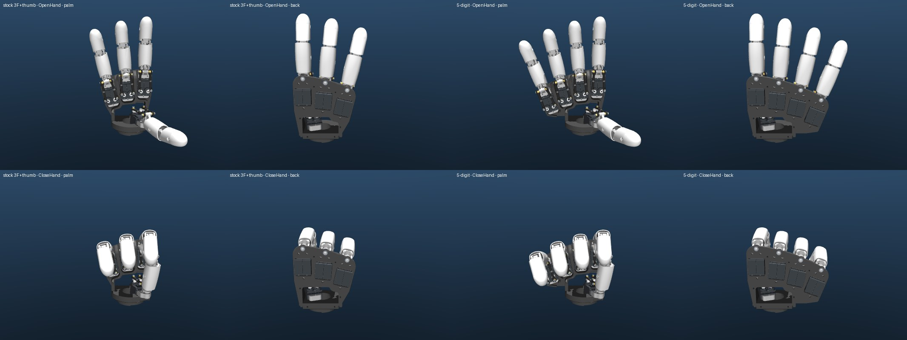

| What | Where |
|---|---|
| MuJoCo models | [AH_Right_5F/mjcf/](Demo/AHSimulation/AHSimulation/AH_Right_5F/mjcf/), [AH_Left_5F/mjcf/](Demo/AHSimulation/AHSimulation/AH_Left_5F/mjcf/) (generated by [build_5f_model.py](Demo/AHSimulation/five_finger/build_5f_model.py)) |
| Checks, renders, reports | [verify_5f_model.py](Demo/AHSimulation/five_finger/verify_5f_model.py), [check_shells.py](Demo/AHSimulation/five_finger/check_shells.py), [render_5f_model.py](Demo/AHSimulation/five_finger/render_5f_model.py), [reports/](Demo/AHSimulation/five_finger/reports/), [renders/](Demo/AHSimulation/five_finger/renders/) |
| Wider palm plates (R and L), STEP + STL | [cad/five_finger/](cad/five_finger/) (generated by [make_5f_plate.py](cad/five_finger/make_5f_plate.py)) |
| Palm/back shells and grip pads (R and L), STL | [cad/five_finger/stl/](cad/five_finger/stl/) (generated by [make_5f_shells.py](cad/five_finger/make_5f_shells.py)) |
| Motor config for AHControl | [Demo/AHControl/config/r_hand_5f.toml](Demo/AHControl/config/r_hand_5f.toml) |
| Styled finger shells with grip pads (fits the stock finger kit) | [cad/five_finger/fingers/](cad/five_finger/fingers/) |
| Slim fingers (−18 % / −31 % width), sim model `AH_Right_5F_Slim` | [cad/five_finger/slim_fingers/README.md](cad/five_finger/slim_fingers/README.md) |
| Powered 2-DOF wrist + forearm base, sim model `AH_Right_5F_Wrist` | [cad/five_finger/wrist/README.md](cad/five_finger/wrist/README.md) |
| **Styled 3-phalanx fingers** (the final finger), sim models `AH_Right_5F_3S`, `AH_Right_5F_3S_Wrist` | [cad/five_finger/ultimate_finger/README.md](cad/five_finger/ultimate_finger/README.md) |
| Study: 3-phalanx fingers (prototype model + concept CAD, superseded by the styled fingers) | [cad/five_finger/three_segment/README.md](cad/five_finger/three_segment/README.md) |

View the models:

```bash
.venv/bin/python -m mujoco.viewer --mjcf=Demo/AHSimulation/AHSimulation/AH_Right_5F/mjcf/scene.xml
```

```bash
.venv/bin/python -m mujoco.viewer --mjcf=Demo/AHSimulation/AHSimulation/AH_Left_5F/mjcf/scene.xml
```

With the new palm/back shells and grip pads on (`scene_shells.xml`; swap `Right` for `Left` for the left hand):

```bash
.venv/bin/python -m mujoco.viewer --mjcf=Demo/AHSimulation/AHSimulation/AH_Right_5F/mjcf/scene_shells.xml
```

To set up the environment and regenerate everything, run these from the repo root:

```bash
uv venv --python 3.12 .venv && uv pip install --python .venv/bin/python mujoco scipy pillow cadquery matplotlib scikit-image trimesh manifold3d fast-simplification
.venv/bin/python cad/five_finger/wrist/make_wrist.py                       # the shells fit the wrist's hand adapter
.venv/bin/python cad/five_finger/make_5f_plate.py
.venv/bin/python Demo/AHSimulation/five_finger/build_5f_model.py --keyframe
.venv/bin/python Demo/AHSimulation/five_finger/build_5f_model.py --side left --keyframe
.venv/bin/python cad/five_finger/ultimate_finger/make_ultimate_finger.py   # 3-phalanx finger CAD
.venv/bin/python cad/five_finger/ultimate_finger/make_ultimate_finger.py --scale 0.88 --no-figures   # the x0.88 pinky
.venv/bin/python Demo/AHSimulation/ultimate_finger/build_models.py         # AH_Right_5F_3S
.venv/bin/python cad/five_finger/make_5f_shells.py                         # fitted to AH_Right_5F and AH_Right_5F_3S
.venv/bin/python Demo/AHSimulation/five_finger/build_5f_model.py           # copies the shells into the models
.venv/bin/python Demo/AHSimulation/five_finger/build_5f_model.py --side left
.venv/bin/python Demo/AHSimulation/slim_fingers/build_slim_model.py
.venv/bin/python Demo/AHSimulation/ultimate_finger/build_models.py
.venv/bin/python Demo/AHSimulation/wrist/build_wrist_model.py --hand AH_Right_5F_3S --keyframe   # (and the others, see the wrist README)
.venv/bin/python Demo/AHSimulation/five_finger/verify_5f_model.py
.venv/bin/python Demo/AHSimulation/five_finger/verify_5f_model.py --model AH_Left_5F
```

## Where the pinky goes, and why

The pinky is the ring finger moved by the same rigid transform that takes the stock middle finger onto the stock ring finger. That transform is a 7.5° rotation about the palm normal plus the matching translation. So the pinky's pivot sits 30.5 mm further out and 15.1 mm lower than the ring's. The fan angle continues 0° → 6° → 13.5° → 21°, and the base drops continue 6.0 → 11.0 → 15.1 mm. Every part fixed to the palm is moved this way: two servos, both finger frames, the bushings, and the closing sites. So are both motor chains and their five loop-closure constraints.

Why I extended the pattern instead of re-spacing all four fingers:

- The index, middle, ring and thumb stay exactly as stock, with the same plate mounts and the same calibration. The plate only grows on the pinky side.
- The pinky sits next to the ring exactly like the ring sits next to the middle in the stock hand. That pair is already proven: neighbouring servos are 4.41 mm apart, and the collision behaviour is identical (see below).
- It is anatomically reasonable: the pinky base is lower and splays out more than the ring.
- Re-spacing does not buy much. The ~33 mm finger pitch is set by two 12 mm-wide servos side by side plus the room each finger needs to swing sideways. A tighter pitch would mean more finger-to-finger contact and a new plate under every finger.

This first step is still how the pinky is made. The four finger modules are then re-placed parallel to each other at a tighter 30 mm pitch; see [Finger layout](#finger-layout-parallel-at-30-mm). The default models, plate and shells use that layout. The numbers in this section and under Verification are for the stock fanned layout (`--layout stock`), unless they say otherwise.

## Sim model (`AH_Right_5F`)

- It has 47 bodies, 40 joints, 85 qpos values, 10 position actuators, 25 equality constraints and 1 keyframe. `finger5` is appended after the thumb, so the stock layout does not move:
  - qpos[0:68], ctrl[0:8] (`finger1_motor1` … `finger4_motor2`) and mocap[0:4] are unchanged.
  - The pinky adds `finger5_motor1`/`finger5_motor2` (ctrl[8:10]), qpos[68:85] and the mocap body `finger5_target` (mocap[4]).
- The new names continue the onshape-to-robot numbering, so nothing collides. They include `custom_servo_horn_5`, `rotule_ball_9`/`_10`, `ball_link_8`/`_9`, `passive_ball13-15`, `passive2/4/_5 (5)`, `closing_1 (5)_*`, `closing_3 (5)_*`, `closing_ball5_*` and the site `tip5`.
- The `zero` keyframe was regenerated by settling at ctrl = 0. Its first 68 values differ from the stock key by less than 5e-5.
- The palm plate mesh is the widened plate from `cad/five_finger` (in mm, with `scale="0.001 …"`). Rebuild with `--stock-plate` to get the 3-finger plate back.
- After the pinky is added, every finger module is placed by [cad/five_finger/layout.py](cad/five_finger/layout.py) (default `parallel`, see [Finger layout](#finger-layout-parallel-at-30-mm)). `--layout stock` keeps the stock fan.
- The stock `AH_Right` model is untouched; `robot.xml` differs from it only by added lines.

### Verification

Full logs are in [reports/](Demo/AHSimulation/five_finger/reports/). The numbers below are for the stock fanned layout ([right](Demo/AHSimulation/five_finger/reports/verify_AH_Right_5F_stock_layout.txt), [left](Demo/AHSimulation/five_finger/reports/verify_AH_Left_5F_stock_layout.txt)); the parallel layout's are under [Finger layout](#finger-layout-parallel-at-30-mm). The same checks were run on the stock model as a baseline.

- **Loads.** Names are unique, every ctrlrange is ±1.5708 rad, and the keyframe has 85 values. Every `fingerN_target` sits on its `tipN`, within 0.006 mm.
- **Exact copy.** With equal commands, the pinky tip in the pinky's own frame matches the ring tip in the ring's frame to within 0.0006 mm. Only gravity acts differently on the two.
- **Stable.** I ran four sweeps:
  - each actuator alone, 0 → +90° → −90° → 0;
  - all digits around the four corners of their range;
  - the demo poses;
  - 60 abrupt random full-range steps.

  There were no NaNs and no MuJoCo warnings, and the motors settle within 0.15° of their command.
- **Equality constraints.** Settled, every site pair stays within 0.003 mm. During ramped motion the worst is 0.044 mm, and during the abrupt random steps it is 0.93 mm. Those transients are on the `_z` axis sites, which sit 100 mm off the axis, so 0.93 mm is about 0.5°. The stock model gives 0.002 / 0.044 / 0.85 mm. The pinky's worst is 0.86 mm, in the same range as the stock fingers.
- **Pinky vs ring.** Each digit is settled on a 9×9 grid over (motor1, motor2), ±90° in 22.5° steps, and the meshes of every pose pair are compared (6561 pairs, surface samples every 1 mm, refined to 0.3 mm below 3 mm). The two fingers touch in 887 of 6561 pose pairs. The stock middle/ring pair gives the identical set. Contact needs the two fingers abducted toward each other: with abduction a = (m1+m2)/2 (positive toward the index) and c = a_pinky − a_ring, it starts at c ≥ 0. At c ≤ 22.5° it only happens with the pinky fully abducted toward the ring (both motors at +68° to +90°). In that pose its proximal shell grazes the ring's horn screw. In practice, never command the pinky further toward the ring than the ring itself; the stock software already treats middle/ring the same way. The extreme case is rendered in [renders/5f_06…](Demo/AHSimulation/five_finger/renders/5f_06_ring_pinky_abducted_together.jpg).
- **Pinky vs thumb.** They stay more than 5 mm apart in all 6561 pose pairs.
- **Pinky vs plate.** Its moving parts touch the widened plate at 9 of 81 grid poses. These are full over-extension poses, where the proximal segment rests on the plate edge. That is the same 9 of 81 as the ring on the stock plate; index, middle and ring are unchanged at 7, 9 and 9.
- **Demo poses with a pinky.** No finger-to-finger contact; ring/pinky are 3.7 mm apart in OpenHand. The only contacts are the stock thumb/index ones the demos intend (CloseHand, Perfect, Pinched, Fuck).
- **Renders.** Six camera angles × 8 poses are in [renders/](Demo/AHSimulation/five_finger/renders/).

### Left hand (`AH_Left_5F`)

`build_5f_model.py --side left` builds it from the stock `AH_Left` model the same way. It finds the ring's palm parts geometrically, because the left export numbers its parts differently, and uses the mirrored step. It has the same names, layout and 10 actuators as the right model, and uses the mirrored plate `L-Hand_Plate_5F`. Its checks on the stock fanned layout ([report](Demo/AHSimulation/five_finger/reports/verify_AH_Left_5F_stock_layout.txt), [stock left baseline](Demo/AHSimulation/five_finger/reports/verify_AH_Left_stock_baseline.txt)) match the right hand:

- The copy check passes (0.0007 mm). The sweeps are stable with no warnings, with the same constraint errors as the right hand.
- Ring/pinky touch in 856 of 6561 pose pairs, the identical set to its own middle/ring pair.
- The pinky touches the plate at 11 of 81 poses, the same as the ring. Index, middle and ring are 7, 11 and 11, unchanged from the stock left plate.
- The thumb stays more than 5 mm from the pinky.

The two stock exports are not exact mirrors. One result: in the left model the stock ClenchHand already has middle/ring touching (0.02 mm). Renders are the `left_*` files in [renders/](Demo/AHSimulation/five_finger/renders/).

## CAD

**[R-Hand_Plate_5F](cad/five_finger/) (STEP + STL, mm, same frame as the stock parts).** [make_5f_plate.py](cad/five_finger/make_5f_plate.py) builds it with CadQuery from the stock STEP. By default it builds the plate for the parallel 30 mm layout: each finger unit is moved by its module's transform from [layout.py](cad/five_finger/layout.py), and the volume is 36.9 cm³ (see [Finger layout](#finger-layout-parallel-at-30-mm)). With `--layout stock` it reads the same 7.5° step from the stock MJCF, so the plate and the model cannot drift apart. That stock-layout plate is the union of four pieces:

- the stock plate, unchanged (0 mm³ removed);
- the ring finger's unit copied by the step. This includes the servo window, pivot boss, screw holes, ribs and outer rim, so the stock finger module and servo mounting pattern fit the pinky as-is;
- a strip from the middle unit that fills the stock plate's rounded corner at the seam;
- a web, with the stock back-sheet and rim thickness, from the pinky unit down to the plate foot.

The result is one valid solid of 36.6 cm³ (stock: 29.1 cm³). It sits on the stock wrist interface and footprint.

**L-Hand_Plate_5F** is R-Hand_Plate_5F mirrored about x = −50 mm. The script first checks that the stock L-Hand_Plate is exactly the R-Hand_Plate mirrored the same way (0 mm³ difference).

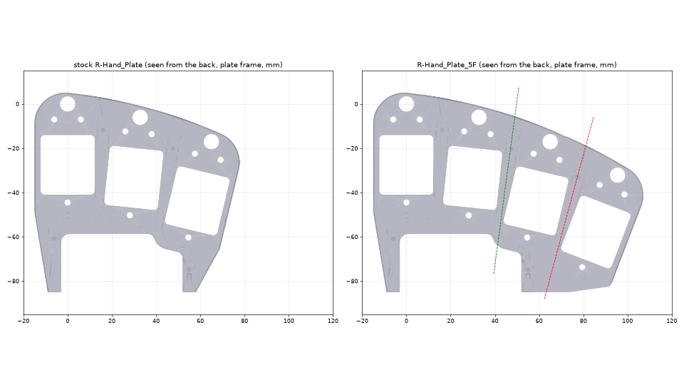

### Palm and back shells (new)

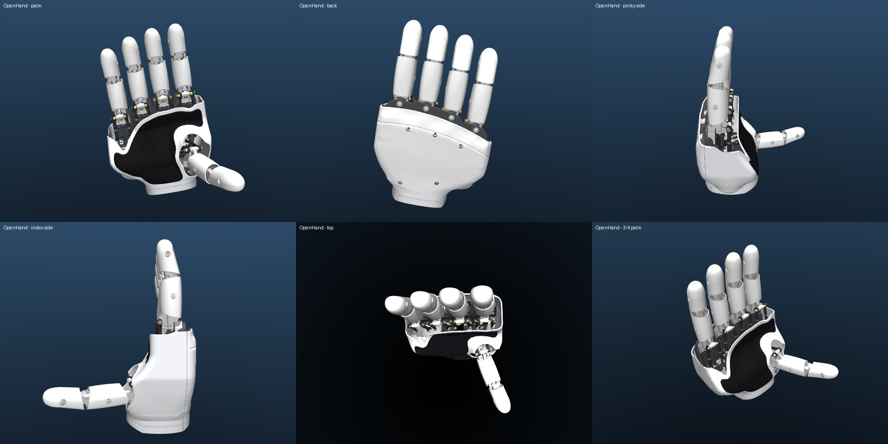

The stock Palm_Shell and Top_Shell cannot go on the widened plate: [check_shells.py](Demo/AHSimulation/five_finger/check_shells.py) shows they cut through the pinky's servo and horn screw ([report](Demo/AHSimulation/five_finger/reports/shells_stock_on_AH_Right_5F.txt)). So [make_5f_shells.py](cad/five_finger/make_5f_shells.py) generates new ones around the 5-digit mechanism. They are sculpted to read as a hand rather than a box, after the reference robot hands: white shells, a domed back, a palm that waists into a round wrist, and one large black ribbed TPU grip pad wrapped around the thumb opening.

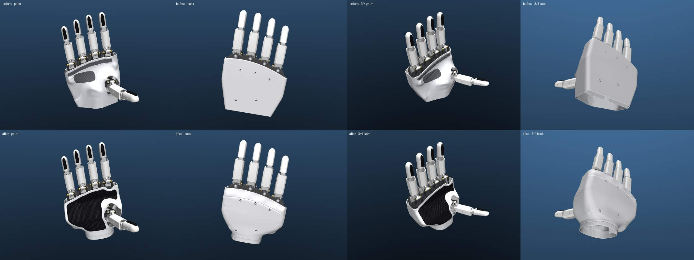

*Before (the earlier box-like shells) and after, on the slim fingers.*

- **Shape.** The shells are implicit (signed-distance) solids on a 0.5 mm voxel grid, in the same frame as the stock parts. From the sim, every digit is settled on a 19×19 grid of its two motors, on both the 2-phalanx hand (`AH_Right_5F`) and the 3-phalanx hand (`AH_Right_5F_3S`), and the two are merged into two keep-out sets, so one set of shells fits either finger:
  - **Enclose:** plate, wrist interface, servos, finger frames, servo horns, push rods (and the wrist's hand adapter). The walls stay at least 1 mm from these.
  - **Stay clear of:** each finger's knuckle, lever and phalanges, and the thumb. The walls stay at least 1.2 mm from these (2.2 mm from the thumb).

  The outer form is laid out along the forearm axis (frame W of the [wrist](cad/five_finger/wrist/README.md#hand-on-the-forearm)) as a smooth union of a few shapes, each with its parameters at the top of the script:
  - **Palm slab.** Straight, parallel sides from the knuckles down (134 mm wide), flaring in from the wrist neck. The back is a dome: its crown at CAD z = 30 mm mid-hand (8.7 mm above the servo backs), dropping towards the wrist, with a 6 mm transverse arch, a 1 mm bump behind each knuckle and a 3.5 mm roll-down to the knuckle line. The palm is a wedge: its surface is at z = −45 mm at the heel and −22 mm under the fingers, with a shallow hollow. Edge radii grow from 10–11 mm at the knuckles to 20–22 mm at the wrist.
  - **Wrist neck.** A round column (Ø69) on the forearm axis. The palm waists into it like a hand into its wrist.
  - **Thenar.** A mound over the thumb's two servos, tilted along them.
  - **Hypothenar.** A soft mound low on the pinky side.
  - **Fit.** The back, and the palm under the fingers, are lifted smoothly wherever a part needs room. A last tight blend with the enclosed parts covers anything the shapes miss (at most 0.8 mm in a few spots, so no visible bumps).
  - **Panel lines.** Two 1.4 mm wide, 0.6 mm deep grooves: one across the back 17 mm below the knuckle line (a knuckle band), and one around the wrist 8 mm above the cut. They stop 2 mm short of the seam, so the lap joint stays whole.
  - **Wrist end:** cut square to the forearm axis, rising towards the back and towards the palm (like the creases of a wrist) so the shells clear the wrist fork at the hard stops (≥ 3.5 mm; > 5 mm everywhere on the operating range). For a hand on the stock wrist interface without the powered wrist, `make_5f_shells.py --no-wrist` cuts at the stock plane (CAD y = −97.5) instead.
  - **Top edges:** the back stops 3 mm under the knuckle line, leaving the knuckle hardware exposed as in the reference. The palm stops on a smooth curve just under where the fingers sweep in a fist.

  The thumb's sweep carves the thumb opening. The finger and thumb openings have rounded edges. Walls are 2 mm.
- **Parts and materials.** Same split as stock:
  - `R-Top_Shell_5F`, PLA, rigid.
  - `R-Palm_Shell_5F`, Filaflex 82A / TPU.
  - `R-Palm_Pad_Palm_5F`, one black TPU insert (52 cm² seen from the palm). It covers the palm-facing surface with an even 5 mm border to every edge and opening, so it runs under the fingers, down the pinky side and around the thumb opening. It sits in a 1 mm recess, stands 0.8 mm proud, has rounded grip ribs across the palm at a 1.8 mm pitch, and a 0.15 mm side gap. Glue it in with flexible CA, or print the palm shell with a second material.

  The left parts (`L-*`) are the right ones mirrored about x = −50 mm, exactly how the stock left shells relate to the right ones (checked: 0 mm³ difference).
- **Assembly:**
  - The palm shell sits under the back shell with a 1.5 mm lap joint all around the rim.
  - Its floor flange lies on the wrist interface's back face and is clamped by the back shell's two bottom screws.
  - The back shell takes 5 screws, the same type and seats as the stock Top_Shell screws. Four go in the stock positions (two into the plate, two into the wrist interface). The fifth goes into the widened plate's copied threaded hole on the pinky side, at (77.8, −32.9) mm.
  - The stock palm shell's flange screws and the side screws into the wrist interface are not used.
- **Verification.** I checked the shells and pads against every digit over a 13×13 grid per digit, which is not the grid the shells were built from ([right](Demo/AHSimulation/five_finger/reports/shells_5f_on_AH_Right_5F.txt), [left](Demo/AHSimulation/five_finger/reports/shells_5f_on_AH_Left_5F.txt)).
  - No moving part touches any shell or pad in any of the 169 poses, on either hand.
  - The smallest clearances on the right are 2.28 mm (thumb vs palm shell) and 4.6 mm (fingers); the grip pad is at least 4.8 mm from every digit. On the left the thumb comes to 1.14 mm, because the stock left export is not an exact mirror of the right (the thumb opening has 2.2 mm of clearance instead of 1.2 mm to absorb that). On the slim fingers every finger keeps at least 4.6 mm, the thumb 2.35 mm. On the 3-phalanx hand ([report](Demo/AHSimulation/five_finger/reports/shells_5f_on_AH_Right_5F_3S.txt)), which curls deeper into the palm, the closest is the pinky in a full fist (1.50 mm), then the other fingers (≥ 2.65 mm) and the thumb (2.39 mm); the pad keeps 3.65 mm.
  - For comparison, the stock shells on the stock hand touch the ring's horn screw at 36 of 81 poses and the thumb at 6.
  - The only contacts with fixed parts are by design: the bosses seat on the plate, and the flange rests on the wrist interface, 0.18 mm beside the plate's foot.
- **Printing.**
  - Back shell: open side down; no supports needed.
  - Palm shell: rim/flange down. The palm is then a shallow dome; same settings as the stock TPU shell.
  - Pad: ribs up.
- **Limits.**
  - STL only. These are freeform implicit surfaces; a triangulated STEP would not be editable. The script is the editable source, with its parameters at the top.
  - Not test-printed. Print the palm shell and one pad first to check the lap-joint and recess fit for your printer and TPU.
  - All six STLs are closed volumes. If a slicer reports a few touching sliver vertices (marching-cubes leftovers in float32), it repairs them silently.

## Extensions

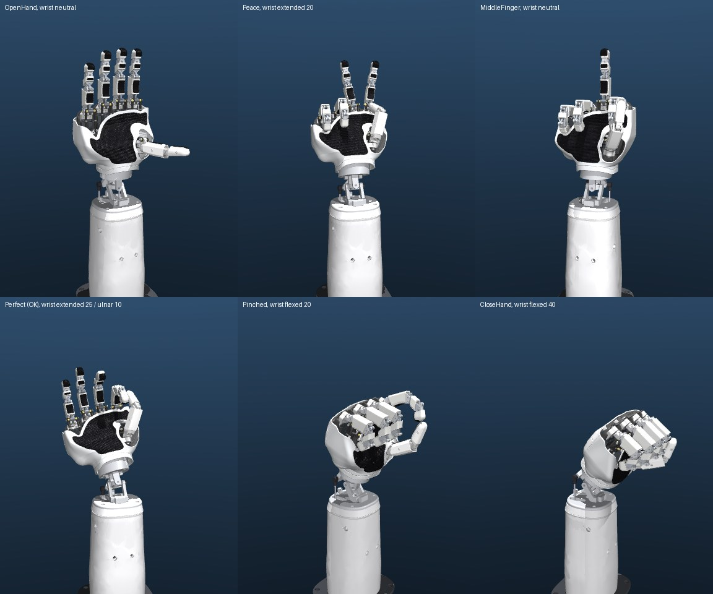

*Full build: forearm, powered wrist, the 5-digit hand with the styled 3-phalanx fingers, and the sculpted palm/back shells with the black grip pad. Model `AH_Right_5F_3S_Wrist`; the gestures use the pose commands in [hand_poses.json](Demo/AHSimulation/ultimate_finger/data/hand_poses.json).*

```bash
.venv/bin/python -m mujoco.viewer --mjcf=Demo/AHSimulation/AHSimulation/AH_Right_5F_3S_Wrist/mjcf/scene_shells.xml
.venv/bin/python Demo/AHSimulation/five_finger/render_showcase.py --model AH_Right_5F_3S_Wrist --poses Demo/AHSimulation/ultimate_finger/data/hand_poses.json --shots gestures --out Demo/AHSimulation/five_finger/renders/showcase_3s.jpg
```

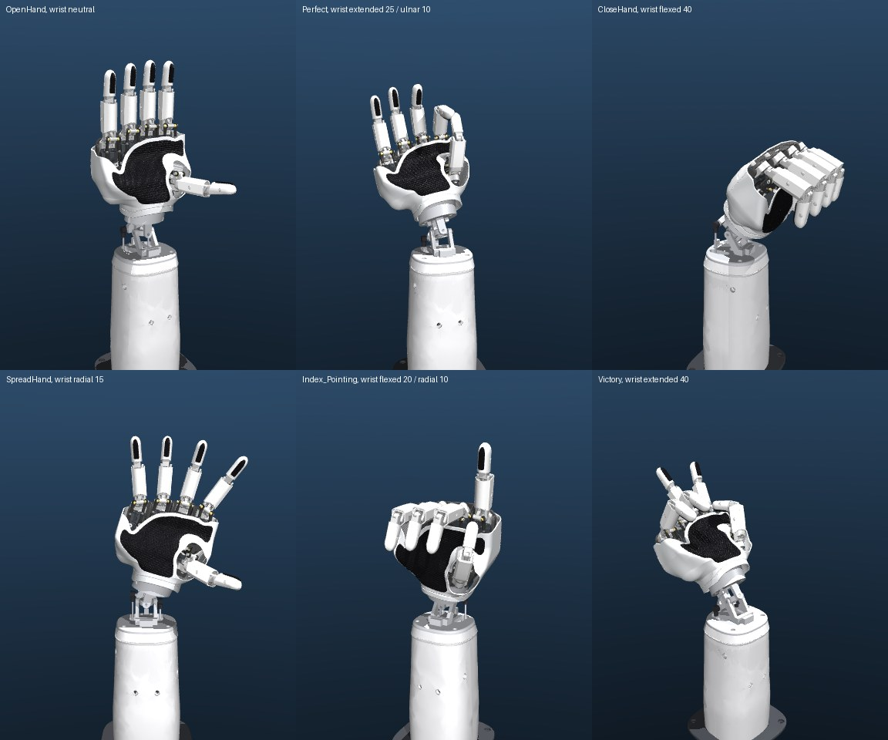

*The same build with the 2-phalanx slim fingers (`AH_Right_5F_Slim_Wrist`), rendered with [render_showcase.py](Demo/AHSimulation/five_finger/render_showcase.py).*

The variants are generated from one another:

- `AH_Right_5F` → `AH_Right_5F_Slim`, via [build_slim_model.py](Demo/AHSimulation/slim_fingers/build_slim_model.py);
- `AH_Right_5F` → `AH_Right_5F_Wrist`, via [build_wrist_model.py](Demo/AHSimulation/wrist/build_wrist_model.py);
- `AH_Right_5F_Slim` → `AH_Right_5F_Slim_Wrist`, via `build_wrist_model.py --hand AH_Right_5F_Slim --keyframe`;
- `AH_Right_5F` → `AH_Right_5F_3S`, via [ultimate_finger/build_models.py](Demo/AHSimulation/ultimate_finger/build_models.py), and on to `AH_Right_5F_3S_Wrist` with `build_wrist_model.py --hand AH_Right_5F_3S --keyframe`.

The wrist mass model still uses the stock-width finger masses for the slim hand. The slim parts are a little lighter, so the torque numbers are slightly conservative.

### Styled finger shells

[make_styled_finger_shells.py](cad/five_finger/fingers/make_styled_finger_shells.py) builds styled versions of the stock Proximal_Shell and Distal_Shell that match the palm pads. Each gets a grey TPU grip pad on the palm side: fingerprint-style grooves at the fingertip, chevrons on the proximal. The fingertip also gets a raised nail plate on the back.

- **Fit:** nothing is removed from the stock shells, so they fit the stock Proximal/Distal, screws and finger kit unchanged.
- **Pads:** the stock shells are only 1.0 mm thick, so the pads sit in a 0.45 mm raised rim instead of a recess.
- **Sides unchanged:** ring/pinky still touch in exactly the stock 887/6561 pose pairs.
- **Thumb:** it now reaches the index a little earlier, by up to 0.77 mm, because the pads close the opposition gap.

[Previews and reports](cad/five_finger/fingers/).

### Slim fingers

Details are in [cad/five_finger/slim_fingers/README.md](cad/five_finger/slim_fingers/README.md).

**What sets the width.** The proximal core is 16.2 mm wide, because the 16 mm pins span its ears. The rest was TPU and air: the stock shells stood 2.8 mm (proximal) and 4.7 mm (distal) off the core on each side.

**What changed.**
- **Shells:** new TPU shells hug the cores with 0.25 mm clearance and a 1.2 mm minimum wall.
- **Cores:** each gets small spot faces at the shell screws, and the distal tip is rounded. Pins, hinge axes, Link, Gimbal, rods and servo drive are unchanged.
- **Knuckles:** both are now exposed.
- **Fingertip pad:** a textured pad, glued on, or as a one-piece print.
- **Screws:** the shell screws become M2.5×5 instead of ×6.

| | Stock | Slim |
|---|---|---|
| Proximal width | 23.8 mm | 19.4 mm (−18 %) |
| Distal width | 21.5 mm | 14.9 mm (−31 %) |

**Verification (9×9 grid per finger).**
- No new contacts with each finger's own parts; 36–44 stock contacts per digit disappear.
- Neighbouring fingers touch less: ring/pinky 712 vs 887 touching pose pairs, index/middle 783 vs 973.
- No contacts with the palm shells or pads.

**Caveats.**
- **Pinch poses:** in `Pinched` and `Fuck` the thumb now stops 2.4 mm short of the index. Use the thumb command (10, −75) instead of (0, −75) on the stock fanned layout, or (25, −75) on the parallel layout.
- **Proximal shell fit:** it has to be squeezed over the middle-joint ears, and that is unproven.
- **Screws:** tighten the shell screws gently; there is only 1.2 mm of TPU under each head.
- **Going narrower:** about 15 / 12 mm would need 2×12 pins, a narrower gimbal, distal and link. Not done.

**Alternatives.** The styled shells above keep the stock width, and these slim fingers replace them. The two are alternatives, not meant to be combined.

### Powered wrist and forearm base

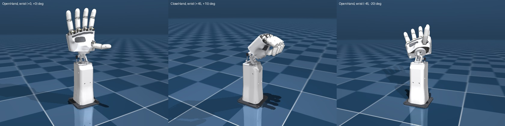

Details are in [cad/five_finger/wrist/README.md](cad/five_finger/wrist/README.md). In short:

- **Wrist:** a 2-DOF ring gimbal under the stock wrist interface. The hand bolts on unchanged through a wedge-shaped adapter.
- **Hand on the forearm:** the forearm runs through the middle of the four fingers, between the middle and ring knuckles. It points along their mean direction, 10.5° from the stock index axis. The fingers therefore fan symmetrically about the forearm, and the knuckle line arcs down to the pinky as on a human hand. With the forearm on the stock interface axis instead, the hand would lean about 11° to the pinky side, and the pinky would look stuck on. ([before / after](Demo/AHSimulation/five_finger/renders/before_after_centering.jpg))
- **Drive:** two Feetech STS3215 (12 V) servos in a tapered forearm push rods, the same parallel drive as the fingers. Flexion is ±60°; deviation is ±25°, tapering to ±15° at full flexion.
- **Longer palm:** the wrist sits 20 mm further from the hand (`PALM_EXT`), and the palm shells reach down to it. The thumb therefore sits higher above the wrist, and palm and finger lengths are in human proportion (113 mm palm for 87 mm fingers).
- **Torque:** the worst static load is 23% of stall for the hand alone and 40% with 200 g at the fingertips.
- **Electrical:** servo IDs 21/22 (left 31/32), on their own 12 V branch.
- **Software contract:** the coupled range must be enforced in software (`clamp_wrist()`). With the longer palm, the thumb no longer needs an interlock.

View it:

```bash
.venv/bin/python -m mujoco.viewer --mjcf=Demo/AHSimulation/AHSimulation/AH_Right_5F_Wrist/mjcf/scene_shells.xml
```

### Finger layout: parallel at 30 mm

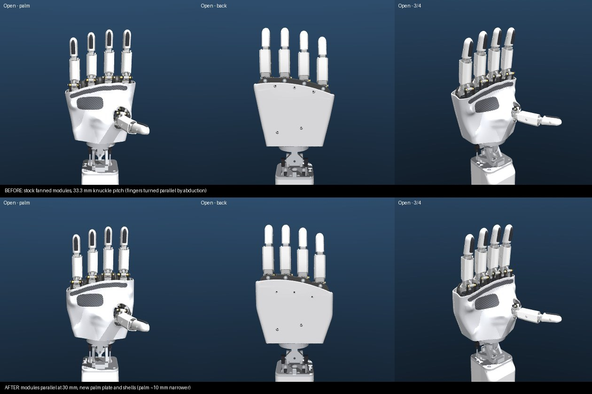

The stock hand fans its finger modules 6–7.5° apart at a ~33.3 mm knuckle pitch. [layout.py](cad/five_finger/layout.py) instead stands all four modules parallel to the forearm axis at a **30 mm** pitch. A module is the finger with its two servos, finger frames, bushings and both push-rod linkages.

- **Rigid moves.** Each module is turned about its own knuckle and shifted as one rigid piece. The finger, its drive, its kinematics and its calibration are unchanged.
- **Knuckle arc.** The knuckles keep their stock height along the forearm: index and middle level, ring 5 mm lower, pinky 14 mm lower. Their centroid stays on the forearm axis, so the wrist does not change.
- **Result.** Straight fingers are now parallel at zero abduction, with no offsets needed. The gaps between slim fingers drop from ~14 mm to ~10.6 mm. The palm is ~10 mm narrower, and the wrist end of the palm shell narrows from 100 to 86 mm.
- **Why 30 mm.** The widest part of a module is the pair of levers at the lower ends of the push rods, 28.4 mm across. Neighbouring drives were already only ~3 mm apart.

  I swept a ±30° abduction × straight-to-curled envelope in the sim. At 30 mm, parallel fingers keep 1.2–1.8 mm between neighbouring drives, against 0.8–1.2 mm for the stock fan with the fingers turned parallel. At 29 mm the drives rub.

  Going tighter needs custom servo horns with the rod ends tucked inward (worth ~3 mm), or a different servo arrangement. The thumb's servos, right under the index and middle modules, block the obvious stagger.
- **Plate.** [make_5f_plate.py](cad/five_finger/make_5f_plate.py) cuts each finger unit out of the stock plate and moves it by the same transform as its module. A unit is the servo pocket and window, the finger-frame screw holes, and the pivot hole and bushing recess; the pinky unit is the ring's. The thumb side and both legs on the wrist interface stay stock, and a back sheet plus rim web joins it all.

  Checks:
  - all 49 unit features are at their moved positions;
  - there is no intersection with any palm-fixed part;
  - the moving parts touch the plate at the same 7/9/9/9 of 81 extreme poses as the stock plate;
  - `--layout stock` reproduces the previous plate exactly.

  The back-shell screws moved to one hole on each 5.5 mm rib between neighbouring servo pairs. The servos stand 5.8 mm proud of the plate there, so those three shell bosses start just above them (0.9 mm clear), and the screws are **2.5 × 16** thermoplastic screws instead of the stock length.
- **Finger-to-finger contact** (9×9 motor grid per finger, ±90°, 6561 pose pairs per neighbour pair):

  | | ring/pinky | middle/ring |
  |---|---|---|
  | stock fan, stock fingers | 887 | 887 |
  | parallel 30 mm, stock fingers | 1751 | 1706 |
  | parallel 30 mm, slim fingers | 1502 | 1435 |

  The extra contacts are at large abduction, beyond ±30°, often with one finger curled and its neighbour swung across ([reports](Demo/AHSimulation/five_finger/reports/)). Inside **|a| ≤ 30° and a relative convergence of ≤ 15°** (a = (m1 + m2)/2), slim fingers never touch over the whole flexion range; the closest is 0.9 mm. The index and pinky may spread further outward, away from their only neighbour: SpreadHand, at ±47°, is clear. All the stock demo poses are free of finger-to-finger contact. The controller should clamp abduction to that envelope (the stock rule was only "never converge neighbours").
- **Demo poses that change.**
  - **ClenchHand.** It squeezes the fingers together, and the stock commands over-squeeze parallel fingers. The new commands are index (−35, 25), middle (−30, 40), ring (−20, 50) and pinky (−27, 43); the fingertips end 1.5–2.3 mm apart.
  - **Pinched and Fuck.** The thumb's (0, −75) now stops 1.1 mm short of the index. Use (5, −75) with stock-width fingers or (25, −75) with slim fingers.
- **Left hand.** It is the same, mirrored. Ring/pinky touch in 1691 of 6561 pose pairs and the demo poses are clear ([report](Demo/AHSimulation/five_finger/reports/verify_AH_Left_5F.txt)).

Rebuild with `build_5f_model.py --layout stock` and `make_5f_plate.py --layout stock` for the stock fan; set `LAYOUT = "stock"` in layout.py so the shells follow.

### Poses: peace sign and middle finger

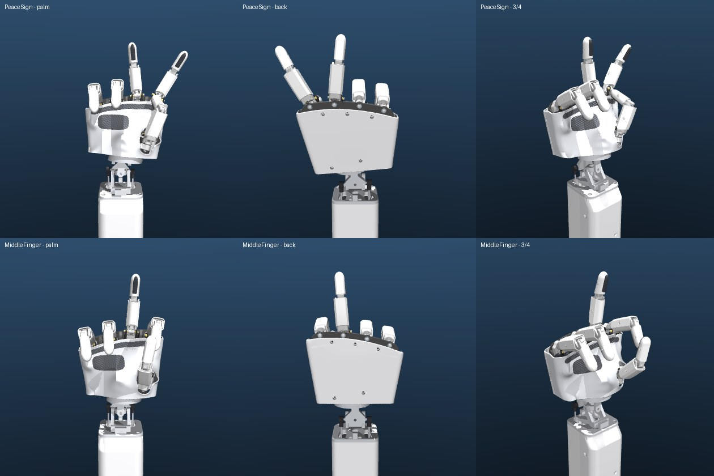

[hand_poses.py](Demo/AHSimulation/five_finger/hand_poses.py) defines poses by intent (each finger straight or curled, plus a spread) and works out the servo commands for a given model. It then settles each pose and checks the clearance between every pair of digits. "Straight" is found per model (f = −32° for slim fingers), so the same pose definitions work for the stock, slim and 3-phalanx variants.

**Fingers together.** On the parallel layout ([Finger layout](#finger-layout-parallel-at-30-mm)) straight fingers point along the forearm at zero abduction, so a pose's spread is simply its abduction. hand_poses.py still measures the base abduction per model; on the stock fan it is −19, −8, +6 and +20° for index…pinky, which brings the fingertips from 42–45 mm apart to 34 mm. Either way the peace sign's V is symmetric about the forearm.

| Pose | Index | Middle | Ring | Pinky | Thumb | Closest digits |
|---|---|---|---|---|---|---|
| Open (relaxed) | (−32, 32) | (−32, 32) | (−32, 32) | (−32, 32) | (−35, 35) | one pair < 3 mm (drive levers) |
| PeaceSign | (−2, 62) | (−62, 2) | (90, −90) | (90, −90) | (90, −90) tucked | none within 3 mm |
| MiddleFinger | (90, −90) | (−32, 32) | (90, −90) | (90, −90) | (75, 45) over the index | thumb/index 0.69 mm |

The commands are right-hand (m1, m2) in degrees, for `AH_Right_5F_Slim`. For the left hand, mirror to (−m2, −m1).

- **Compared with the stock demo:** these are close to the stock `Victory` and `Fuck` demos. The V is symmetric about the forearm (±16°), the pinky is curled, and the middle finger has the thumb folded over the curled index.
- **Thumb limit:** the thumb cannot hold down the curled ring and pinky in the peace sign. It opposes only towards the index, and its tip stays at least 56 mm from the curled ring. So it tucks into the palm instead, as in the stock `Victory`.

```bash
.venv/bin/python Demo/AHSimulation/five_finger/hand_poses.py --model AH_Right_5F_Slim --render-model AH_Right_5F_Slim_Wrist
```

### Styled 3-phalanx fingers (final)

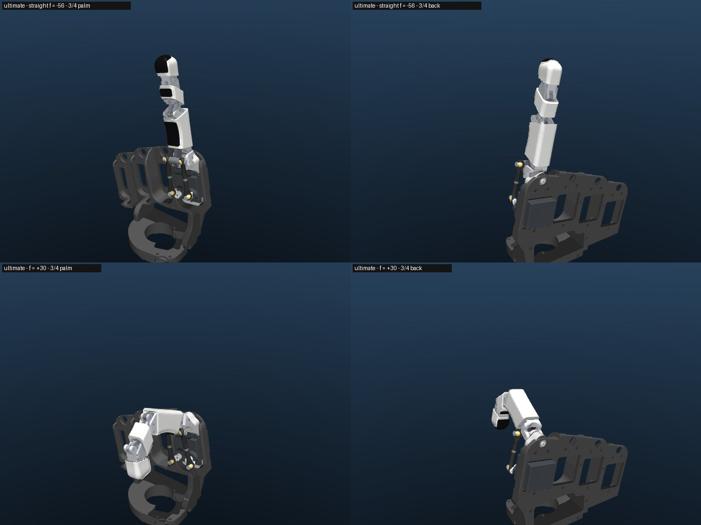

[cad/five_finger/ultimate_finger/README.md](cad/five_finger/ultimate_finger/README.md) is the finger to build: three phalanges on the stock two-servo drive, slim, styled after the reference hand.

- **Look:** white TPU sleeves with rounded-rectangle sections and black ribbed TPU pads on the palm face of every phalanx; a nail-like fingertip cap, a little fuller than its neck, that the ribbed pad wraps round the tip. Knuckles stay exposed, with metal-grey links.
- **Size:** 15.8 / 15.0 / 13.5 mm wide (proximal / middle / fingertip); the pinky's phalanges are 0.88× as long.
- **Range:** MCP 89° / PIP 78° / DIP 54° at full travel (stock 75° / 69°). Straight at f = −56°.
- **Strength:** holds 7.5 N at the fingertip straight and 26 N from f = +30°. Set the SCS0009 `max_torque_limit` to 800 and limit the load in software above f = +45°.
- **Checks:** single finger and the 5-digit hand pass (stable, no self-contact in the working range). Neighbouring fingers touch in about half as many pose pairs as stock fingers on the same layout. No contact with the palm plate or the palm shells (closest: pinky 1.50 mm in a full fist).
- **On the wrist:** `AH_Right_5F_3S_Wrist` ([report](Demo/AHSimulation/wrist/reports/verify_AH_Right_5F_3S_Wrist.txt)).
- **Poses:** peace sign, middle finger, OK and pad-to-pad pinch all work without interpenetration. hand_poses.py finds the same gestures from intent:

  | Pose (`AH_Right_5F_3S`) | Index | Middle | Ring | Pinky | Thumb |
  |---|---|---|---|---|---|
  | Open | (−56, 56) | (−56, 56) | (−56, 56) | (−56, 56) | (−35, 35) |
  | PeaceSign | (−26, 86) | (−86, 26) | (90, −90) | (90, −90) | (90, −90) tucked |
  | MiddleFinger | (90, −90) | (−56, 56) | (90, −90) | (90, −90) | (15, −60), 1.1 mm from the curled fingers |

  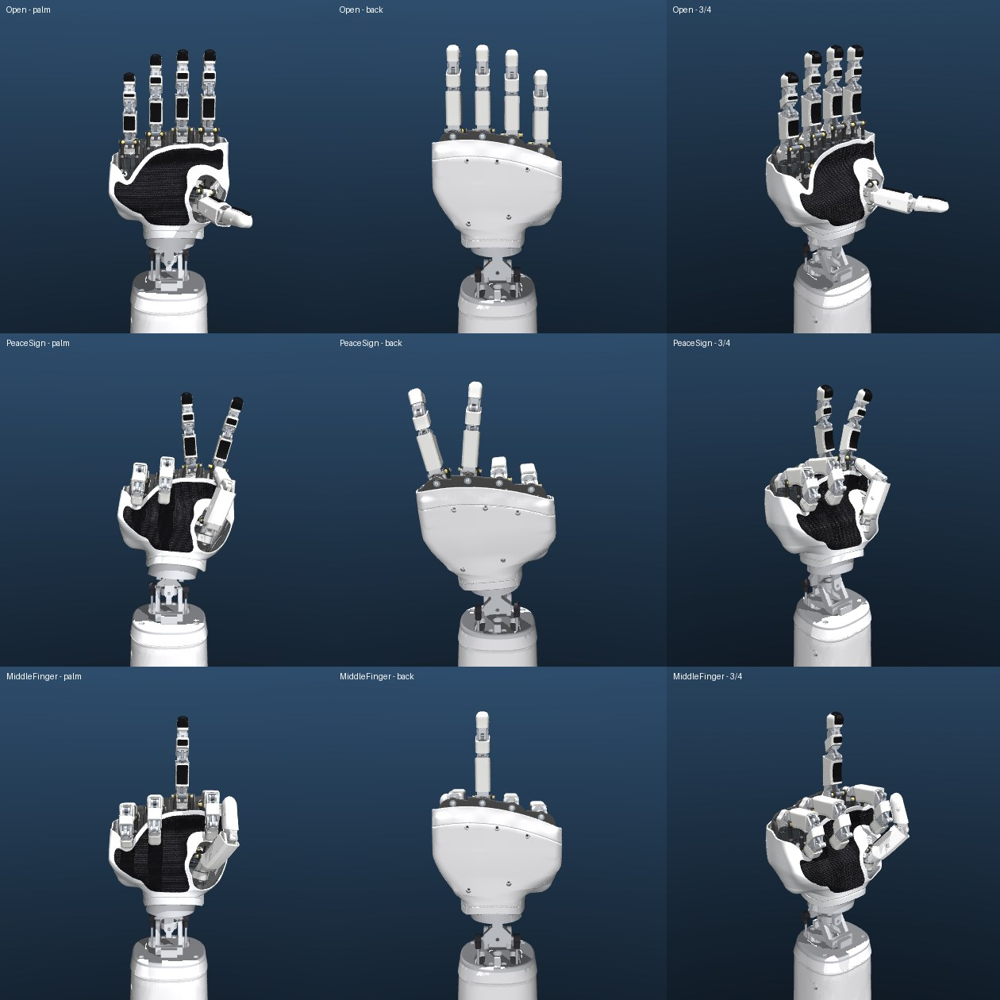
- **Not done:** printing and fit; the thumb keeps the slim shells (with the new black pads); the left hand.

### Three phalanges per finger (study)

[cad/five_finger/three_segment/README.md](cad/five_finger/three_segment/README.md) answers "what would it take":

- **Approach:** keep the 2 servos per finger and add a second passive four-bar. The old distal becomes a middle phalanx, and a new distal follows it at DIP = 0.7 × PIP.
- **Range (simulated):** MCP 89° / PIP 78° / DIP 54°, against the stock 75° / 69°. A human fist is about 90° / 100° / 70°.
- **What changes:** the servos, rods, gimbal, plate and bus stay the same. Per finger, 5 new PLA parts, 3 TPU covers and 3 more pins.
- **Risks:** pin loads rise, so the flexed half needs a servo torque limit or bushings. FDM tolerances, and about ±0.7° of play at the DIP.

Includes a working single-finger MuJoCo prototype, a 5-digit 3-phalanx hand variant with regenerated palm shells, and concept CAD.

## BOM delta

- **+1 finger kit**, the same as each existing finger. Per finger the model contains:
  - 2× SCS0009 servo with custom horn;
  - printed Finger_Frame-1, Finger_Frame-2, Proximal, Proximal_Shell, Distal, Distal_Shell, Gimbal, Link;
  - 2× bushing 0608-04;
  - 2× ball-joint rods (each: 2 ball joints, 2 levers, 1 M2×18 rod, 1 spacer);
  - 4× M2×10 pan head screw, 4× M2.5×6 and 1× 2.5×8 thermoplastic screw;
  - 2× Ø2×10 and 2× Ø2×16 pin, 1× M2.5 washer;
  - plus the screws that fix the servos and frames to the plate, per the assembly guide.
- **+2 SCS0009**, so **10 servos** in total, plus one more servo cable for the daisy chain.
- **Print R-Hand_Plate_5F, R-Top_Shell_5F and R-Palm_Shell_5F** instead of the stock R-Hand_Plate, R-Top_Shell and R-Palm_Shell (`L-*` for a left hand). Print the grip pad in black TPU. The back shell takes 5 screws instead of 4. On the parallel layout, three of them are 2.5 × 16 thermoplastic screws into the plate's ribs, and two are stock Top_Shell screws into the wrist interface.
- **Optional extras:**
  - **Styled finger shells:** 2 grip pads per digit.
  - **Slim fingers:** new shells, spot-faced cores, M2.5×5 shell screws.
  - **Wrist and forearm:** 2× STS3215 C018, bearings, ball links, about 0.3 kg of printed parts. Full list in the [wrist README](cad/five_finger/wrist/README.md#bom-delta-right-hand-the-left-is-the-same-with-l--parts).

## Servo IDs

Every piece of control code in the repo hard-codes IDs per finger. The right hand uses 1/2 index, 3/4 middle, 5/6 ring and 7/8 thumb; motor1 is the odd ID. A two-hand bus uses 11–18 for the left hand. So:

- **Right pinky: 9 (motor1) and 10 (motor2).** IDs 1–8 and their calibration stay valid, and 9/10 is free on a two-hand bus.
- **Left pinky: 19 and 20**, following the existing left = right + 10 rule.
- **Wrist (optional): 21/22 right, 31/32 left.** These are STS3215 servos with a different register layout from the SCS0009, so they need their own controller; see the wrist README.

The upstream code is inconsistent about which left finger is 11/12. [2hands.toml](Demo/AHControl/config/2hands.toml) and `assets/Both_Hands-IDs.jpg` have the left index on 15/16 and the ring on 11/12, but `AmazingHand_Demo_Both.py` drives 11/12 as the index. Pick one before adding 19/20.

New servos ship as ID 1, so set one servo at a time, alone on the bus. Use the Feetech FD tool, or run this from `Demo/`, then again with `--new-id 10`:

```bash
cargo run --bin=change_id -- --serialport /dev/ttyACM0 --old-id 1 --new-id 9
```

## Power

SCS0009 figures at 6 V, from reseller spec tables: about 150 mA moving with no load, 1.0 A stall, 2.3 kg·cm stall torque.

| | 8 servos (stock) | 10 servos |
|---|---|---|
| All moving, no load | ~1.2 A | ~1.5 A |
| Typical demo (a few accelerating at once) | ~1.5–2.5 A peaks | ~2–3 A peaks |
| All stalled (hard grasp, or fingers pushed into each other) | 8 A | 10 A |

The README's 5 V / 2 A adapter is already marginal for 8 servos and is too small for 10. Use a **5–6 V supply rated at least 5 A** (10 A if the hand will squeeze objects hard with every finger), and avoid holding stalled poses for long. SCS0009 is rated 4–7.4 V (reseller data), so stay at or below 6 V.

Feed power to both ends of the daisy chain rather than through ten servos' small connectors in series. Check that the bus adapter's power path is rated for the current.

The optional wrist's STS3215 C018 servos run on a separate 12 V branch, at least 6 A, sharing only ground and the data line with the hand. 12 V must never reach the SCS0009s. See the wrist README.

## Control code changes for finger5

- **Python** (`PythonExample/AmazingHand_Demo.py`; `_Demo_Both.py` likewise, with IDs 19/20 for `Hand==2`):

  ```python
  MiddlePos = [3, 0, -5, -8, -2, 5, -12, 0, 0, 0]  # + calibration of IDs 9, 10

  def Move_Pinky(Angle_1, Angle_2, Speed):
      c.write_goal_speed(9, Speed); time.sleep(0.0002)
      c.write_goal_speed(10, Speed); time.sleep(0.0002)
      c.write_goal_position(9, np.deg2rad(MiddlePos[8] + Angle_1))
      c.write_goal_position(10, np.deg2rad(MiddlePos[9] + Angle_2))
      time.sleep(0.005)
  ```

  Add a `Move_Pinky` call to every pose. The right-hand values are the ones checked above (`DEMO_POSES_5F` in `verify_5f_model.py`). For the left hand, mirror right (m1, m2) to (−m2, −m1).

  | Pose | Right pinky (m1, m2) | Left pinky (m1, m2) |
  |---|---|---|
  | OpenHand / OpenHand_Progressive (after the ring) | (−35, 35) | (−35, 35) |
  | CloseHand, Index_Pointing, Victory, Pinched, Fuck | (90, −90) | (90, −90) |
  | SpreadHand | (−90, −4) | (4, 90) |
  | ClenchHand | (0, 70) | (−70, 0) |
  | Perfect | (−20, 20) | (−20, 20) |

  In SpreadHand, also change the ring from (−90, −4) to (−68, 18), mirrored (−18, 68) on the left. That leaves the pinky room to splay out past the ring.

  **On the parallel layout** (the default, see [Finger layout](#finger-layout-parallel-at-30-mm)), two poses change:
  - **ClenchHand** for all four fingers: index (−35, 25), middle (−30, 40), ring (−20, 50), pinky (−27, 43).
  - **Thumb in Pinched/Fuck:** (5, −75) with stock-width fingers, (25, −75) with slim fingers.

  Mirror these the same way for the left hand. Keep the abduction (m1 + m2)/2 within ±30°, except for the index and pinky spreading outward, and keep neighbours converging by ≤ 15°.

  To calibrate the pinky, set `ID_1 = 9`, `ID_2 = 10` in `AmazingHand_Hand_FingerMiddlePos.py` / `AmazingHand_FingerTest.py`.

- **Arduino** (`ArduinoExample/Amazing_Hand_Demo.ino`): set `int MiddlePos[10] = {520,511,500,490,515,520,480,511, 511,511};` with your calibration for IDs 9 and 10. Add the function below, plus the same `Move_Pinky` calls per pose. Calibrate with `ID_1 = 9; ID_2 = 10;` in `Amazing_Hand-Finger_Test.ino`.

  ```cpp
  void Move_Pinky(float Pos_1, float Pos_2, int Speed)
  {
    sc.RegWritePos(9, MiddlePos[8]+Pos_1/Step, 0, Speed);sc.RegWritePos(10, MiddlePos[9]+Pos_2/Step, 0, Speed);sc.RegWriteAction();
  }
  ```

- **AHControl (Rust/dora):** no code change. Use [config/r_hand_5f.toml](Demo/AHControl/config/r_hand_5f.toml), which adds `r_finger5` with IDs 9/10. Fill in the offsets with `cargo run --bin=get_zeros -- --config AHControl/config/r_hand_5f.toml`, and point the dataflow's `--config` at it. The controller drives every `finger_name` from the TOML that the sim node sends in its metadata.
- **AHSimulation** (`AHSimulation/mj_mink_right.py`):
  1. Load `AH_Right_5F/mjcf/scene.xml`.
  2. Add `self.task5 = mink.FrameTask(frame_name='tip5', ...)` in both modes, and add it to `self.tasks`.
  3. Add `mink.move_mocap_to_frame(..., "finger5_target", "tip5", "site")` and `self.task5.set_target(mink.SE3.from_mocap_name(..., "finger5_target"))`.
  4. Read `finger5_motor1/2` and send `motor_pos = np.zeros(10)` with `self.metadata["r_finger5"] = [8, 9]`.
  5. In `write_mocap_pos` / `write_mocap_quat`, handle `r_tip5` as `mocap_pos[4]` / `mocap_quat[4]`. For the position, use offsets of about (−0.025, −0.0775, +0.065), which are the ring's offsets moved to `finger5_target`.
- **Hand tracking** (`HandTracking/main.py`): add `tip5` from `PINKY_TIP − PINKY_MCP`, rotated by `R` like the others, and send it as `r_tip5`/`l_tip5`. In `examples/finger_angle_control.py`, add `rtip5`/`ltip5` with the next roll offset (30°, continuing the 10°/20° pattern).
