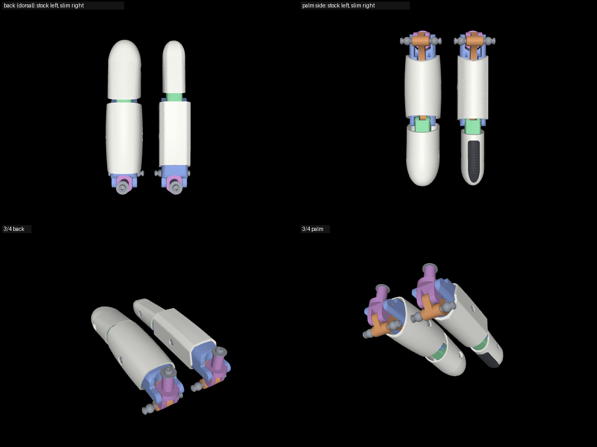
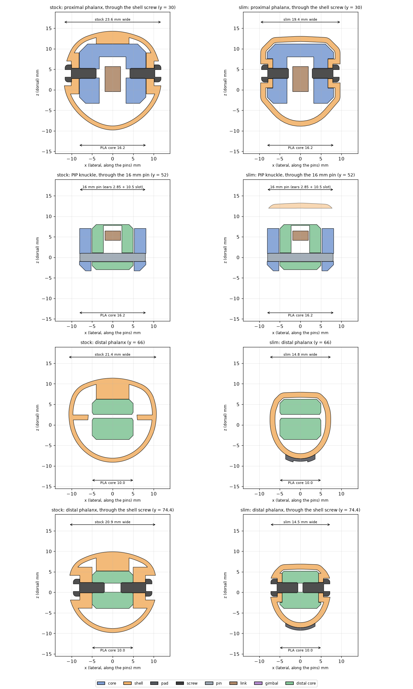
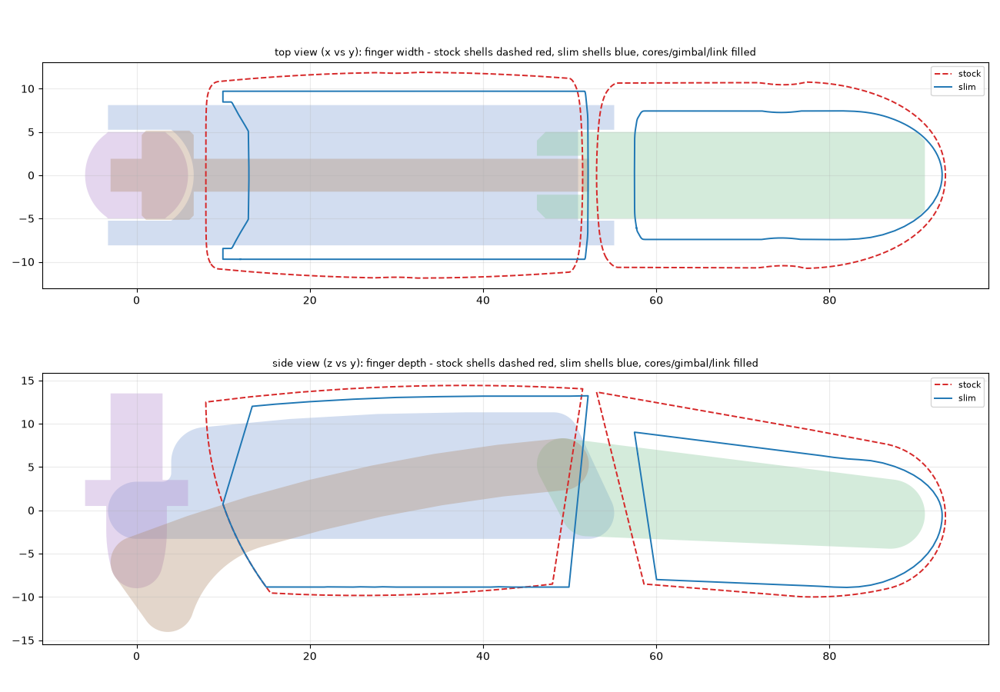
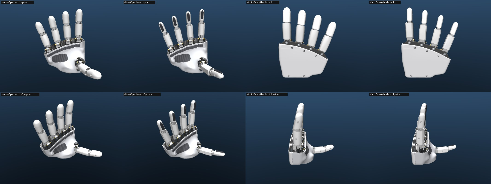

# Slim fingers for the 5-digit AmazingHand

Thinner fingers in the spirit of the Shadow hand: slender segment covers, exposed knuckle joints and a grip pad on the fingertip.

The kinematics and the rest of the kit do not change:

- same pins, hinge axes and hole positions;
- same Link, Gimbal, push rods and servo drive;
- the shells are still screwed to the cores through the stock holes.

The same parts fit every digit (index, middle, ring, pinky and thumb), and they are left/right symmetric.



| | stock | slim | change |
|---|---|---|---|
| **Proximal phalanx**, widest point | 23.76 mm | 19.41 mm | **−4.35 mm (−18.3 %)** |
| Proximal at y = 20 / 30 / 40 | 23.03 / 23.56 / 23.36 | 19.40 / 19.41 / 19.41 | −15.7 / −17.6 / −16.9 % |
| **Distal phalanx**, widest point | 21.51 mm | 14.86 mm | **−6.65 mm (−30.9 %)** |
| Distal at y = 60 / 66 / 74.4 / 80 / 86 | 21.31 / 21.34 / 20.90 / 21.06 / 18.06 | 14.84 / 14.84 / 14.49 / 14.85 / 13.82 | −30.4 / −30.5 / −30.7 / −29.5 / −23.5 % |
| Depth (back to palm), proximal at y = 30 | 23.96 | 21.90 | −2.1 mm |
| Depth, distal at y = 66, including the 1 mm pad | 20.50 | 16.20 | −4.3 mm |

All dimensions are in mm, in the finger part-studio frame of the stock STEP files:

- x is lateral, along the pins;
- y runs along the finger: MCP pin at y = 0, PIP pin at y = 52;
- z points to the back of the finger; the palm side is −z.

## 1. What sets the finger width today



| Contributor | Lateral width | What it is |
|---|---|---|
| **Proximal (PLA)** | 16.2 | Two 2.85 mm ears around a 10.5 mm slot. The slot takes the 10 mm Gimbal at the MCP and the 10 mm Distal at the PIP. Between the joints, side blocks (4.85 mm) carry the shell-screw holes at y = 20/30/40, z = 4 (Ø2.2, through). |
| **Ø2 × 16 pins** (MCP, PIP) | 16.0 | They go through both ears and are pushed flush, so **the pin length sets the 16.2 mm proximal core**. |
| **Distal (PLA)** | 10.0 | Two 2.75 mm ears around the 4.5 mm Link slot (Ø2 × 10 pin). It sits in the proximal's 10.5 mm slot. |
| Gimbal / Link | 10.0 / 10.3 (arm 3.8) | Both sit inside the proximal's slot and channel. |
| **Proximal_Shell (TPU)** | 23.76 | 1.0 mm wall plus a **2.8 mm air gap** on each side. It is held by Ø10 bosses (1.9 mm TPU under the head) with an M2.5 × 6 head in a counterbore. |
| **Distal_Shell (TPU)** | 21.51 | 1.0 mm wall plus a **4.7 mm air gap** on each side. It is held by Ø10 bosses (3 mm TPU under the head). |
| Rod ball joints + M2 pan screws on the Link | 25.1 | At the MCP knuckle, inside the palm shell; unchanged. |

So across a stock finger, about 2/3 of the width is PLA and pins and 1/3 is air and TPU. The width that can be removed without touching the kinematics is mostly the air inside the shells: 2 × 2.8 mm on the proximal and 2 × 4.7 mm on the distal.

## 2. What changed

### (a) Slim TPU shells that hug the cores

Built by [make_slim_fingers.py](make_slim_fingers.py).

**How the shells are built.**

- Each shell is a smooth B-spline loft through cross-sections. The proximal has 12 stations, the distal 11, and the distal nose closes to an apex.
- A section is the convex hull of the core section offset by the 0.25 mm sliding clearance, plus a rounded palm cushion. Its corners are rounded to r 0.8.
- The wall is **1.2 mm minimum**, nominally 1.24 so the loft stays ≥ 1.2 between stations. The stock wall is 1.0 mm.

**Proximal shell.** It sits 0.25–0.33 mm off the 16.2 mm core and is **19.4 mm** wide.

**Distal shell.** It is **14.5–14.9 mm** wide. The 10 mm core does not set this; the recessed screw head does (see Screws below). The shell keeps a 1.1 mm side gap and touches the core only on top and at the screw cups.

**Palm cushions.** Both shells keep a soft air cushion on the palm side, 4.3 mm (proximal) and 3.4 mm (distal); stock is 5.5 and 4.6 mm.

**Fingertip.** The fingertip is a smooth elliptic nose.

### (b) PLA core trims (non-functional material only)

**Spot faces.** There is a Ø7.2 spot face around each shell-screw hole, on both sides: 1.37 mm deep on the Proximal, 0.55 mm on the Distal. The shell's screw cup sits in it, so the head ends 0.19 mm below the slim surface, and the cups locate the shell on the core.

**Distal tip.** The square tip corners of the Distal beyond y = 84 are trimmed to the shell's nose cavity, shrunk by 0.25 mm. This is only the end of the bar; the third side hole at y = 81.9 is untouched.

**Material removed.** The Proximal loses 100 mm³ (−1.4 %) and the Distal 97 mm³ (−2.7 %). Pins, pin holes, the Link slots, the gimbal seat and all other faces are untouched. The STEP solids are the stock solids minus these cuts.

### Screws: M2.5 × 5 thermoplastic instead of M2.5 × 6

There are 4 per finger, in the same holes, with the same head (Ø4.2 × 1.55). An M2.5 × 6 cannot be recessed in a slim shell:

- in the Proximal its tip would reach the Link (±1.9 mm);
- in the Distal it would hit the opposite screw.

With M2.5 × 5:

| | Head top at \|x\| | Tip at \|x\| | Tip clearance | Thread engagement in PLA |
|---|---|---|---|---|
| Proximal | 9.48 | 2.88 | 0.37 mm inside the 6.5 mm link channel, ~1.0 mm from the Link | 3.5 mm (stock ≈ 3.9) |
| Distal | 7.20 | 0.60 | the two tips are 1.2 mm apart | 3.85 mm (stock ≈ 2.7) |

### Joint ends from the kinematics

The finger is a planar 4-bar (Gimbal, Proximal, Distal, Link) with all hinge axes along x. The script:

1. sweeps every moving body through the full MCP range of −34.2° to +79.4°. That is the −30.2° to +75.4° the sim reaches with ±90° motor commands, plus 4°.
2. chooses the proximal shell's PIP end plane and the distal shell's base plane together:
   - the end faces stay within ±6° (proximal) and ±9° (distal) of square to the finger;
   - the cut faces are flat print faces;
   - they keep **≥ 0.5 mm** from everything that sweeps past: the other phalanx and its shell, pins, screws, the Link with its ball joints, and the Gimbal with its screw and washer;
   - among those, the pair gives the smallest knuckle gap.

The resulting planes:

| End | Plane | Stock |
|---|---|---|
| Proximal shell, PIP end | y = 50.80 + 0.10 z (≈ stock) | y = 49.33 + 0.155 z |
| Distal shell, base | y = 58.83 − 0.15 z | 53.1–58.6 |

The proximal shell's MCP end keeps the stock cylindrical cut on the palm side. A dorsal plane, y ≥ 12.6 + 0.3 (z − 9.5), clears the gimbal washer and screw, the finger frame and the plate at full hyperextension. The stock shell touches all of these there.

Both knuckles are exposed: the PIP ears, the distal base and the gimbal show, and the two shells never touch each other.

### Grip pad

`Distal_Pad_Slim` is a 1.0 mm grey TPU insert glued onto the palm side of the fingertip. It covers |x| ≤ 3.6 and y = 63.5–89.5 and has fingerprint-like arc grooves 0.35 deep and 0.5 wide. Its back is the shell's outer surface.

`Distal_Shell_Slim_OnePiece.stl` is the shell and pad as one body, for single-material printers.

A flush, recessed pad was tried and dropped. On the curved palm wall, a recess plus the inner thickening needed to keep 1.2 mm always left either a 0.4–0.6 mm joggle or knife-edge lips at the rim.



## Files

| File | Contents |
|---|---|
| `make_slim_fingers.py` | Builds everything: CadQuery booleans on the stock STEP solids for the cores, B-spline lofts for the shells. Runs the checks below and writes `report_cad.txt`, `design.json` and the previews. Takes about 11 min. `--checks-only` and `--previews-only` re-run just those parts. |
| `step/` | `Proximal_Slim`, `Distal_Slim` (PLA), `Proximal_Shell_Slim`, `Distal_Shell_Slim` and `Distal_Pad_Slim_untextured` (TPU). Each is one valid solid. The pad's STEP has no grooves: the grooved B-rep exports as a 40–60 MB STEP, because its intersection curves with the lofted surfaces are huge B-splines. |
| `stl/` | `Proximal_Slim`, `Distal_Slim`, `Proximal_Shell_Slim`, `Distal_Shell_Slim`, `Distal_Pad_Slim` (with grooves) and `Distal_Shell_Slim_OnePiece` (shell + grooved pad). All watertight. |
| `width_analysis.py` | Writes `width_breakdown.png`, `silhouettes.png` and `width_table.md`. |
| `preview_finger.png`, `preview_side.png`, `preview_parts.png` | Stock vs slim renders. |
| [Demo/AHSimulation/slim_fingers/](../../../Demo/AHSimulation/slim_fingers/) | `build_slim_model.py` (generates `AHSimulation/AH_Right_5F_Slim/mjcf`), `verify_slim.py`, `render_slim.py`, `reports/`, `renders/`. |

To regenerate everything, run from the repo root (environment as in FIVE_FINGER.md, plus shapely):

```bash
uv pip install --python .venv/bin/python shapely
.venv/bin/python cad/five_finger/slim_fingers/make_slim_fingers.py
.venv/bin/python cad/five_finger/slim_fingers/width_analysis.py
.venv/bin/python Demo/AHSimulation/slim_fingers/build_slim_model.py
.venv/bin/python Demo/AHSimulation/slim_fingers/verify_slim.py      # about 6 min with 12 processes
.venv/bin/python Demo/AHSimulation/slim_fingers/render_slim.py
.venv/bin/python -m mujoco.viewer --mjcf=Demo/AHSimulation/AHSimulation/AH_Right_5F_Slim/mjcf/scene_shells.xml
```

The model folder holds only the five slim meshes and the M2.5 × 5 screw. It references the other meshes from `AH_Right_5F/mjcf/assets` (no copies), so rebuild it whenever AH_Right_5F is regenerated.

In every digit the model differs from AH_Right_5F only in:

- the four finger meshes;
- an added pad geom;
- the shell screws, moved and shortened;
- the proximal shell's frame, set equal to the core's. The stock assembly has the shell 0.1 mm off-centre; the slim shell is centred by its cups.

Bodies, joints, constraints, actuators and the keyframe are identical.

## 3. Verification

### CAD

From [report_cad.txt](report_cad.txt):

- **Solids.** Every part is one valid B-rep solid.
- **Wall thickness**, from exact B-rep cross-sections every 0.5 mm away from the cut ends, cups and nose:
  - proximal shell min **1.221 mm**;
  - distal shell min **1.226 mm**.

  A sampled 3-D measure over the whole surface (nearest opposite-facing point, 15000 points) gives a median of 1.24, a 1st percentile of 1.20 and a minimum of 1.17. That minimum is sampling resolution.
- **Pad.** 1.0 mm thick, 0.65 mm under a groove.
- **Shells on their cores** (straight finger):
  - no overlap;
  - minimum gap away from the screw cups 0.28 mm (proximal) and 0.23 mm (distal).
- **Joint sweeps.** 3-D, over the full range in 0.5° steps:

  | Slim part | vs | Min clearance |
  |---|---|---|
  | Proximal shell | distal body (core, pin, screws, shell, pad) | 0.65 mm |
  | Proximal shell | Link | 1.19 mm |
  | Proximal shell | Gimbal | 2.18 mm |
  | Distal shell | proximal body | 0.53 mm |

  The same test on the stock parts gives **0.00 mm**: the stock shells hit each other and the gimbal hardware.

### Simulation

[verify_slim.py](../../../Demo/AHSimulation/slim_fingers/verify_slim.py), [report](../../../Demo/AHSimulation/slim_fingers/reports/verify_slim.txt).

Setup:

- `AH_Right_5F` (stock) vs `AH_Right_5F_Slim`;
- every digit on a 9 × 9 grid of (motor1, motor2) over ±90°;
- surface samples every 1 mm, refined to 0.3 mm;
- "touching" means a sampled distance under 0.225 mm, the same convention as `verify_5f_model.py`.

1. **Structure and stability.** Same bodies, joints, qpos, actuators, constraints and keyframe; 5 more geoms (the pads). Each actuator was swept alone (0 → max → min → 0): no NaN, no MuJoCo warnings, equality error 0.000 mm.
2. **Each digit's own parts over its full joint range.** Every changed part (proximal, distal, both shells, pad, shell screws) was checked against every other part of the digit: gimbal, link, rods, horns, the other phalanx, servos, finger frames and bushings. The palm plate and wrist interface were included.

   **New contacts compared with stock: 0 in all five digits.**

   Stock contacts that disappear, per digit: index 43, middle 44, ring 44, thumb 36, pinky 44 (pair × pose). They come from the proximal shell's dorsal start, the shells at the PIP and the distal shell against the proximal ears. The shell/washer, shell/torx-screw, shell/bushing and shell/plate contacts at hyperextension are all gone.
3. **Neighbouring digits, every pair of grid poses (6561):**

   | Pair | stock | slim | Change |
   |---|---|---|---|
   | ring / pinky | 887 | **712** | −175 (−20 %) |
   | middle / ring | 887 | **712** | −175 |
   | index / middle | 973 | **783** | −190 |

   In every case the slim set of touching pose pairs is a **strict subset** of the stock set. Ring/pinky contact now needs the two fingers abducted towards each other by c ≥ 45°; the stock touches from c = 0°.

   The remaining contacts are mostly proximal shell against proximal shell or the other finger's PLA core: x216 and x158 respectively, plus proximal/proximal x61. With 1.5 mm of TPU per side left, the 16.2 mm cores now set this limit.
4. **5-finger palm/back shells and grip pads:** 0 contacts for every digit, as with stock. Minimum clearances are unchanged or larger.
5. **Demo poses:**
   - OpenHand, SpreadHand and Perfect are unchanged.
   - In ClenchHand the clearances grow: index/middle 0.88 → 1.94 mm, middle/ring 1.67 → 3.61 mm.
   - In **Pinched / Fuck** the fingertips no longer meet: thumb–index goes from 0.01 to **2.36 mm**. With the thumb at **(10, −75)** instead of (0, −75) they meet again (0.01 mm).
   - CloseHand and Perfect still touch, as in stock. In Perfect the PLA cores themselves meet, in stock as well.



More renders are in [renders/](../../../Demo/AHSimulation/slim_fingers/renders/):

- `compare*_{OpenHand,CloseHand,SpreadHand,Perfect}.jpg`: palm, back, 3/4 and side views, stock | slim, with and without the palm shells;
- `finger_closeup.jpg`;
- `extremes.jpg`: hyperextended, fully flexed, ring and pinky abducted together.

## 4. Printing

### TPU shells

Filaflex 82A with the stock settings: 0.2 mm layers, 40–70 % infill, no supports. A 1.2 mm wall is three 0.4 mm perimeters.

- **`Proximal_Shell_Slim`:** stand it on its flat PIP end face, MCP end up. The screw cups are horizontal Ø4.6 / Ø7.0 holes in vertical walls, the same feature as the stock counterbores.
- **`Distal_Shell_Slim`:** stand it on its flat base face, nose up. The nose closes like the stock tip, with a 1.25 mm wall at the apex.

### Pad

`Distal_Pad_Slim` is a curved 1 mm skin, about 1.3 mm of sag across its width. Options:

- **(1)** Print the shell and pad in one multi-material job: they share a frame, so registration is exact. This is the cleanest option.
- **(2)** Print the pad texture-up on light tree supports, or print it flat and let the TPU conform, then glue it on with flexible CA.
- **(3)** Print `Distal_Shell_Slim_OnePiece.stl` in one material.

### PLA cores

As stock: supports and ≥ 80 % infill. The spot faces are shallow pockets on the side faces.

### Assembly (stock order)

**Proximal shell.** Its screw cups protrude 1.37 mm inside the core's side faces. To fit it:

1. Keep the finger straight.
2. Squeeze the shell top-to-bottom so its sides bow out while it slides over the PIP ears.
3. Slide it until the cups drop into the spot faces at y = 30.

**Distal shell.** Its cups protrude only 0.55 mm.

**Screws.** Tighten gently. There is 1.2 mm of TPU under each head, against 1.9 / 3.0 mm in stock.

## 5. Strength and other concerns

### Cores

The section through the shell-screw hole is the weakest one; it already has the Ø2.2 hole.

| Section | Area | Flexion bending (Ixx) | Lateral bending (Izz) |
|---|---|---|---|
| Proximal at y = 30 | −10 % | −3.3 % | −19.7 % |
| Proximal 2.5 mm away | −9 % | −1.5 % | −17 % |
| Distal at y = 74.4 | −7.5 % | −5.2 % | −21 % |
| Distal 2.5 mm away | −6 % | −2.1 % | −17 % |

- Bending in the grasping direction is practically unchanged.
- Lateral bending loses about a fifth, locally, over the 7 mm of the spot face. Lateral loads on a finger are small, but avoid hard side impacts.
- The distal spot face leaves a 0.8 mm PLA rim under the core's top chamfer (at x ≈ ±4.6, z ≈ 4.7), which is still two perimeters.
- Everything that carries the pins (ears, pin holes) is untouched.

### Shells

- **Thinner TPU under the screw heads** (1.2 mm vs 1.9 / 3.0 mm). Over-tightening can pull a head through; the stock guide already warns about this.
- **Slightly harder grasp.** The palm cushions are about 1 mm thinner.
- **Tighter assembly.** The proximal shell is a little harder to fit than stock because its cups snap into the spot faces.

### Not done

- **Not printed.** Before printing five, check the fit (0.25 mm clearance, cups into spot faces) with one proximal shell. TPU shrinkage and printer tolerance may call for 0.1–0.2 mm more clearance (`CLEAR`).
- **Inertials.** The MJCF inertials were not updated. Every body has an explicit `<inertial>`, and the slim parts weigh within a fraction of a gram of stock.
- **Left hand.** No left-hand model was generated. The parts are symmetric in x, so the same STLs fit `AH_Left_5F`. `build_slim_model.py` would need `SRC`/`DST` switched, and the left export's part frames should be checked first.

## 6. A deeper redesign (not implemented): narrower pins, gimbal and link

With (a) and (b) the proximal phalanx is 19.4 mm, and 16.2 mm of that is the PLA core set by the 16 mm pins. Going further means narrowing what sits in the proximal's slot, which changes the kit. A worked example that gives a **≈15 mm proximal** and a **≈12 mm distal**:

| Part | Change |
|---|---|
| Gimbal | 10 → 7 mm wide. Its abduction boss carries the 6 mm bushings and the M2.5 screw, so 7–8 mm is the floor without a new bearing concept. |
| Distal | 10 → 7 mm, with the 4.5 mm Link slot narrowed to about 3 mm. The ears around a Ø2 hole would be 2 mm thick: marginal in PLA. Use brass bushings or Ø1.5 pins. |
| Link | Arm 3.8 → 2.5–3 mm. It is the force-carrying coupler: check it in PLA, or cut it from aluminium or steel sheet. |
| Proximal | Ears 2.85 → 2.3 mm around a 7.5 mm slot, giving a 12.1 mm core. |
| Pins | Ø2 × 12 at the MCP and PIP; Ø2 × 7–8 for the Link pins. All are standard ISO 2338 / 8734 lengths. |

What it costs:

- four new rigid parts and new pins;
- about 20 % less pin bearing length in the PLA ears, so more wear and play;
- new verification of the abduction joint.

The Link's ball joints stay at ±8.05 mm (set by the rods), so the knuckle remains about 25 mm wide.

The finger pitch, about 33 mm and set by two 12 mm servos side by side, does not change either way: slimmer fingers simply leave wider gaps between them.

A cheaper, smaller step is a 1.0 mm TPU wall like stock and a 0.15 mm clearance. That would save another 0.6 mm or so on each phalanx.
