# Three phalanges per finger: what would it take?

Study for the 5-digit AmazingHand ([FIVE_FINGER.md](../../../FIVE_FINGER.md)): turning each 2-phalanx finger (proximal + distal) into a 3-phalanx finger (proximal P1, middle P2, distal P3, with MCP, PIP and DIP joints). It includes a working MuJoCo prototype, a concept CAD set and the numbers behind both.

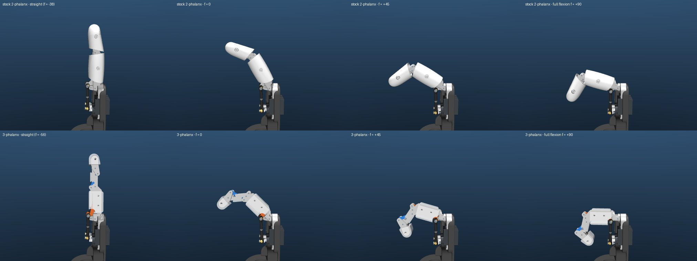

*Top: stock finger. Bottom: 3-phalanx prototype. Poses from left to right: straight, f = 0, f = +45°, full servo travel (f = (m1 − m2)/2 is the flexion command).*

## The short answer

**Keep the 2 servos per finger and add a second passive linkage.** The stock finger is already a crossed four-bar linkage: the Link that the two push rods drive is the input, and the distal is the coupler. A 3-phalanx finger needs three changes:

- re-dimension that four-bar so the old "distal" becomes a shorter **middle phalanx P2**;
- add a **DIP coupler L2**, a second crossed four-bar that makes the new **distal P3** follow the PIP at about 0.7× (human-like);
- replace the Link's **arm**. Its base, with the pivot and both ball studs, is the stock geometry, so the servos, horns, rods, gimbal, plate and calibration of the drive do not change.

**What it buys (all simulated):**

| | Stock 2-phalanx | 3-phalanx, recommended | Human index, full fist |
|---|---|---|---|
| MCP at full servo travel | 75° | **89°** | ~90° |
| PIP | 69° | **78°** | ~100° |
| DIP | none (rigid) | **54°** (DIP = 0.70 × PIP throughout) | ~70° |
| Total curl of the fingertip | 144° | **221°** | ~260° |
| Fingertip at full flexion, (y, z) from the MCP | (−18, −67) mm | (−32, −40) mm: curls 14 mm further under, toward the palm | |

**What it costs:**

- **No new servos, electronics, bus IDs or palm plate.**
- **Per finger:**
  - 5 new PLA parts replace 3: Link arm, P1, P2, P3 and L2 replace Link, Proximal and Distal.
  - 3 TPU covers replace 2.
  - 3 more stock Ø2×16 pins.
  - +5 g of moving mass.
- **Re-calibration.** The straight finger moves from f = −37.5° to f = **−56°**.
- **Less abduction room in the straight pose: ±16° instead of ±23°.** Spreading uses the servo travel that flexion now needs, because |m1|, |m2| ≤ 90° means |a| + |f| ≤ 90°.
- **Lower holdable force at the fingertip in the straight pose: 3.6 N instead of 4.0 N.** At mid-flexion it is higher than stock.
- **More pin joints.** That means more backlash and friction, and pin loads 1.4–1.8× the stock ones.
- **The 5-digit palm shell has to be regenerated** because the fingers close further. That is done here: [stl/palm_shells](stl/palm_shells/).

The targets in the brief were MCP 0–90°, PIP 0–100° and DIP 0–70°. **MCP is met, but PIP and DIP are not.** With this drive, a crossed four-bar caps the middle phalanx's total rotation at about MCP + PIP ≈ 170°, whatever the link lengths or the gimbal pivot spacing (section 3.3). Reaching PIP 100° needs a 6-bar linkage, a larger Link rotation (a new Link base, so a new drive calibration), or a third actuator.

**Effort:** about 1–2 weeks for one person to go from this concept to printable parts, including 2–3 print/fit iterations. Material is under €2 per finger. Details in section 6.

---

## 1. How the stock finger works

Source: [analyze_stock_finger.py](../../../Demo/AHSimulation/three_segment/analyze_stock_finger.py), report [stock_finger_analysis.txt](../../../Demo/AHSimulation/three_segment/reports/stock_finger_analysis.txt).

The index finger is cut out of `AH_Right_5F` into a standalone model. Its tip matches finger1 of the full hand to within 0.0000 mm at 6 poses. It is settled on a 25×25 grid of the two motor commands and along the pure-flexion line. All angles are measured between the **CAD frames** of the parts: every stock STL is drawn in one "finger design frame", with the finger straight, the MCP at the origin, y along the finger and z dorsal. So "0°" means the straight finger of the CAD.

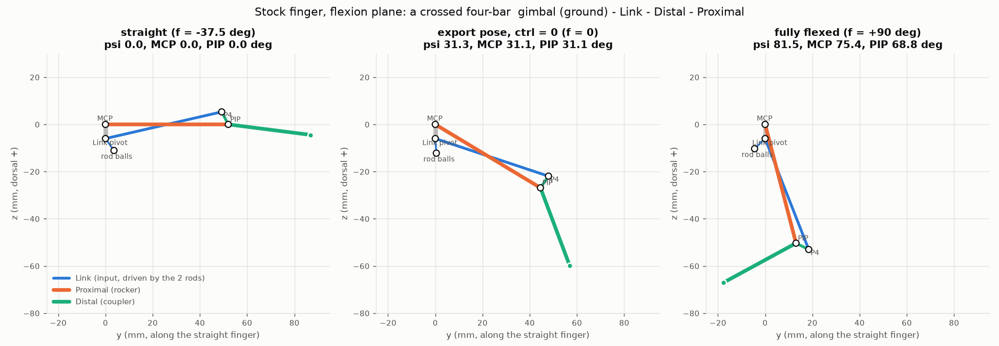

**Topology.** The rod and ball constraints close the loops as follows:

- The two rods push the Link's two ball studs. The studs are 16.1 mm apart along the pin axis, at the same place in the flexion plane.
- When the rods move together, the Link turns about its pivot on the gimbal. When they move in opposition, the Link and gimbal turn together about the abduction axis.
- The flexion coupling is a **crossed four-bar**: ground is the gimbal (MCP to Link pivot, 6.00 mm), the input is the Link (50.50 mm), the coupler is the Distal (PIP to P4, 6.00 mm) and the output is the Proximal (52.00 mm).

The Link starts on the palm side of the MCP and ends on the dorsal side of the PIP. That crossing is what makes the distal flex with the proximal; a parallelogram would keep the distal parallel to the palm. A closed-form planar solution of this four-bar reproduces the sim to within 0.006° on MCP and 0.06° on PIP.

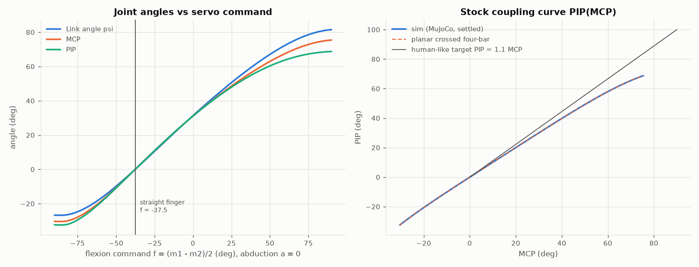

**Coupling.**

- The finger is straight at **f = −37.5°**.
- At f = +90°: MCP 75.4°, PIP 68.8°, total 144°.
- PIP ≈ 0.92 × MCP over the flexion range. That matches the instant-centre estimate for a crossed four-bar with equal short links: PIP/MCP ≈ ground/crank = 1 at small angles.
- The Link turns 108° over the whole ±90° servo travel and flattens near ±90°, where the horn approaches toggle. MCP ≈ Link angle.

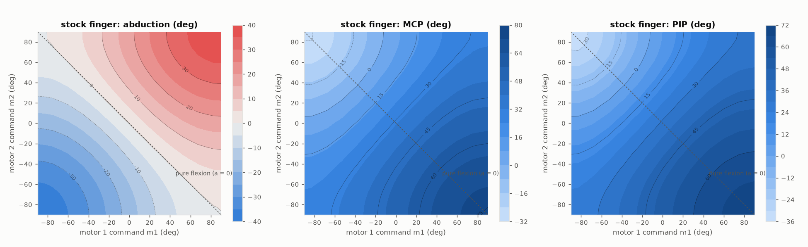

**Abduction.**

- Abduction ≈ 0.49 × a, where a = (m1 + m2)/2. The linear fit has 2.4° rms error.
- Maximum ±38.5° at f = 0, but only ±23° in the straight pose (f = −37.5°) and ±18° at f = +45°, because both servos must stay within ±90°.
- MCP shifts by up to 12° with abduction (left panel of the next figure).

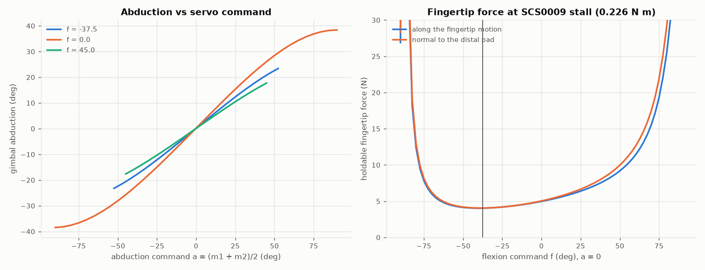

**Workspace and force.**

- The tip site sweeps x −36…41, y −18…87, z −74…55 mm, a 222 cm³ hull. The large z range comes from 30° of hyperextension at f = −90°.
- **Holdable fingertip force at SCS0009 stall (0.226 N·m).** I computed it with the Jacobian transpose through every loop: the motor-to-tip Jacobian comes from the constraint null space of all equality constraints, then F = stall / max_i |J_iᵀ n|.
  - 4.0 N in the straight pose;
  - 5.0 N at f = 0;
  - 9 N at f = +45°;
  - 19 N at f = +75°;
  - it diverges near f = +90° because the horns approach toggle. There, part strength limits the force, not the servo.

## 2. Options for three phalanges

| | (a) 2 servos + passive linkage (recommended) | (b) 3rd servo per finger (15 servos) | (c) tendon / cable coupling |
|---|---|---|---|
| **What changes** | Printed finger parts and 3 pins per finger | +5 SCS0009, mounts, wiring, new IDs | Pulleys or guides in the phalanges, cable, return springs or antagonist |
| **Where the actuator goes** | none | The palm is full: the 33 mm finger pitch already holds 2 servos of 12.1 mm side by side. Options: inside P1 (12.1 wide fits a 16 mm proximal, but the servo is 28.5 × 32.5 mm against an 18 mm thick P1, so it sticks out), or a second row in the palm or forearm driving PIP through a cable across the 2-DOF MCP gimbal | A cable from an existing actuator, or from a 3rd servo for (b + c) |
| **Mass and space** | +5 g/finger, same envelope | +~6.6 cm³ of servo per finger, plus wiring that flexes across MCP (±90°) and abduction (±38°) | Light; needs routing channels |
| **Power and bus** | Unchanged: 10 servos, 5 A supply | Stall worst case 10 → 15 A; 5 more IDs (needs an ID plan per hand); still fine on one 1 Mbps half-duplex bus (sync-write) | Unchanged (passive) or as (b) |
| **Control** | Same 2 commands. PIP and DIP are slaved to MCP (fixed synergy) | Independent MCP and PIP; new IK and kinematics | Coupling depends on cable tension and stretch; creep needs re-tensioning |
| **Pros** | Cheap, stiff, back-drivable, no electronics, matches the hand's rigid-linkage style, deterministic synergy | Real 3rd DOF (hook grip, independent fingertip pinch) | Compact, small parts, PIP and DIP ratio easy to change |
| **Cons** | No independent PIP; PIP range capped (~78°); more pins, backlash and friction; abduction room shrinks | +50% servos, cost, heat, weight on the finger or a cable through the gimbal; much more redesign (plate, shells, firmware) | Friction around small pulleys, creep (PE/Dyneema), pretension and adjustment, needs a return mechanism; not what the AmazingHand is built on |

**Recommendation: (a).** It is the only option that keeps the palm, servos, electronics and firmware architecture, and it can be verified completely in simulation. (b) is a different hand, and (c) adds tuning and wear problems that the AmazingHand's rigid ball-rod design avoids. If an independent fingertip DOF is ever needed, (b) with the servo in the forearm and a single PIP tendon is the path, but that is a project, not a modification.

## 3. The design (option a)

Source: [synth_linkage.py](../../../Demo/AHSimulation/three_segment/synth_linkage.py) (report [synthesis.txt](../../../Demo/AHSimulation/three_segment/reports/synthesis.txt)) and [linkage.py](../../../Demo/AHSimulation/three_segment/linkage.py) (planar kinematics). All numbers live in [design.json](design.json), which the CAD script and the sim builder both read.

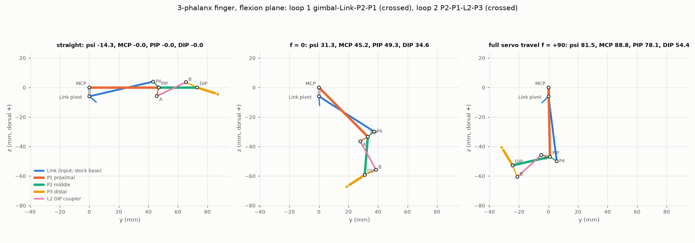

### 3.1 Segment lengths

The total length is kept: MCP to tip site is **86.85 mm, identical to the stock finger**, and the fingertip end with its TPU cap is about 93.4 mm, also as stock. The split follows human index-finger proportions (Buchholz et al. 1992: P1 : P2 : P3 ≈ 1 : 0.58 : 0.39):

| | P1 (MCP–PIP) | P2 (PIP–DIP) | P3 (DIP–tip site) | P3 to fingertip end |
|---|---|---|---|---|
| mm | 47.0 | 26.0 | 13.85 | ~20.4 |
| ratio | 1 | 0.55 | – | 0.43 |

### 3.2 Linkage

All points are (y, z) in mm, in the finger design frame, straight pose. The ground pivots stay stock: MCP O_M = (0, 0), Link pivot O_L = (0, −6) on the gimbal.

| Loop | Element | Value |
|---|---|---|
| **1** (crossed): gimbal–Link–P2–P1 | P4 (Link/P2 pivot) | (43.20, 3.95); PIP→P4 crank 5.48 mm (stock 6.00) |
| | Link pivot→P4 | 44.33 mm (stock 50.50) |
| | New Link arm | rotated 14.25° about the Link pivot relative to the stock arm, so the finger is straight at Link angle ψ = −14.25°, i.e. at f = −56° |
| **2** (crossed): P2–P1–L2–P3 | A (on P1, palm side of the PIP) | (45.65, −5.85); crank 6.00 mm |
| | B (on P3, dorsal side of the DIP) | (65.45, 3.65); crank 8.39 mm |
| | Coupler L2 = AB | 21.96 mm; two-force member, in compression when the pad is pushed |

Both loops were optimised with differential evolution plus a Nelder-Mead polish against the measured stock drive map ψ(f). Requirements:

- MCP 90° at full travel;
- maximise PIP toward 100°, with PIP ≈ 1.11 × MCP;
- DIP = 0.7 × PIP;
- transmission angles ≥ 40° from a dead point in the flexion range and ≥ 25° over the whole servo travel;
- the finger assembles on one branch over the **whole** ±90° servo travel, so no command can jam it;
- motion is monotonic;
- pin and boss clearances in the shared centre layer are ≥ 0.8 mm: L2 vs the PIP, DIP and P4 pins, the Link arm vs the A and PIP pins, and L2 vs the Link.

The result was rounded to 0.05 mm.

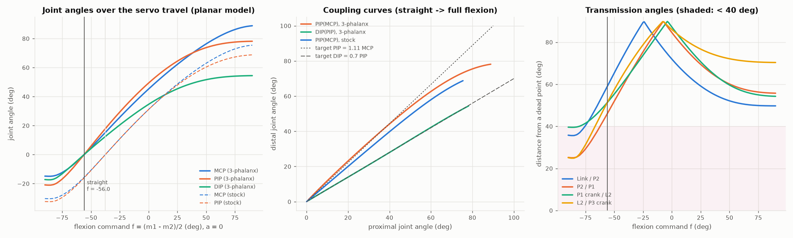

Achieved (planar, then confirmed in the sim, section 4):

- MCP 0→88.8°, PIP 0→78.1°, DIP 0→54.4°.
- DIP/PIP = 0.699 ± 0.2° rms over the whole range.
- PIP/MCP = 1.1 up to MCP ≈ 45°, falling to 0.87 overall.
- Transmission angles stay ≥ 47° from a dead point (0° or 180°) in the flexion range and ≥ 25° at the hyperextension end of the travel.

### 3.3 Why PIP stops at about 78°

The Link can turn about 95° between the straight pose and full travel. The stock drive gives ψ from −26.7° to 81.5°. In a crossed four-bar whose input turns that far, the coupler (P2) turns at most about 170° relative to the ground, so MCP + PIP ≲ 170°. Within this topology I explored:

- the crank PIP–P4 between 3.8 and 22 mm, including P4 placed on P2 beyond the PIP;
- P1 from 44 to 50 mm;
- even a longer gimbal ground, 6 to 12 mm (which would mean a new gimbal).

Each time PIP at MCP ≥ 85° topped out at **78.5°**. A crank shorter than 5.3 mm will not assemble over the full travel. So:

- PIP 100° with MCP 90° needs a two-stage (6-bar) linkage, more Link rotation, or its own actuator;
- DIP is set by loop 2 alone, so its ratio is a free choice. 0.7 is the human value; about 0.9 would give DIP ≈ 70° at the cost of a less human-like curl.

### 3.4 Drive and calibration: the one real trade-off

The drive is unchanged. Link angle and abduction versus (m1, m2) match the stock finger to within 0.22° and 0.02° in the sim. The new Link arm angle decides **where in the servo travel the finger is straight**. Moving the straight pose earlier in the travel gives more flexion and less spreading room:

| Straight at f | MCP at f = +90 | PIP at +90 | Abduction command room when straight | ≈ abduction when straight |
|---|---|---|---|---|
| −68.7° | 95.2° | 78.5° | ±21° | ±10° |
| −61.6° | 91.9° | 78.5° | ±28° | ±13° |
| **−56.0° (chosen)** | **88.8°** | **78.1°** | **±34°** | **±16°** |
| −50.1° | 84.4° | 78.5° | ±40° | ±19° |
| −45.0° | 80.3° | 78.5° | ±45° | ±21° |
| −37.5° (stock calibration) | 74.7° | 74.1° | ±52.5° | ±24° |

The chosen design takes MCP ≈ 90°. Re-running `synth_linkage.py` with another straight-pose position is a one-parameter change; everything downstream is regenerated.

**Minimal-change alternative (not built).** Keep the stock Link, the 52 mm proximal and loop 1, and add only a DIP coupler. The result is MCP 75° / PIP 69° / DIP 48° with no recalibration and no loss of abduction. The catch is that P2 is only 21 mm long (ratio 1 : 0.40), so the finger looks and grasps like a stock finger with a bent tip. Planar numbers only.

## 4. MuJoCo prototype

Files are in [Demo/AHSimulation/three_segment/](../../../Demo/AHSimulation/three_segment/), all generated by [build_finger_models.py](../../../Demo/AHSimulation/three_segment/build_finger_models.py) from `AH_Right_5F` and the CAD STLs, never hand-edited:

| Model | What it is |
|---|---|
| `model/finger_stock.xml` | The stock index finger, standalone, as the baseline (moves like finger1 of AH_Right_5F to within 0.0000 mm) |
| `model/finger_3seg.xml` | The 3-phalanx prototype |
| `model/hand5_3seg/` | Optional 5-digit right hand with 3-phalanx index, middle, ring and pinky; the thumb stays stock |

```bash
.venv/bin/python -m mujoco.viewer --mjcf=Demo/AHSimulation/three_segment/model/scene_3seg.xml
.venv/bin/python -m mujoco.viewer --mjcf=Demo/AHSimulation/three_segment/model/hand5_3seg/scene.xml
```

**The model, per finger.**

- Stock servo horns, rods, ball joints and gimbal, with the same names.
- The Link body keeps its frame. Its mesh is the new Link (stock base plus new arm).
- New bodies, each with its body frame equal to its CAD frame:
  - `p2` on the Link at P4, joint `passive4 (N)`;
  - `p1` on P2 at the PIP, joint `passive_5 (N)`;
  - `l2` on P1 at A;
  - `p3` on P2 at the DIP.
- Loop closures:
  - the 5 stock ones (abduction hinge, MCP hinge as two site pairs, rod-2 ball);
  - one new connect, L2 to P3 at B.
- Pins are visual cylinders. Inertia comes from the CAD meshes: PLA 1.24, TPU 1.21 g/cm³.
- The model is built in the stock export pose (qpos = 0, Link angle 31.44°). Every loop is closed there by construction, with an error below 1e-7 m.
- The tip site `tip1` sits where the stock one is when straight.

### 4.1 Verification

Script: [verify_3seg_finger.py](../../../Demo/AHSimulation/three_segment/verify_3seg_finger.py). Report: [verify_3seg.txt](../../../Demo/AHSimulation/three_segment/reports/verify_3seg.txt). Verdict: **PASS**.

| Check | 3-phalanx | Stock baseline |
|---|---|---|
| Loads, names unique, 2 actuators ±90°, 6 loop closures | yes | yes (5 closures) |
| Sim vs planar design, settled flexion sweep | max 0.02° MCP, 0.20° PIP, 0.38° DIP | 0.006° / 0.06° |
| Up/down hysteresis¹ | 1.9° | 0.4° |
| Drive unchanged: ψ(f), abduction vs stock | ≤ 0.22°, ≤ 0.02° | – |
| Stability (each actuator 0→max→min→0, range corners, 60 abrupt random full-range steps) | no NaN, **no MuJoCo warnings** | same |
| Loop-closure error: settled / ramped / abrupt steps | 0.004 / 0.03 / 0.76 mm | 0.002 / 0.014 / 0.56 mm |
| Motor tracking, settled, 25×25 grid | ≤ 0.24°: the full servo range is reachable, nothing binds | ≤ 0.19° |
| Joint ranges over the whole (m1, m2) square | MCP −14.6…88.8, PIP −20.5…78.1, DIP −16.8…54.4, abduction ±38.5 | MCP −30.3…75.4, PIP −32.3…68.8 |

¹ Hysteresis is mostly the model's generic `frictionloss = 0.1 N·m` on every passive joint, inherited from the stock export. That is large for a 2 mm pin, and the new finger has 2 more passive joints.

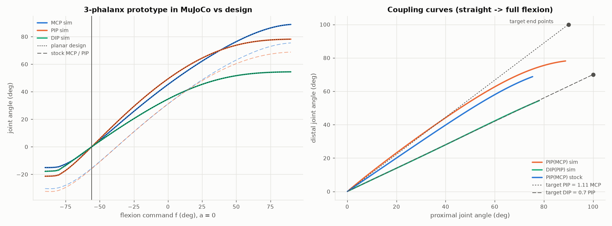

### 4.2 Self-collision

These checks use exact mesh booleans (manifold3d): the overlap volume and the true minimum gap. The new parts were checked against every other part of the finger on a 13×13 command grid plus the 2.5°-step flexion line, 242 poses and 413 part pairs. Pins are excused only against the two parts they join. The same check was run on the stock finger.

- **Working range (MCP ≥ −3°): no interference.** The new parts keep ≥ 0.25 mm apart, which is the designed lateral running gap between the layers; the closest in-plane approach is 0.42 mm (P2 pad to P1). Three zero-gap touches have no overlap volume, and the stock model shows each of them too:
  - the Link base against the gimbal's side face, in every pose (stock: same);
  - P1's reused MCP end against the gimbal's side face (stock: Proximal against the gimbal, same);
  - a rod end grazing P1's MCP end at full flexion, 0.04 mm³ (stock: 0.002 mm³).
- **Hyperextension stop.** P1 meets the finger frame (and a bushing) from f ≈ −65° (MCP ≈ −5°); there is no contact at f = −60°. The stock Proximal hits the same finger frame from MCP −4° (f = −42.5°): it is the finger's hyperextension stop, and P1 keeps the stock MCP end. **Clamp the command to f ≥ −60° for these fingers.**
- **Inherited from the stock model, not changed here:**
  - The two rod-end sockets overlap the Link's ball-stud boss by 9 mm³ in *every* pose, in the stock model too. This is a mesh artefact of the stock ball joints.
  - The stock Distal and Proximal overlap at the PIP in all 199 working-range poses of the stock model. The new parts don't.

Fixes that came out of this check, all now in the CAD:

- The stock Link's arm root rises toward the MCP. With the straight pose moved to f = −56° it would hit the gimbal inside the working range, so only the pivot and ball-stud bosses of the stock Link are kept.
- P1's reused MCP end flexes 13° further than the stock part, so it is re-cut against the gimbal and Link sweeps.
- There is now 0.25 mm lateral clearance between the nested layers.

### 4.3 Workspace

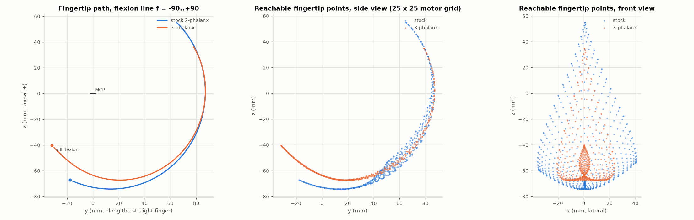

- **The fingertip curls much further.** At full flexion the tip is 14 mm further under the finger, toward the palm and wrist, and comes to within 51 mm of the MCP (stock: 69 mm). This is the point of a third phalanx: wrapping objects, hook grip, and a tighter fist.
- **The 3D hull of reachable tip positions is smaller.** In the working range (MCP ≥ −3°) it is 95 cm³ vs 125 cm³ for the stock finger. The reason is that spreading (|a| > 0) now happens with a more curled finger, so the lateral tip range is ±22 mm instead of ±38 mm. A straight pose later in the travel trades MCP range back for spread (table 3.4).

### 4.4 Statics and strength

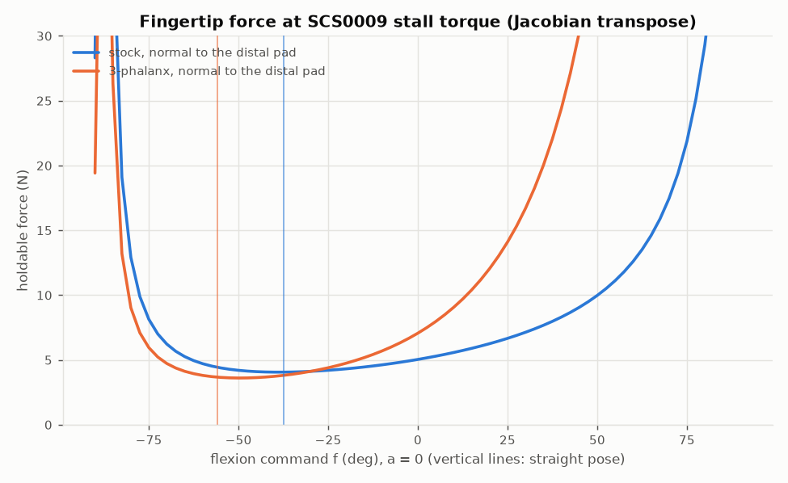

**Holdable force at servo stall.** I computed it with the Jacobian transpose (normal to the distal pad):

| Pose | 3-phalanx | Stock |
|---|---|---|
| Straight | 3.6 N | 4.0 N |
| f = 0 | 7.1 N | 5.0 N |
| f = +30 | 16.7 N | 7.1 N |

The servo-limited force rises steeply toward full flexion, because the horns approach toggle.

**Pin loads.** I pushed the pad with 5 N and read MuJoCo's constraint and interaction forces, with frictionless pins:

| f | Motor torque (N·m) | P4 | PIP | DIP | L2 (A/B) | Stock P4 / PIP |
|---|---|---|---|---|---|---|
| −56 (straight) | 0.31 | 68 N | 77 N | 14 N | 11 N | 46 / 44 N |
| 0 | 0.16 | 41 N | 54 N | 13 N | 8 N | 29 / 31 N |
| +30 | 0.06 | 42 N | 53 N | 14 N | 9 N | 30 / 34 N |

- **Pin forces are 8–15× the pad force.** The cranks are short (5.5–8.4 mm) and the pad is 40–90 mm from the joints. That is 1.4–1.8× the stock.
- **Up to about 15–20 N at the fingertip, PLA is fine.** Bearing stress in the 3.8 mm Link eye at P4 or in the 2.85 mm walls stays below about 20 MPa. Print the parts with the pin axes vertical, so bearing loads act in the layer plane.
- **In the flexed half the servos can push harder than that** (17 N at f = +30, 76 N at f = +60 by stall torque). At f = +60 the PIP and P4 pins would carry 650–820 N, which is 70–110 MPa of bearing stress and beyond PLA. **Set the SCS0009 torque limit** (or limit it in software) for grasps, or put Ø2/Ø4 brass bushings in the P4, PIP and DIP eyes. The stock finger has the same behaviour with 1.4–1.8× lower pin loads.
- L2 is never critical. Axial stress is below 9 MPa even at f = +60, and its buckling load is about 0.9 kN.

### 4.5 5-digit hand variant (optional)

Script: [verify_3seg_hand.py](../../../Demo/AHSimulation/three_segment/verify_3seg_hand.py), which imports `five_finger/verify_5f_model.py` unchanged so the numbers compare 1:1. Reports: [verify_hand5_3seg.txt](../../../Demo/AHSimulation/three_segment/reports/verify_hand5_3seg.txt), [verify_hand5_3seg_shells.txt](../../../Demo/AHSimulation/three_segment/reports/verify_hand5_3seg_shells.txt).

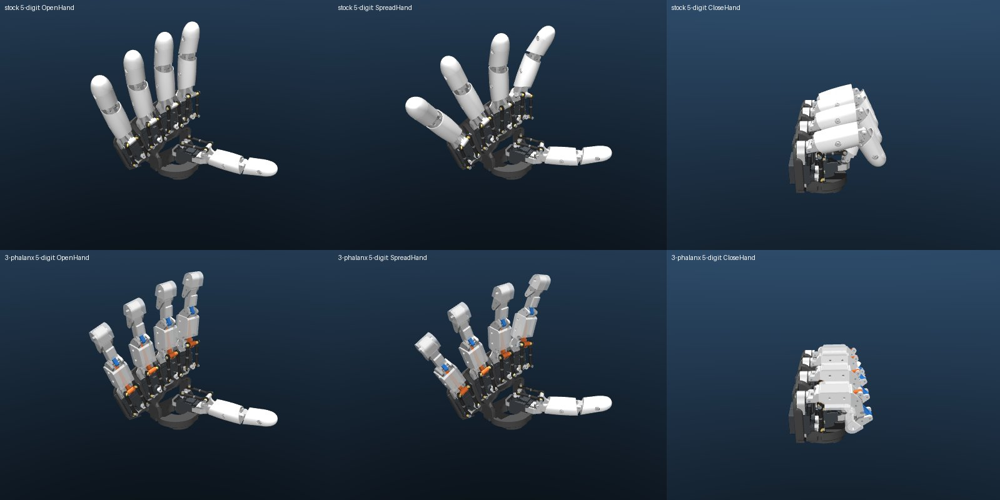

- **Structure.** 50 bodies, 93 qpos values, 10 actuators, 29 loop closures. The stock actuator names and order are kept.
- **Copies.** The pinky is still an exact copy of the ring (0.0016 mm). Every converted finger moves like the standalone model (≤ 0.07 mm).
- **Stability.** Stability sweeps with all digits and the re-mapped demo poses: no warnings. Loop error settled ≤ 0.008 mm, transient ≤ 0.93 mm (the thumb, which is stock).
- **Finger to finger.** Ring/pinky and middle/ring touch in **691/6561** pose pairs, against 887/6561 in the stock 5-digit hand. Contact now starts only when the two fingers are abducted ≥ 45° toward each other (stock: from 0°). The thumb stays > 5 mm from ring and pinky. No digit touches the plate.
- **Demo poses**, re-mapped for the new fingers (table in section 6): no new contacts. The only touches are the stock thumb/index ones the demos intend (CloseHand, Perfect).
- **Palm shells.** The existing 5-digit palm shell was shaped around the stock fingers' sweep, which stops at MCP 75°. The new P1 shells reach its top edge in a full fist: 12/169 poses per finger, f ≳ 60°, up to about 2.8 mm deep at f = 90°. I regenerated the shells around the new sweep, with `make_5f_shells.py` unchanged, run through [regen_palm_shells.py](../../../Demo/AHSimulation/three_segment/regen_palm_shells.py). The new set ([stl/palm_shells](stl/palm_shells/), right hand) clears every digit in all 169 poses: minimum 1.6 mm, and 1.1 mm for the thumb, which is the stock value.

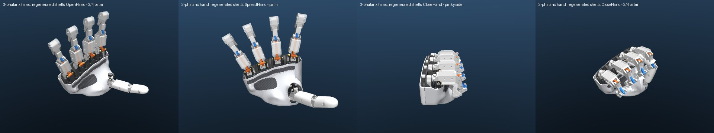

## 5. Concept CAD

Script: [make_three_segment.py](make_three_segment.py) (CadQuery and shapely). It reads [design.json](design.json) and writes [step/](step/), [stl/](stl/) and [figures/](figures/). All parts are in the stock finger design frame (mm), drawn in place in the straight pose. The new Link is drawn in the stock Link's own frame, like the stock STEP. `Finger_3S_assembly.step` is the straight-pose assembly.

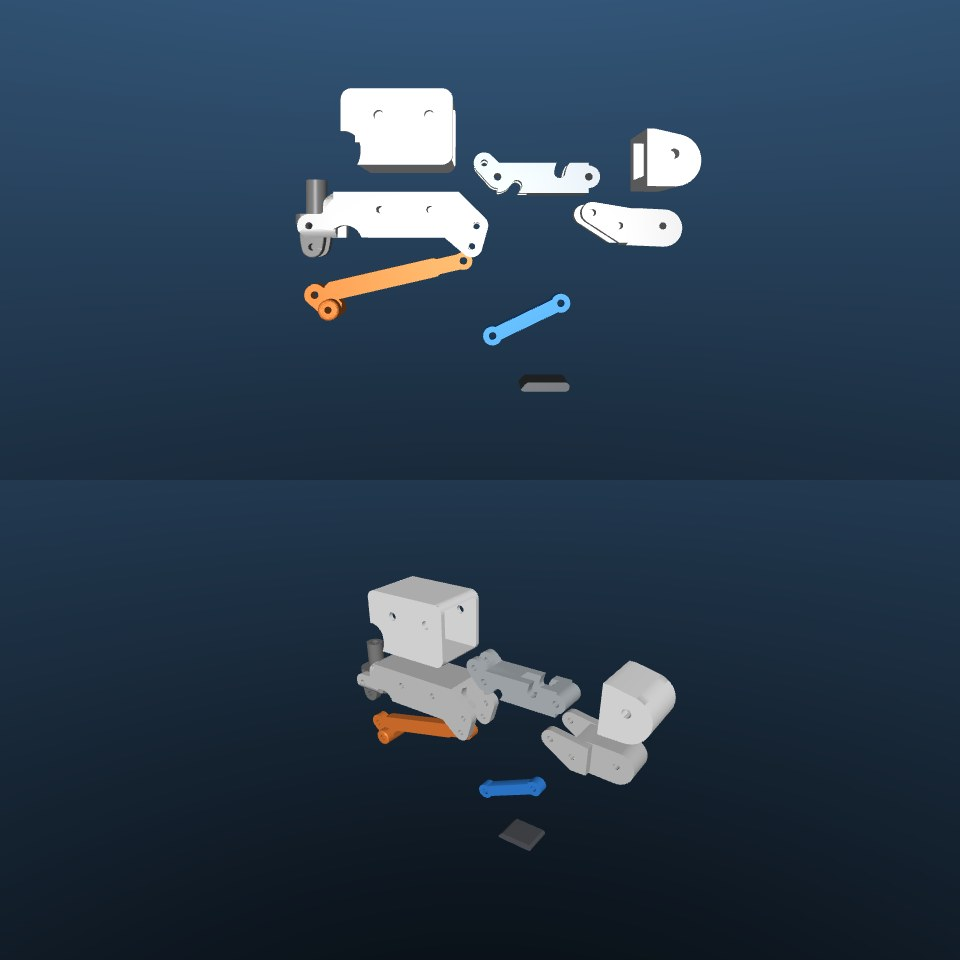

| Part | Material | Volume (cm³) | Mass (g) | Size (mm, x × y × z) | Replaces |
|---|---|---|---|---|---|
| `Link_3S` | PLA | 1.23 | 1.5 | 10.3 × 49.9 × 11.3 | Link. Stock pivot and ball-stud bosses kept; new arm, 3.8 thick and 5.5 tall, necked to 4.5 near P4 |
| `P1_Proximal_3S` | PLA | 6.58 | 8.2 | 16.8 × 53.6 × 18.4 | Proximal. Stock MCP end (re-cut) plus a new body; palm-side lug for pin A |
| `P2_Middle_3S` | PLA | 1.93 | 2.4 | 10.0 × 36.0 × 11.6 | Distal. Takes the PIP, P4 and DIP pins, with notches for the A and B pins |
| `P3_Distal_3S` | PLA | 2.23 | 2.8 | 16.2 × 29.0 × 12.5 | new. Fork round P2 holding the DIP and B pins; fingertip core |
| `L2_Coupler_3S` | PLA | 0.41 | 0.5 | 3.8 × 25.3 × 15.0 | new. Dog-bone, 21.96 mm between holes |
| `P1_Shell_3S` | TPU 82A | 3.53 | 4.3 | 20.0 × 31.0 × 21.1 | Proximal_Shell. 4 × M2.5×6 thermoplastic screws |
| `P2_Pad_3S` | TPU 82A | 0.33 | 0.4 | 10.0 × 13.9 × 2.6 | new. Palm-side pad, glued on (flexible CA) |
| `P3_Shell_3S` | TPU 82A | 2.15 | 2.6 | 18.0 × 15.0 × 16.1 | Distal_Shell. Fingertip cap with a 3.8 mm pad; 2 × M2.5×6 screws |

**Layers** (x, across the finger):

| Layer | x range (mm) | Parts |
|---|---|---|
| Centre | ±1.9 | Link arm and L2 (as thick as the stock Link arm) |
| P2 walls | 2.15–5.0 | P2 |
| Outer forks | 5.25–8.1 | P1 walls and P3 cheeks (the stock Proximal's width) |

There are 0.25 mm running gaps between layers. All new parts sit on the Link's mid-plane. The stock assembly has the Link 0.35 mm off the gimbal mid-plane, so the reused P1 MCP end is shifted by −0.6 mm to sit exactly where the stock Proximal does against the gimbal.

**How the shapes are made.** Each part is its layer blanks minus the swept envelope of every other part and pin sharing that layer, sampled every 0.25° of Link angle over the whole servo travel and grown by 0.6 mm. Clearance therefore holds by construction in the flexion plane, and the sim re-checks it in 3D (section 4.2).

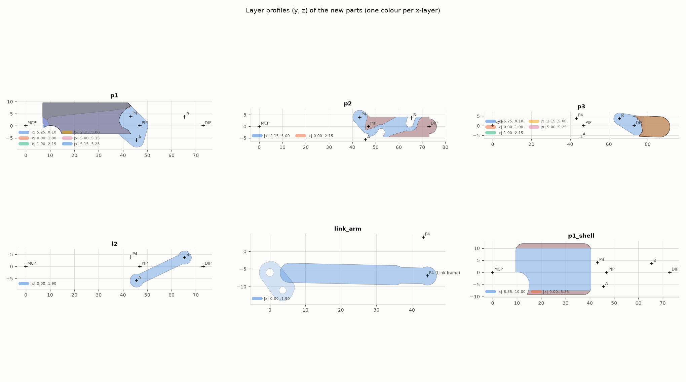

**Pins** are the stock Ø2 parallel pins:

- Ø2×16 at MCP, PIP, A, DIP and B, through the 16.2 mm forks;
- Ø2×10 at P4 and the Link pivot.

The holes are Ø1.95 where the pin is held (P1 at PIP and A; P2 at P4; P3 at DIP and B) and Ø2.15 where it turns. All bosses are ≥ 1.5 mm wall around the hole. The thinnest is the Link eye at P4, at 1.5 mm.

**Printing.**

- **Orientation:** all PLA parts print lying on a side face, with the pin axes vertical. P2, L2 and the Link are flat, so no supports; P1 and P3 will probably need small supports under the fork bridges (not sliced yet).
- **Holes:** ream them with a Ø2 drill.
- **Cleanup:** remove the elephant's foot on the fork faces, or the 0.25 mm gaps will bind.
- **TPU:** covers print as the stock shells do.

**Limits.** This is concept CAD, not production-ready:

- Curved edges are polylines, so the STEP is faceted.
- No fillets or chamfers.
- The pin retention (press fit) has not been test-printed.
- The covers are simple and boxy, and P2 has only a palm-side pad.

## 6. What it would take

### Parts per finger (×4 for the 5-digit hand; the thumb stays 2-phalanx)

| Stock part | 3-phalanx part |
|---|---|
| Link | `Link_3S`. Re-use the 2 ball studs and 2 M2×10 screws |
| Proximal | `P1_Proximal_3S` |
| Distal | `P2_Middle_3S` |
| none | `P3_Distal_3S`, `L2_Coupler_3S` |
| Proximal_Shell, Distal_Shell | `P1_Shell_3S`, `P3_Shell_3S`, `P2_Pad_3S` |
| 2× Ø2×16 + 2× Ø2×10 pins | 5× Ø2×16 + 2× Ø2×10 pins (**+3 Ø2×16**) |
| 4 shell screws (M2.5×6 thermoplastic) | 6 (+2) |

**Unchanged:**

- the 10 SCS0009 servos, horns, push rods, ball joints and spacers;
- the gimbals, finger frames, bushings and the abduction screw and washer;
- the 5-digit palm plate, wrist interface, wiring, bus and power supply (still 10 servos, 5 A);
- the thumb.

**Changed elsewhere:**

- The 5-digit palm shell and grip pads: regenerate them around the new sweep. The set is in [stl/palm_shells](stl/palm_shells/), made by [regen_palm_shells.py](../../../Demo/AHSimulation/three_segment/regen_palm_shells.py) with the existing generator, unchanged.
- The MJCF for IK (mink) and AHSimulation: use `model/hand5_3seg`.

### Software

- **New straight pose:** f = −56° instead of −37.5°. Add an offset in the demo poses or controller; the servo zero calibration (MiddlePos / AHControl offsets) is unchanged because the drive is unchanged.
- **Clamp the flexion command to f ≥ −60°**, i.e. m1 − m2 ≥ −120°. That keeps the finger off the hyperextension stop.
- **Torque-limit the servos in grasps** (see 4.4).
- **Demo poses** re-mapped for the 3-phalanx fingers. Flexion is rescaled from [−37.5, 90] to [−56, 90]; abduction is limited by |a| + |f| ≤ 90. Right hand, (m1, m2) in degrees:

| Pose | Index | Middle | Ring | Pinky | Thumb (stock) |
|---|---|---|---|---|---|
| OpenHand | (−53.1, 53.1) | (−53.1, 53.1) | (−53.1, 53.1) | (−53.1, 53.1) | (−35, 35) |
| CloseHand, Pinched | (90, −90) | (90, −90) | (90, −90) | (90, −90) | as stock |
| SpreadHand | (−30, 90) | (−49.7, 49.7) | (−85, 35) | (−90, 30) | (−90, −4) |
| ClenchHand | (−77.4, 17.4) | (−53.1, 53.1) | (−18.1, 88.1) | (−18.1, 88.1) | (−4, 90) |
| Index_Pointing | (−58.5, 58.5) | (90, −90) | (90, −90) | (90, −90) | (90, −90) |
| Perfect | (44.2, −44.2) | (−13, 13) | (−35.9, 35.9) | (−35.9, 35.9) | (65, 12) |
| Victory | (−33.5, 83.5) | (−83.5, 33.5) | (90, −90) | (90, −90) | (90, −90) |

### Effort and cost (estimates)

- **Material:** about 12.4 cm³ PLA + 6.0 cm³ TPU per finger, roughly what the stock finger set uses (12.1 + 7.0). That is under €1 of filament plus 3 steel pins, so **under €2 per finger, about €8 for the hand**. No new servos or electronics.
- **Print time:** about 1.5–2.5 h per finger set on a typical FDM printer.
- **Engineering, for one person, about 1–2 weeks:**
  - redraw the concept parts in Onshape with fillets, chamfers, pin retention and shell attachment: 2–4 days;
  - 2–3 print/fit iterations for the pin holes, 0.25 mm layer gaps and the TPU covers: 2–4 days;
  - firmware/demo/IK update and calibration: about 1 day;
  - grasp tests and the torque limit: 1–2 days.

### Risks and open questions

- **PIP and DIP fall short of the brief: 78° and 54° instead of 100° and 70°.** This is a hard limit of a crossed four-bar on this drive (section 3.3).
- **Less spread in the straight pose (±16° vs ±23°), and a smaller lateral workspace.** This is a calibration choice (table 3.4).
- **Strength at this scale.** Pin loads are 8–15× the fingertip force (1.4–1.8× the stock). This is fine up to about 15–20 N at the fingertip in PLA; above that, use a torque limit or brass bushings. The Link eye at P4 (1.5 mm wall) is the weakest point. It has not been load-tested.
- **Print tolerances.** The design relies on 0.25 mm lateral gaps between nested forks and on Ø1.95/2.15 holes. FDM variation is about the same size. Expect to tune the slicer (hole compensation) and add a chamfer at the first layer.
- **Friction and backlash.** There are 3 more pin joints per finger (A, B, DIP), on top of the stock MCP, PIP, P4 and Link-pivot pins and the two ball-joint rods. With 0.05 mm radial play per pin, the DIP alone gets about ±0.7° of play. The sim has no contacts and uses generic joint friction, so it does not predict real friction.
- **The middle phalanx has no full cover** (only a palm-side pad), and the fingertip cap is smaller than the stock bulbous one. Grip quality is untested.
- **Not modelled or not verified:**
  - contact and grasp simulation (all geoms are visual);
  - the left hand;
  - real servo dynamics (current limit, compliance);
  - the regenerated palm shells were only checked for clearance, not assembled.

## 7. Reproduce

From the repo root:

```bash
cd Demo/AHSimulation/three_segment
../../../.venv/bin/python build_finger_models.py --stock-only   # stock index finger, standalone
../../../.venv/bin/python analyze_stock_finger.py               # section 1 (+ data for the synthesis)
../../../.venv/bin/python synth_linkage.py                      # section 3 -> cad/five_finger/three_segment/design.json
cd ../../.. && .venv/bin/python cad/five_finger/three_segment/make_three_segment.py   # section 5 (STEP/STL)
cd Demo/AHSimulation/three_segment
../../../.venv/bin/python build_finger_models.py                # finger_stock, finger_3seg, hand5_3seg
../../../.venv/bin/python verify_3seg_finger.py                 # section 4.1-4.4
../../../.venv/bin/python regen_palm_shells.py                  # palm shells around the new fingers
../../../.venv/bin/python verify_3seg_hand.py                   # section 4.5
../../../.venv/bin/python render_finger.py                      # renders
```

## What is verified and what is not

**Verified in simulation (MuJoCo 3.15):**

- the kinematics of the design, with sim and planar model within 0.4°;
- stability and loop closure over the full servo range;
- the drive is unchanged;
- no self-interference of the new parts in the working range (exact mesh booleans);
- the workspace and the Jacobian forces;
- the pin loads (rigid, frictionless);
- the 5-digit hand: finger-to-finger contact, stability and shells.

**Not verified:**

- anything physical: printing, fit, friction, backlash, strength, wear;
- grasping with contact;
- the left hand;
- the minimal-change variant (planar only).
