# The "ultimate" finger: thin, styled, 3 phalanges, stock drive

A finger for the 5-digit AmazingHand ([FIVE_FINGER.md](../../../FIVE_FINGER.md)) that merges three earlier studies into one buildable, simulated design:

| From | What it contributes |
|---|---|
| [three_segment](../three_segment/README.md) | 3 phalanges on the unchanged 2-servo drive: a re-dimensioned crossed four-bar (Link → middle phalanx P2) plus a DIP coupler L2. **The linkage is kept as is**: it is verified, well conditioned, and a re-optimisation would not move PIP past ~78° (section 2). |
| [slim_fingers](../slim_fingers/README.md) | TPU covers hugging the cores (0.25 mm clearance, ≥ 1.2 mm wall) and clearing everything that moves past them over the whole travel (≥ 0.5 mm), with the knuckle hardware exposed. The thumb reuses the slim cores. |
| [fingers](../fingers/) (styled shells) | The two-colour TPU look. Restyled after the user's reference hands (section 4): the proximal and middle phalanges are rounded capsules with domed ends, the fingertip is 5 mm longer and tapers into a rounded point, a black ribbed glove covers the palm half of every segment and wraps the fingertip, and the white back of the fingertip reads as a nail. |

New here: the **lateral stacking** of the cores (it sets the width), a **longer, pointed fingertip**, the covers as **implicit solids** built around everything that moves inside and past them, the strength analysis of the thinner parts with a torque-limit recommendation, the thumb in the same style, a **shorter pinky** variant, and the 5-digit hand `AH_Right_5F_3S`.

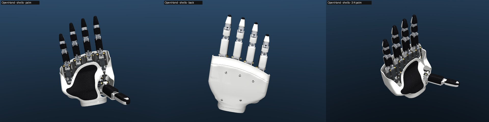


*AH_Right_5F_3S on the palm shells of `cad/five_finger/stl`: thin 3-phalanx fingers made of rounded capsules with a white back and a black ribbed glove on the palm half, long fingertips tapering to a rounded point with a nail-like back, the joint hardware visible in the short gaps between segments; the thumb in the same style; shorter pinky.*

**In short**

- **Look:** the proximal and middle phalanges are capsules: superellipse sections (no flat faces), slightly convex sides, and domed, knuckle-like ends that roll past each other at the joints. The fingertip is 5 mm longer than before (24.8 mm from the DIP pin to its end, about as long as the middle segment) and tapers continuously into a rounded point (an ogive with a 4 mm nose). The back is smooth white TPU. A black TPU glove with 1 mm ribs covers the palm half and wraps the fingertip, whose white back reads as a nail. The thumb has the same style. The linkage is unchanged; only the fingertip core's free end got longer.
- **Width:** proximal 16.9 mm, middle 15.9 mm, distal 13.3 mm (tapering to 8.2 mm 4 mm before the end) including the covers (limits ≤ 17 / 16 / 15). The covers are 19.4 / 15.3 / 15.0 mm deep. Inner knuckles 12.0 mm. The MCP knuckle stays 16.2 mm (stock gimbal and Proximal ears).
- **Range:** MCP 89° / PIP 78° / DIP 54° (stock 75° / 69° / –), identical to the 3-phalanx concept. A six-bar stretch study shows PIP 100° / DIP 70° is reachable inside the stock drive, at the cost of 2 parts, 3 pins and 2–3 link layers per finger (section 2): not built.
- **Strength:** the Link arm (a bending member) and the PIP pin in P1's fork govern. The longer fingertip is a longer lever. With Link, L2, P1, P2 in PA-CF the parts hold 6.8 N at the fingertip when straight (was 7.5; the servos can push 3.3 N there) and 21.5 N from f = +30 on (was 26). **Set `max_torque_limit` = 800 (80 %)**, unchanged; it protects contact up to f = +45. Beyond that, limit the load in software (section 5).
- **Simulation:** single finger PASS (kinematics, stability, loop closures, no self-contact in the working range).
  - The 5-digit hand is stable.
  - Finger-to-finger contacts are about half those of stock fingers on the same 30 mm parallel layout.
  - The fingers do not touch the final palm plate or the palm shells regenerated against this hand (closest 1.50 mm, the pinky fingertip in a fist).
  - Peace sign, middle finger, pad-to-pad pinch and, with the longer fingertip, a pad-to-pad OK sign work (section 7).
- **Not done:** printing, fit and load tests; contact/grasp simulation; the left hand. On the powered wrist the hand is `AH_Right_5F_3S_Wrist` ([FIVE_FINGER.md](../../../FIVE_FINGER.md#styled-3-phalanx-fingers-final)).

## 1. What changed, in one table

| | Stock 2-phalanx | Slim (2-phalanx) | 3-phalanx concept | **This finger** | Target |
|---|---|---|---|---|---|
| Phalanges | 2 | 2 | 3 | **3** | 3 |
| Proximal width (cover) | 23.8 | 19.4 | 20.0 | **16.9** | ≤ 17 |
| Middle width | – | – | 10.0 (pad only, no cover) | **15.9** | ≤ 16 |
| Distal width | 21.5 | 14.9 | 18.0 | **13.3**, tapering to a point | ≤ 15 |
| Cover depth, proximal / middle / distal | | | | **19.4 / 15.3 / 15.0** | |
| DIP pin to the fingertip's end / tip site | – | – | – / 13.85 | **24.8 / 18.85** (was 19.9 / 13.85) | |
| Inner knuckles (PIP, DIP) | 16.2 | 16.2 | 16.2 | **12.0** | |
| MCP knuckle (stock gimbal + Proximal ears) | 16.2 | 16.2 | 16.8 | 16.2 | stock |
| MCP / PIP / DIP at full travel | 75 / 69 / – | 75 / 69 / – | 89 / 78 / 54 | **89 / 78 / 54** | (90 / 100 / 70 human) |
| Straight finger at f = (m1 − m2)/2 | −37.5° | −37.5° | −56° | **−56°** (clamp f ≥ −60°) | |
| Moving mass beyond the gimbal | 18.4 g | ~18 g | 23.5 g | **19.3 g** | |
| Pins per finger | 2×16, 2×10 | same | 5×16, 2×10 | **2×16, 2×10 (stock) + 3×12, 2×8** | |

All widths are across the pins (x), depths across the finger (z), measured on the exported meshes including covers and pins ([report_cad.txt](report_cad.txt)).

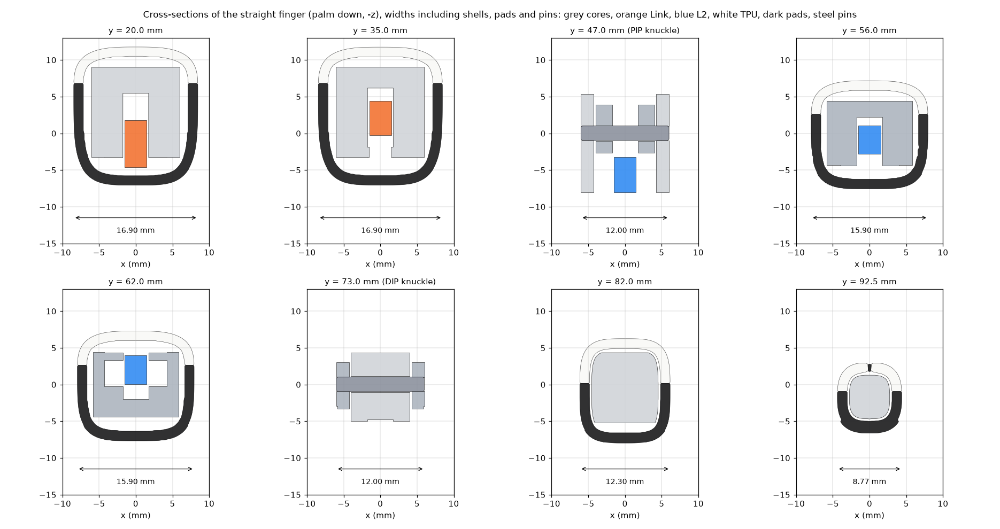

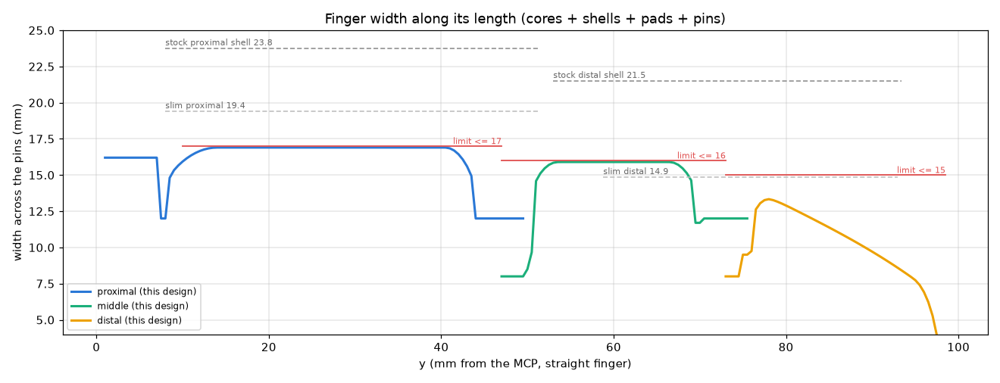

## 2. Kinematics

The planar linkage of the [3-phalanx study](../three_segment/README.md#3-the-design-option-a) is used unchanged ([design.json](design.json) copies it), with one change: the distal segment is **5 mm longer** (`uf_layout.TIP_EXT`), for a more slender fingertip about as long as the middle segment. The DIP, the coupler L2 and both four-bars are untouched; only the fingertip core's distal end, its cover and the tip site move out. Segments 47 / 26 / 18.85 mm (MCP→PIP→DIP→tip site; the cover ends 24.8 mm beyond the DIP pin), loop 1 = crossed four-bar gimbal–Link–P2–P1 with P4 = (43.20, 3.95), loop 2 = crossed four-bar P2–P1–L2–P3 with A = (45.65, −5.85), B = (65.45, 3.65), the new Link arm rotated 14.25° so the finger is straight at f = −56°. In the sim ([verify_finger.txt](../../../Demo/AHSimulation/ultimate_finger/reports/verify_finger.txt)):

| f | MCP | PIP | DIP | total curl | stock MCP / PIP |
|---|---|---|---|---|---|
| −60 (clamp) | −3.2 | −4.0 | −2.9 | −10 | −18.8 / −19.3 |
| −56 (straight) | 0 | 0 | 0 | 0 | −15 / −15 |
| 0 | 45.2 | 49.3 | 34.6 | 129 | 31.1 / 31.1 |
| +45 | 73.8 | 72.4 | 50.7 | 197 | 60.4 / 58.3 |
| +90 | **88.8** | **78.1** | **54.4** | **221** | 75.4 / 68.8 |

Sim vs planar design ≤ 0.02° MCP, 0.20° PIP, 0.37° DIP; the drive (Link angle, abduction) matches the stock finger to 0.22° / 0.01°.

**Why not re-optimise for more PIP?** With the Link as the only input and the stock gimbal pivots, a crossed four-bar tops out at PIP ≈ 78° for MCP ≈ 89° ([three_segment §3.3](../three_segment/README.md#33-why-pip-stops-at-about-78)). The **stretch study** ([sixbar/](../../../Demo/AHSimulation/ultimate_finger/sixbar/sixbar_report.txt)) checked six-bars inside the existing drive:

| Layout (planar, transmission ≥ 40° in flexion / ≥ 25° over the travel) | MCP | PIP | DIP | extra parts / pins | centre layers | PIP play (0.05 mm/pin) |
|---|---|---|---|---|---|---|
| current crossed four-bar | 88.8 | 78.1 | 54.4 | – | 1 | ±2.5° |
| (a) Watt six-bar: Link → rocker R on P1 → coupler C → P2 | 88.0 | **100.0** | 69.6 | +2 / +3 | 3 | ±5.0° |
| (b) Stephenson six-bar: Link → K → P1, Link → D → P2 | 90.0 | **100.0** | 69.7 | +2 / +3 | 2 | ±6.2° |
| (c) P2 hung on two links ("virtual P4") | 90.0 | 76.7 | 57.0 | +2 / +3 | 3 | – |

So **yes, PIP 100° / DIP 70° is reachable within the stock drive**, with a Watt or Stephenson six-bar. It is **not built here** because it works against the other goals: it needs 2–3 link layers in the centre of the finger instead of one (≈ +3–6 mm width at the knuckles), 3 more pins per finger with about twice the PIP play, and at f = +90 the fingertip curls back to y ≈ −25 mm, under its own knuckle, so the palm shell and plate would have to be re-checked for it. It is the right next step for a "fist-closing" finger that may be wider.

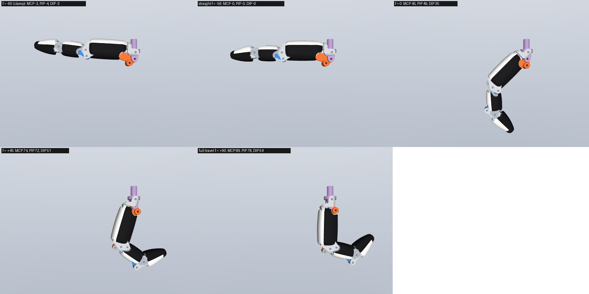

## 3. Thin layout

Every part is a stack of slabs across the pin axis x ([uf_layout.py](uf_layout.py), figure [layers.png](figures/layers.png)):

| Band | \|x\| (mm) | At the PIP | At the DIP | Elsewhere |
|---|---|---|---|---|
| C (centre) | 0–1.5 | Link arm eye (P4), L2 eye (A) | L2 eye (B) | Link arm in P1's channel; L2 inside P2 |
| g1 | 1.5–1.75 | 0.25 mm running gap | gap | filled only to join a part's own bands |
| M | 1.75–4.0 | **P2** (inside P1's fork) | **P3** (inside P2's fork) | P1 walls, P2 walls, P3 tip body |
| g2 | 4.0–4.25 | gap | gap | filled where a part spans M and O |
| O | 4.25–6.0 | **P1 fork** | **P2 fork** (walls 5.85, pin bosses 6.0) | P1 walls; P3 tip body only to 4.75 |

- The **nesting flips between the knuckles**: P2 is the inner part at the PIP and the outer fork at the DIP. P3 is therefore an inner part at the DIP and its fingertip body can be 9.5 mm wide (13.3 mm with the cover) without passing P2's fork.
- **Pins**: hardened Ø2 dowels. 2×12 at the PIP, A and DIP, flush with the 12.0 mm forks; 2×8 at P4 and B, flush with the 8.0 mm inner parts and held in place by the outer fork 0.25 mm away. MCP (2×16) and Link pivot (2×10) stay stock.
- **Links**: the Link arm and L2 are 3.0 mm thick (stock arm 3.8). The Link arm is 8 mm tall at its root, tapering to 4.5 mm at the neck, because its bending moment falls linearly towards P4 (section 5). The stock Link base (pivot and ball-stud bosses) is kept, so the rods, horns and calibration are unchanged.
- **Carving.** Each slab is its blank minus the swept envelope (whole servo travel, 0.25° Link steps) of every slab of every other part that overlaps it laterally (with the 0.25 mm gap), grown by 0.6 mm in-plane. Knuckle "essentials" (pin bosses, forks) are laid out first, then the fillers, so the bosses are never eaten. Slivers under 0.9 mm are removed. Clearance therefore holds by construction in the flexion plane; the sim re-checks it in 3D.
- **What limits the width.** At the knuckles: 3 links-and-walls layers × 2 + 2 running gaps: 2 × (1.5 + 0.25 + 2.25 + 0.25 + 1.75) = 12.0 mm. One more mm would need either thinner fork walls than 1.75 mm (pin bearing, section 5) or a smaller running gap than 0.25 mm (FDM tolerance). On the covers: 12.0 mm (P1) or 11.7 mm (P2) core + 2 × (0.25 clearance + 1.27 TPU) = 15.0 / 14.7 mm is the minimum; the capsule sections use the rest of the allowance to round off the box-shaped cores (16.9 / 15.9 mm; the fingertip 13.3 mm, tapering; section 4). The MCP knuckle stays 16.2 mm because the stock gimbal and the stock Proximal ears around it are kept (the brief keeps the MCP interface stock).

## 4. Styling: capsule covers, glove, long pointed fingertip

The covers follow the user's reference hands. The proximal and middle phalanges are rounded capsules with domed, knuckle-like ends. The fingertip is long and slender: it tapers from the DIP into a rounded point. A black ribbed TPU glove covers the palm half of every segment and wraps the fingertip; the back is a smooth white shell, which on the fingertip reads as a nail. Only covers and pads changed, plus two things on the fingertip:
- the distal segment is 5 mm longer (section 2);
- the fingertip core's tip body (no joint in it) is trimmed to the cap's cavity, as before.

Cores, links, pins and kinematics are otherwise as before.

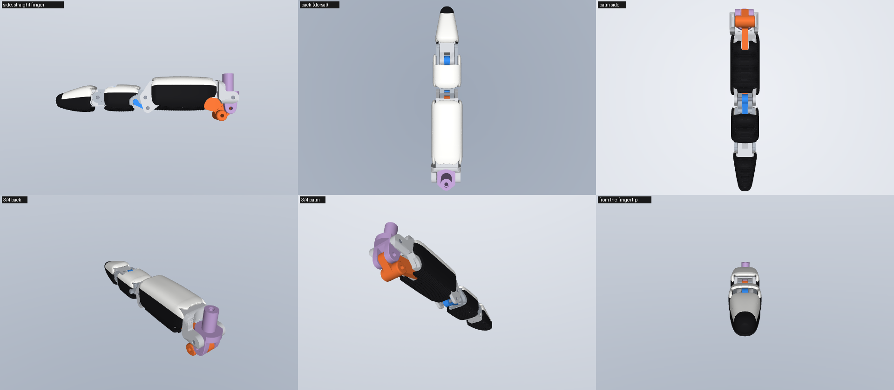

**How they are made.** The covers are implicit solids on a 0.12 mm voxel grid ([uf_covers.py](uf_covers.py)), the same technique as the palm shells (`make_5f_shells.py`).

1. **Fields per phalanx** (in its own frame), all swept over the whole servo travel in 0.25° Link steps:
   - distance to its own core and pins;
   - distance to everything that moves inside the cover: the Link arm in P1, the coupler L2 in P2;
   - distance to everything that moves past it: the other phalanges, the links, the gimbal and hardware, and the previous phalanx's finished cover.
2. **Proximal and middle: capsules.** One superellipse section per phalanx, exponent 4 on the palm half and 3.2 on the back half (no flat faces).
   - The section is fitted to contain the core + 0.25 mm and the inside movers + 0.6 mm, plus the wall, over the mid-span of the phalanx.
   - They use the allowed width (16.9 / 15.9 mm): a wider superellipse needs less depth around the 12 × 12 mm box cores, so the sections are rounder than before (P1 16.9 × 19.4 mm, was 16.4 × 20.3; P2 15.9 × 15.3 mm, was 15.5 × 16.5 and now wider than deep).
   - The back and palm lines are slightly convex (fullest mid-segment).
   - The ends are domes whose sections shrink towards the joint pin axis, so they read as knuckles and the two ends at a joint roll past each other.
   - **No spindle taper.** The reference segments narrow towards both joints. Ours cannot: the box cores run the full length of P1 and P2 at constant section, and the fitted section touches them along the whole shaft (required scale 1.00 at every slice). The narrowing happens only in the domes, down to the 12 mm knuckles. Tapered segments would need tapered core shafts (section 10).
3. **Fingertip: an ogive** (`ogive_tip`). From 5 mm past the DIP to the end:
   - **Plan view:** the width tapers continuously (a cubic tangent ogive) into a round nose of 4 mm radius: 13.3 mm just past the DIP, 11.7 mm halfway, 9.7 mm 8 mm before the end, 8.2 mm 4 mm before it.
   - **Side view:** the nail side curves down. The pad side stays full (a slight pulp) and then sweeps up to meet it at the end point, 1.8 mm below the pin axis. The depth goes from 14.7 mm at the DIP (15.0 with the ribs) to 8.5 mm 4 mm before the end (nose radius 4 mm).
   - The sections round off from exponent 4 at the DIP to 2.3 at the end.
4. **Skin.** 1.27 mm thick, measured from the smooth outer surface by an exact distance transform. After meshing it is ≥ 1.22 mm everywhere it exists (1st percentile 1.23–1.26, median 1.31), fingers and thumb.
5. **Cuts.**
   - Everything within 0.25 mm of its own core or 0.6 mm of the inside movers is removed.
   - Everything within 0.72 mm on the voxel field of what moves past is removed too, widened across the finger to bands of at least 2.5 mm, so no narrow tabs of skin stand between neighbouring cut-outs. That gives ≥ 0.5 mm true clearance; the measured minimum is 0.61 mm (CAD sweep and sim).
   - **Full-thickness rims.** The skin is removed in whole columns: wherever a cut reaches within 1.2 mm of the outer surface, the skin under that surface point goes. Rims are square to the surface and full thickness, never a feathered wedge where a dome runs into a core at a shallow angle. Remaining slivers thinner than 1 mm are removed as well. The report lists what is still thinner than 1.0 mm: only rounded rim corners, at most 0.27 mm deep (the previous covers had feathered dome edges up to 7 mm long).
   - The cuts are a smooth maximum of the fields, so the rims are rounded. Where joint hardware passes through a dome, the dome opens around it, so the metal joints stay visible between the segments.
6. **Split and glove.**
   - The cover is split at a seam a little above its widest line. The palm part (50–60 % of the circumference) is the black TPU glove. On the fingertip the glove wraps over the end, and the white back is a nail that stops 5.5 mm short of the end.
   - The glove carries transverse ribs (0.3 mm high, 0.55 mm wide, 1 mm pitch) where it faces the palm. They follow the curvature and turn round the fingertip's nose.
   - On the sides, at the widest line, the glove is smooth, so the ribs never add width.
7. **Meshing.** Marching cubes, decimation to at most 150 000 faces per part (thumb up to 180 000), and a manifold check (every cover is one watertight solid). **The covers are STL only** (no STEP): they are TPU parts defined as implicit solids. The rigid parts keep their STEP files.

| Phalanx | Width (cover) | Depth (cover) | Limit (width) | Section |
|---|---|---|---|---|
| Proximal | **16.90** | 19.37 | ≤ 17 | superellipse n = 4 (palm half) / 3.2 (back half), fitted |
| Middle | **15.90** | 15.28 | ≤ 16 | same |
| Distal | **13.33** just past the DIP, tapering to 8.2 mm 4 mm before the end | 15.04 → 8.5 | ≤ 15 | ogive, n = 4 → 2.3, nose radius 4 mm; 24.8 mm from the DIP pin to the end |
| Pinky (×0.88) | 16.90 / 15.90 / 13.32 | 19.37 / 15.28 / 14.97 | | the same covers on the shorter phalanges (fingertip 22.0 mm from its DIP pin) |
| Thumb proximal / distal | 19.80 / 15.20 | 24.55 / 15.72 | | same style on the slim-finger thumb cores (unchanged) |

- **Retention**: the covers are glued (flexible CA) and have no screws. Back shell and glove meet at the seam; glue them to each other along it and to the core. They can also print as one two-material part (white + black TPU).
- **Thumb (2 phalanges)**: same method and style on the slim-finger parts, with the same rim handling:
  - a capsule proximal cover with domes towards its two pins;
  - a bullet distal with a nail and the glove wrapping the end.
  - Its length is unchanged. Its distal segment is already 41 mm from its joint to the end, so it does not look stubby next to the longer fingertips. It keeps a bullet end rather than the ogive, because its slim distal core fills the cover nearly to the end, and a pointed cap would mean a trimmed thumb core.
  - It is glued, so its shell screws are no longer used (the cores keep their holes). Its kinematics are stock.

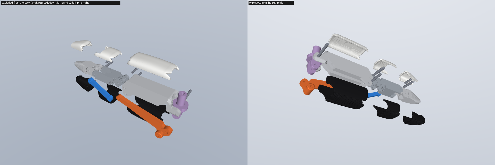

## 5. Strength, materials and the servo torque limit

Source: section 6 of [verify_finger.txt](../../../Demo/AHSimulation/ultimate_finger/reports/verify_finger.txt), figure [strength.png](figures/strength.png).

**Method.** The finger is held at a flexion command f with frictionless pins, and the fingertip pad is pushed with 5 N along the pad normal at the tip site. Every joint force is read from MuJoCo (body interaction forces, including the loop-closure forces) and turned into stresses with the actual thin geometry. Everything scales linearly with the pad force.

**The longer fingertip.** The tip site is now 18.85 mm beyond the DIP instead of 13.85 mm, so the same pad force loads every joint 15–35 % more:
- the allowed fingertip force drops from 7.5 to 6.8 N straight and from 26 to 21.5 N from f = +30 on;
- what the servos can push at the tip drops more (−11 % straight, −26 % at +45), so the recommended torque limit keeps more margin than before.

**Loads per 5 N at the fingertip.** The cranks are short, so the P4 and PIP pins carry 10–18× the pad force (1.7–2.2× the stock finger):

| f | motor torque | P4 | PIP | A | DIP | B | MCP¹ | Link-arm moment at its root |
|---|---|---|---|---|---|---|---|---|
| −56 (straight) | 0.34 N·m | 78 N | 92 N | 15 N | 17 N | 15 N | ~78 N | 762 N·mm |
| 0 | 0.18 | 49 | 65 | 11 | 16 | 11 | ~54 | 352 |
| +30 | 0.082 | 50 | 65 | 12 | 17 | 12 | ~55 | 185 |
| +60 | 0.024 | 53 | 65 | 12 | 17 | 12 | ~57 | 78 |

¹ The MCP hinge is two site-pair closures in the model; the pin load is their sum (≈ twice the first pair, which the 3-phalanx study reported).

**The Link arm is a bending member.**
- It carries the whole Link torque as a force at P4 almost perpendicular to the arm. Its root therefore sees ~760 N·mm per 5 N in the straight pose.
- That is why the 3.0 mm arm is 7.7 mm tall at the root, tapering to 4.5 mm at the neck.
- Stress: 30 MPa per 5 N straight, falling to 9 MPa at f = +30, because the Link torque per newton drops as the finger curls.

**Stresses per 5 N** (bearing = F/(d·t·n); pins as beams between the wall centres; hardened Ø2 dowels):

| Element | straight | f = 0 | f ≥ +30 | Limit used (PLA / PETG / PA-CF / steel) |
|---|---|---|---|---|
| Link arm, root to mid (bending + axial) | 29.6 | 14.4 | 8.9–4.4 | 25 / 22 / 40 |
| PIP pin in the P1 fork (1.75 mm walls), bearing | 13.1 | 9.2 | 9.2–9.3 | 25 / 20 / 40 |
| P4 pin in the 3.0 mm Link eye, bearing | 13.1 | 8.2 | 8.4–8.9 | 25 / 20 / 40 |
| PIP pin in P2 (2.25 mm walls), bearing | 10.2 | 7.2 | 7.2–7.3 | 25 / 20 / 40 |
| PIP pin bending / P4 pin bending | 131 / 106 | 93 / 66 | 94 / 72 | 600 (hardened ISO 8734) |
| DIP, A, B joints (any part) | ≤ 2.7 | ≤ 2.5 | ≤ 2.6 | |
| L2 axial | 1.4 | 1.1 | 1.1 | buckling 564 N (PLA) ≫ 15 N |
| P1 / P2 / P3 bending at their thinnest sections | 0.2 / 1.3 / 0.5 | | | |

The limits are typical FDM datasheet strengths in the layer plane, halved (static, dry): PLA 50 MPa, PETG 45, PA-CF (PA6/PA12-CF) 80. Pin-hole bearing is in the layer plane when the parts print with the pin axes vertical (all cores print on a side face).

**Allowable fingertip force** = the lowest element limit. With the recommended materials it is:
- **6.8 N in the straight pose** (Link arm; was 7.5 N with the shorter tip);
- 13.9 N at f = 0 (was 16.3);
- **21.5 N from f = +30 on** (PIP pin in the P1 fork; was 26).

Compare with what the servos can hold at stall: 3.3 N straight, 6.1 N at f = 0, 13.2 N at +30, 22.3 N at +45, 44 N at +60, 113 N at +75 (was 3.7 / 7.1 / 17 / 30 / 68 / 220 N). So the parts are stronger than the servos up to about f = +45. Beyond that, the linkage's leverage grows (the horns approach toggle) and the servos could break the PIP fork.

**Servo torque limit** (SCS0009 EEPROM register `max_torque_limit`, address 16, 0–1000 = 0–100 % of stall; rustypot `write_raw_max_torque_limit(id, value)`). A fixed limit that keeps every part safe for contact anywhere from straight up to f_max, and the fingertip force it then still allows:

| Materials | f_max = +30 | +45 | +60 | +75 |
|---|---|---|---|---|
| all PLA | 99 % (3.3 / 6.2 / 13.6 / 13.5 N) | 58 % (1.9 / 3.6 / 7.9 / 13.5 N) | 29 % | 11 % |
| all PETG | 79 % | 46 % | 23 % | 8.5 % |
| **Link, L2, P1, P2 in PA-CF; P3 PLA** | 100 % | **92 % (3.1 / 5.7 / 12.7 / 21.6 N)** | 46 % (1.5 / 2.8 / 6.3 / 10.7 N) | 17 % |

(forces in brackets: straight / f = 0 / +30 / +45; before the longer tip the recommended row read 100 / 81 / 35 / 10 %)

**Recommendation.**
- **Materials:** Link, L2, P1 and P2 in PA-CF (PA6-CF or PA12-CF, dried, hardened nozzle). Use PETG if PA-CF is not available (then use the PETG row). P3 in PLA or PETG. Covers white TPU 82A (Filaflex 82A as stock), gloves black TPU 82A. Pins: hardened Ø2 m6 dowels (ISO 8734 / DIN 6325), 3 × 2×12 and 2 × 2×8 per finger. ISO 2338 unhardened pins are marginal in bending at 21 N.
- **Torque limit: `max_torque_limit` = 800 (80 %)**, unchanged, on the eight servos of the four 3-phalanx fingers (right hand IDs 1–6 and 9–10; the thumb, 7/8, is unchanged).
  - It protects every part for contact up to f = +45, now with more margin (92 % would still be safe).
  - It costs little force in the open half: 2.6 instead of 3.3 N straight.
- **Beyond f = +45 the limit alone is not enough**, as on the stock finger (the leverage near full travel is huge). For grasps that close further, limit in software: stop advancing the flexion command when `present_load` reaches the pose-dependent value (46 % at +60, 17 % at +75 of stall), or cap the command at contact + 5°. Free motion to f = +90 is fine (no load).
- **Hyperextension clamp:** f ≥ −60° (m1 − m2 ≥ −120°): P1 meets the finger frame from f ≈ −65°, as the stock Proximal does from f ≈ −42°.

## 6. Single-finger model and verification

[build_models.py](../../../Demo/AHSimulation/ultimate_finger/build_models.py) cuts the index finger out of `AH_Right_5F` (palm plate, its two SCS0009, finger frames, both motor chains, the 5 stock loop closures) and converts it, like the 3-phalanx prototype: the Link keeps its body and gets the new mesh; new bodies `p2` (on the Link at P4), `p1` (on P2 at the PIP), `l2` (on P1 at A), `p3` (on P2 at the DIP); one more closure L2 ↔ P3 at B; cores, covers (white back shell + black glove per phalanx) and **pins are all mesh geoms** of the bodies that carry them, inertias from the meshes. PIP and DIP have stops just outside their kinematic range (section 10, loop-2 branch point). [verify_finger.py](../../../Demo/AHSimulation/ultimate_finger/verify_finger.py) reuses the checks of the 3-phalanx study unchanged; report [verify_finger.txt](../../../Demo/AHSimulation/ultimate_finger/reports/verify_finger.txt). **Verdict: PASS.**

| Check | Ultimate finger | Stock finger |
|---|---|---|
| Loads, unique names, 2 actuators ±90°, 6 loop closures | yes | yes (5) |
| Sim vs planar design (settled flexion sweep) | ≤ 0.02° MCP, 0.20° PIP, 0.37° DIP | |
| Drive unchanged: Link angle, abduction vs stock | ≤ 0.22°, ≤ 0.01° | |
| Stability: each actuator alone, range corners, 60 abrupt random full-range steps | no NaN, no warnings | same |
| Loop-closure error settled / ramped / abrupt | 0.006 / 0.031 / 0.52 mm | 0.002 / 0.014 / 0.56 mm |
| Motor tracking, settled, 25 × 25 grid | ≤ 0.24° (nothing binds) | ≤ 0.19° |
| Joint ranges over the whole (m1, m2) square | MCP −14.6…88.8, PIP −20.5…78.1, DIP −16.8…54.4, abduction ±38.5 | MCP −30.3…75.4, PIP −32.3…68.8 |
| Loop 2 stays on its branch, 60 abrupt steps | yes: DIP −33…56° transient (soft stops at −22 / +62°; the other branch lies below −47°) | – |
| Self-collision, 13 × 13 grid + flexion line, exact mesh booleans, 579 part pairs | **0 new contacts in the working range** | 3 stock pairs overlap in its working range |
| Moving mass beyond the gimbal | 19.3 g (the longer fingertip included; the first sleeves and pads gave 21.0 g) | 18.4 g |

Self-collision details: all new parts (cores, covers, pins) were checked against every other part of the finger; pins are excused only against the two parts they join, so the A pin is checked in P2's slot. The remaining overlaps are the stock rod-end mesh artefact (in every pose, also in the stock model) and the hyperextension stop of P1 against the finger frame and a bushing below MCP −3° (f < −60°, beyond the clamp; the stock Proximal does the same from f ≈ −42°). Closest approaches in the working range: 0.25 mm between parts in neighbouring layers (the designed running gap); covers ≥ 0.61 mm from anything moving past them (sim, exact booleans: the Link against the proximal glove at full hyperextension). The CAD sweep over the whole travel gives: P1 cover to the Link 0.61, to P2 0.79, to L2 0.81, to the gimbal 0.83; P2 cover to P1 0.79, to P3 0.77, to L2 0.72; fingertip cover to P2 0.77; pinky ≥ 0.62; thumb 0.71–0.87. Covers are 0.18–0.26 mm from their own cores (0.25 nominal) and never overlap them.

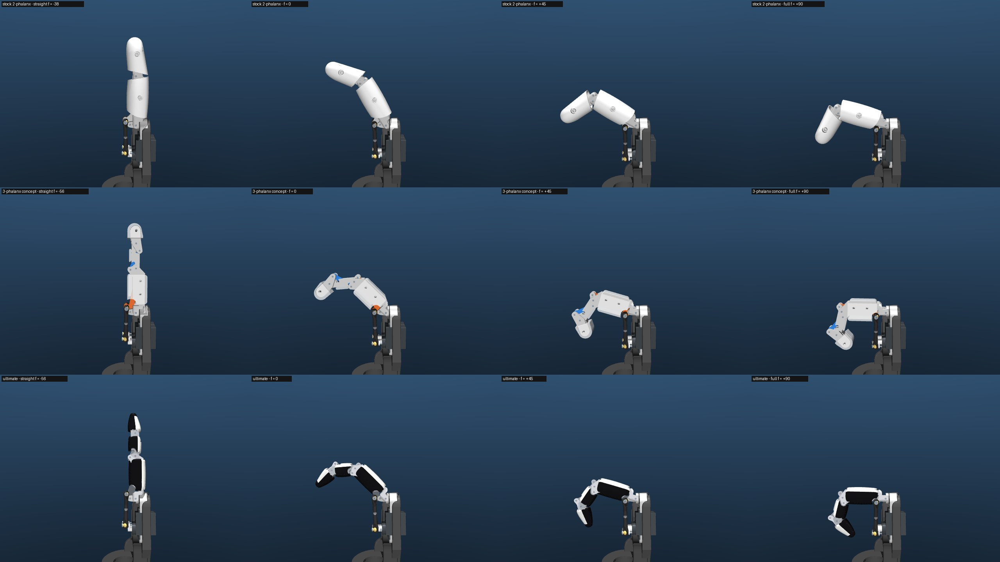

## 7. The 5-digit hand `AH_Right_5F_3S`

[build_models.py](../../../Demo/AHSimulation/ultimate_finger/build_models.py) generates [AH_Right_5F_3S/mjcf](../../../Demo/AHSimulation/AHSimulation/AH_Right_5F_3S/mjcf/) from `AH_Right_5F_Slim` (= `AH_Right_5F` with the slim finger parts, on the current **parallel 30 mm finger layout** of [layout.py](../layout.py)). Nothing is hand-edited; rerun it whenever `AH_Right_5F`/`_Slim` are regenerated.

- **Index, middle, ring**: the ultimate finger; **pinky**: the same finger with its phalanges scaled ×0.88 (`--pinky-scale`, meshes `ufpk_*`, CAD `*_S088`); **thumb**: the slim-finger thumb cores with covers in the same style. White back shells (`uf_shell`), black gloves (`uf_pad`, rgba 0.07 0.07 0.08), grey links (`uf_link`, `uf_coupler`).
- Same layout as `AH_Right_5F/mjcf`: `robot.xml` (root body and its `Part …` comments untouched, actuator names and order `finger1_motor1 … finger5_motor2` kept, the stock joint names `passive4 (N)`/`passive_5 (N)` reused for P2/P1, plus `coupler_a (N)` and `dip (N)`), `keyframes.xml` regenerated by settling at ctrl = 0, `scene.xml` with the finger targets moved onto the tips at the keyframe, `scene_shells.xml` with the palm/back shells and palm pad of `cad/five_finger/stl` (white shells, black pad; `--shells DIR` to use others), and a **self-contained `assets/`** (every mesh copied, all finger geoms are meshes, so `make_5f_shells.py --model AH_Right_5F_3S` and `build_wrist_model.py --hand AH_Right_5F_3S` can use it as is).
- 55 bodies, 48 joints, nq 93, 10 actuators, 29 loop closures.

### Verification ([verify_hand.txt](../../../Demo/AHSimulation/ultimate_finger/reports/verify_hand.txt))

[verify_hand.py](../../../Demo/AHSimulation/ultimate_finger/verify_hand.py) imports `five_finger/verify_5f_model.py` unchanged.

- **Structure**: names unique, every ctrlrange ±90°, keyframe loop error 0.0001 mm, mocap targets on the tips.
- **Every ultimate finger of the hand moves like the standalone model**: tip within 0.083 mm at 6 commands.
- **Shorter pinky**: the linkage closes over the whole travel (planar check and sim, loop error ≤ 0.0015 mm settled). At f = +90: MCP 87.8, PIP 79.7, DIP 54.7° (ring 88.8 / 78.1 / 54.4); straight at the same f = −56°. The tip site is 10.9 mm closer to its finger frame (87.6 vs 98.5 mm, straight).
- **Stability**: each actuator alone, all range corners, the demo poses twice, 60 abrupt random full-range steps: no NaN, no warnings; loop error settled ≤ 0.006 mm, transient ≤ 0.93 mm (the thumb's stock closure, as in the stock model); motors settle within 0.25°.
- **Neighbouring fingers**, 9 × 9 grid per digit, all 6561 pose pairs, touching = sampled distance < 0.225 mm. The finger layout changed under this work (fanned → parallel at 30 mm), so the stock-finger baseline was re-measured on the same layout ([baseline_AH_Right_5F.txt](../../../Demo/AHSimulation/ultimate_finger/reports/baseline_AH_Right_5F.txt)):

| Pair | Stock fingers, old fanned layout | Stock fingers, parallel 30 mm layout | **Ultimate fingers, parallel 30 mm** |
|---|---|---|---|
| ring / pinky | 887 | 1751 | **962** (was 952) |
| middle / ring | 887 | 1706 | **871** (was 869) |
| index / middle | 973 | 1656 | **763** (was 808) |
| thumb / ring, thumb / pinky | > 5 mm | > 5 mm | > 5 mm |

  The thin fingers halve the contacts on the tighter layout. The wider capsules (16.9 / 15.9 mm) and the longer fingertips change them little: +1 % on ring/pinky and middle/ring, −6 % on index/middle (the slimmer fingertip). The unstyled thin finger had 880 / 784 / 734. Ring/pinky contact needs the two fingers abducted towards each other (4/456 pairs at c = −22.5°, 15/489 at c = 0, 73/375 at c = +45°; c = a_pinky − a_ring); it is mostly proximal cover against proximal cover, and the ring's Link ball-stud screw against the pinky's cover.
- **Digits vs the final palm plate** ([cb16aff](../layout.py)). The moving parts of every digit were checked against the plate and the wrist interface on the 9 × 9 grid (section 5b of the report):
  - No contact in any of the 81 poses, for every digit.
  - Closest approach 0.40 mm: the gimbal screw's washer at full hyperextension, the same feature as on the stock thumb.
  - On the same plate, stock fingers touch it in 7–9 of 81 poses and slim fingers in 3–4 (`five_finger/reports/verify_AH_Right_5F[_Slim].txt`).
- **Palm and back shells** (`cad/five_finger/stl`: Top_Shell, Palm_Shell, Palm_Pad_Palm), 13 × 13 grid per digit ([verify_hand_shells.txt](../../../Demo/AHSimulation/ultimate_finger/reports/verify_hand_shells.txt); `five_finger/check_shells.py --model AH_Right_5F_3S --shells 5f --grid 13` gives the same):
  - **The shells the coordinator regenerated against this hand** (14:45): no moving part touches them. Closest: pinky fingertip glove 1.50 mm, index fingertip 2.01 mm, thumb proximal glove 2.61 mm, middle / ring 2.97 / 2.91 mm, palm pad ≥ 4.04 mm.
  - Before that regeneration, the shells fitted to the previous covers were touched by the longer pinky fingertip in a full fist: 3 of 169 poses, (+75, −90), (+90, −90) and (+90, −75), 0.02 mm sampled. The thumb's proximal glove came to 0.71 mm.
  - The plate and wrist interface sit in the shell's lap joint by design.

### Poses

The demo poses of `verify_5f_model.py` are re-mapped for the new fingers:
- Flexion is rescaled from [stock straight −37.5°, 90°] to [−56°, 90°].
- Hyperextension is kept as an offset, clamped at f ≥ −60°.
- Abduction is kept, within |a| + |f| ≤ 90.

The thumb commands of CloseHand, Perfect and Pinched were then searched against the 3-phalanx index ([thumb_refine.py](../../../Demo/AHSimulation/ultimate_finger/thumb_refine.py), [thumb_poses.txt](../../../Demo/AHSimulation/ultimate_finger/reports/thumb_poses.txt)):
- A coarse 7.5° grid, then a 1.5° grid.
- Every candidate is checked with exact mesh booleans, so "touch" means touching with no interpenetration.
- This round it ran as 6 parallel shards (one per pose and index flexion), merged by `--merge`: about 65 min of wall time.

Commands are (m1, m2) in degrees for the right hand ([hand_poses.json](../../../Demo/AHSimulation/ultimate_finger/data/hand_poses.json)); f = (m1 − m2)/2, a = (m1 + m2)/2.

| Pose | index | middle | ring | pinky | thumb | every digit pair (exact booleans) |
|---|---|---|---|---|---|---|
| OpenHand | (−53.1, 53.1) | (−53.1, 53.1) | (−53.1, 53.1) | (−53.1, 53.1) | (−35, 35) | ≥ 5.0 mm |
| CloseHand | (90, −90) | (90, −90) | (90, −90) | (90, −90) | **(25.5, −48)** | thumb lies over the curled index, 0.30 mm from it, no overlap; others ≥ 5.0 mm |
| SpreadHand | (−30, 90) | (−49.7, 49.7) | (−85, 35) | (−90, 30) | (−90, −4) | ≥ 5.8 mm |
| ClenchHand | (−52.4, 42.4) | (−48.1, 58.1) | (−38.1, 68.1) | (−45.1, 61.1) | (−4, 90) | ≥ 4.0 mm |
| Index_Pointing | (−58.5, 58.5) | (90, −90) | (90, −90) | (90, −90) | (90, −90) | ≥ 6.0 mm |
| Perfect ("OK") | **(40, −20)** | (−13, 13) | (−35.9, 35.9) | (−35.9, 35.9) | **(27, −34.5)** | **pad on pad**: index and thumb fingertip pads 0.19 mm apart, no overlap; others ≥ 2.0 mm |
| Victory | (−33.5, 83.5) | (−83.5, 33.5) | (90, −90) | (90, −90) | (90, −90) | ≥ 5.9 mm |
| **Pinched** | **(10, −10)** | (90, −90) | (90, −90) | (90, −90) | **(43.5, −6)** | **pad on pad**: index and thumb fingertip pads 0.13 mm apart, no overlap; others ≥ 5.4 mm |
| **Peace** | (−26, 86) | (−86, 26) | (90, −90) | (90, −90) | (90, −90) | ≥ 5.5 mm |
| **MiddleFinger** (= Fuck) | (90, −90) | (−56, 56) | (90, −90) | (90, −90) | (22.5, −52.5) | thumb 0.36 mm from the curled index's fingertip (no touch); others ≥ 7.1 mm |

- **Peace sign.** Index and middle are straight and spread into a V: a = ±30°, as in `five_finger/hand_poses.py` (the abduction room at f = −56° is |a| ≤ 34°). Ring and pinky are fully curled.
  - The thumb **cannot fold over the ring and pinky.** Searching its whole 2-motor grid never brings its pad within 19.6 mm of the ring's middle phalanx. The thumb module sits on the index side, and its two joints swing it towards the index, not across the palm.
  - The pose therefore uses the tucked thumb (90, −90), folded into the palm on the index side.
  - Every pair is ≥ 5.5 mm apart, and the tips are 61 mm apart across the V.
- **Middle finger.** The middle finger is straight at f = −56° with no abduction; the other three are fully curled.
  - The thumb folds across the curled index and rests 0.36 mm from it (its proximal glove next to the index fingertip's back).
  - Nothing touches.
- **Pinch.** The pads meet face to face: index f = +10, a = 0, thumb (43.5, −6), pads 0.13 mm apart with no overlap.
  - With the longer fingertip the pinch moved: before, it needed index a = +10 and the thumb at (84, 30).
  - This is the "pinch fix": the re-mapped stock pinch (index curled, thumb (0, −75)) does not reach the index tip on this layout.
  - The search covers index f = 0 / 10 / 20 and a = −10 / 0 / +10. Pad-on-pad candidates within 0.10–0.18 mm were found at f = 10, 20 and 30 (a = −10 … +10); at f = 0 the pads stay 4 mm apart.
- **OK sign (Perfect).** Now **pad on pad** (0.19 mm, no overlap): index f = +30, a = +10, thumb (27, −34.5). With the shorter fingertip the tips only met cap on cap, 0.87 mm short of the pads.
  - A more curled index (f = 45) also reaches (pads 0.45 mm apart), but less squarely.
- **CloseHand.** In the stock command the thumb folds into the palm, where the 3-phalanx index tip now curls; it passes 8.8 mm through the index.
  - The searched command lays the thumb over the curled index (a fist with the thumb outside): its distal pad 0.24 mm (sampled) from the index's middle cover, the closest part its proximal glove 0.30 mm from the index fingertip.

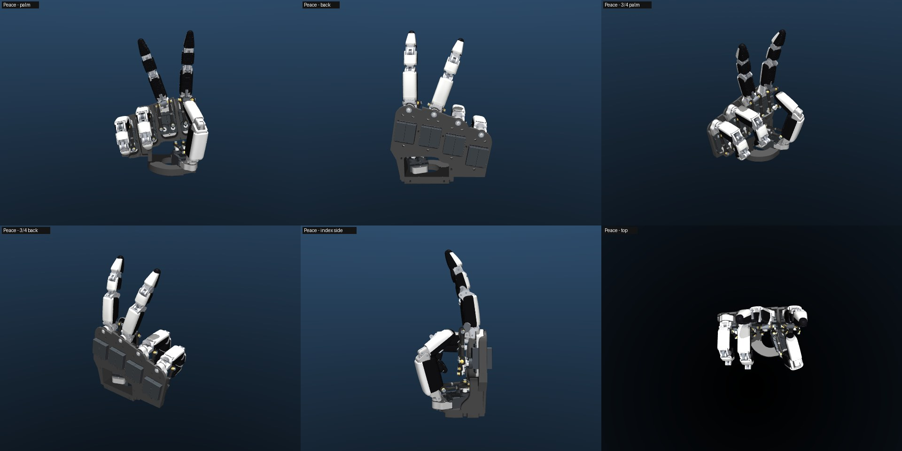

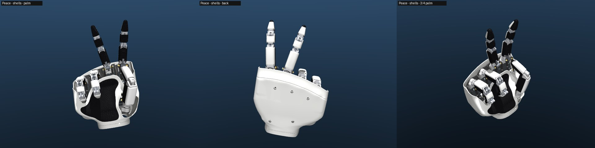

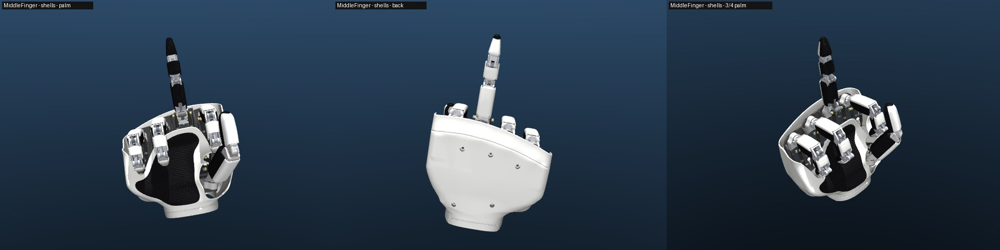

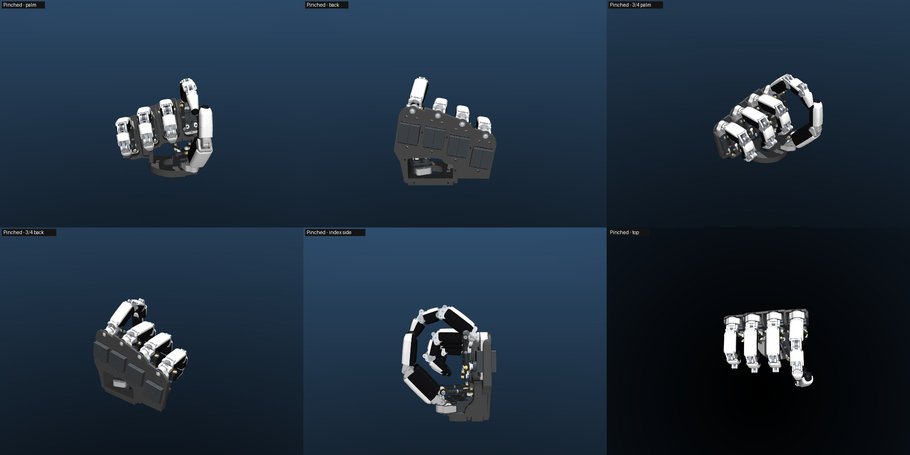


### Notes for the palm shells and the wrist

- The fingers **curl much further into the palm** than the stock ones: MCP 89° instead of 75°; at f = +90 the tip site is 54 mm from its finger frame (98.5 mm straight). The shells in `cad/five_finger/stl` are fitted to the merged sweeps of `AH_Right_5F` and this hand (coordinator). If the finger geometry changes again, refit them: `make_5f_shells.py` takes `--model AH_Right_5F_3S`, and its keep-out sweep uses every finger geom, all of which are meshes.
- The pinky is shorter (×0.88 phalanges), so its tip sweep is smaller.
- The proximal covers are 16.9 mm wide instead of 19.4 (slim) and 23.8 (stock): the openings between the fingers in the palm shell can follow the thinner fingers.
- Moving mass per finger 19.3 g (stock 18.4 g, slim ≈ 18 g).
- Software for this hand: straight at f = −56° (not −37.5°), clamp f ≥ −60° (m1 − m2 ≥ −120°), abduction room |a| ≤ 90 − |f|, torque limit as in section 5.

## 8. BOM delta per finger (index, middle, ring, pinky), vs the stock finger

| Stock part | Ultimate finger | Material |
|---|---|---|
| Link | `UF_Link` (stock base + 3.0 mm tapered arm); re-use the 2 ball studs and 2 M2×10 screws | PA-CF |
| Proximal | `UF_P1_Proximal` (stock MCP end + new 12 mm body) | PA-CF |
| Distal | `UF_P2_Middle` | PA-CF |
| – | `UF_P3_Distal` (5 mm longer tip body, trimmed to the pointed cap), `UF_L2_Coupler` | PLA / PA-CF |
| Proximal_Shell, Distal_Shell | `UF_P1_Shell`, `UF_P2_Shell`, `UF_P3_Shell`: the white backs of the three covers (the fingertip one is the nail); STL only | white TPU 82A |
| – | `UF_P1_Pad`, `UF_P2_Pad`, `UF_P3_Pad`: the black ribbed gloves on the palm half (the fingertip one wraps the end); STL only | black TPU 82A |
| 2× Ø2×16, 2× Ø2×10 pins | MCP Ø2×16 and Link pivot Ø2×10 kept; **3× Ø2×12 + 2× Ø2×8** hardened dowels (PIP, A, DIP; P4, B) | steel |
| 4× M2.5×6 shell screws | none (shells glued, flexible CA) | |

Net per finger: +2 printed rigid parts, +1 white TPU back, +3 black gloves, −1 Ø2×16, −1 Ø2×10, +3 Ø2×12, +2 Ø2×8, −4 screws. About 9.4 cm³ of rigid filament, 1.6 cm³ of white TPU (backs) and 2.7 cm³ of black TPU (gloves) per finger (pinky 8.2 / 1.3 / 2.2) (stock finger set: 12.1 + 7.0). Unchanged: servos, horns, rods, ball joints, gimbal, finger frames, bushings, plate, electronics, IDs. Pinky: the same parts with the `_S088` suffix. Thumb: the slim-finger cores; covers `Thumb_Proximal_Shell` + `Thumb_Proximal_Pad` and `Thumb_Distal_Shell` + `Thumb_Distal_Pad` (2.3 cm³ white, 3.4 cm³ black, STL only); the slim shells' screws are no longer needed. The fingertip core is printed from `stl/UF_P3_Distal.stl` (trimmed to the cap); `step/UF_P3_Distal_untrimmed.step` is the B-rep before that mesh trim.

## 9. Print and assembly notes

- **Rigid parts:** print on a side face (pin axes vertical) so pin bearing loads lie in the layer plane; 100 % infill for the Link, L2 and P2 (they are thin); 0.12–0.16 mm layers. Ream the holes with a Ø2 drill: Ø1.95 press (P1 at PIP and A, P2 at P4 and DIP, P3 at B), Ø2.15 running (P2 at PIP, P3 at DIP, Link at P4, L2 at A and B). Remove the elephant's foot on every face that runs against another part: the running gaps are 0.25 mm.
- **TPU covers (white back + black glove):** best as one two-material print per phalanx (they share a frame and meet at the seam), standing on the proximal end with the finger axis vertical. Then every rib is a horizontal ring a few layers tall, so the 0.55 mm ribs and 0.45 mm grooves come from the layer height (0.1 mm), not from the nozzle width. The end domes need light supports where they close in towards the pins; the fingertip stands on its base, point up. Printed separately, use the same orientation. The skin is 1.22–1.3 mm: 3 perimeters, no infill needed.
- **Gluing:** flexible CA between back and glove along the seam and onto the core.
- **Assembly order** (the P4 and B holes are only reachable at certain poses): P1 on the gimbal (MCP pin) → Link (pivot pin) with its arm in P1's channel → P2 into P1's fork with the PIP pin → flex P2 fully so its P4 hole clears P1's fork, press the P4 pin through P2 and the Link eye → L2 onto the A pin (through P1's fork, L2's eye and P2's slot) → P3 into P2's fork with the DIP pin → flex the DIP fully so B rises above P2's walls, press the B pin → covers last: each back and glove is open along the seam, so it goes onto its pinned core from above and below (the glove snaps over the widest line) and is glued. This sequence is untested.
- **Hard stops (recommended addition, not in the CAD):** the model has PIP/DIP stops at −25° / −22°; add small stop faces on P2 against P1 and on P3 against P2 there. See risks.

## 10. Risks and open points

- **PIP 78° / DIP 54°**, not the human 100° / 70°. The six-bar study shows how to get there (section 2) at the cost of width, parts and play.
- **Strength in deep flexion**: above f ≈ +45 the servos can out-push the parts; the torque limit alone does not cover the last 45° (section 5). Not load-tested.
- **Loop-2 branch point.** The DIP coupler's four-bar has a second assembly branch, reached at PIP ≈ −27° (the design never goes below −21°). In the simulation, abrupt full-range command steps let the soft closures overshoot and flip loop 2 (DIP ≈ −72°) until PIP/DIP stops were added to the model. A rigid printed linkage cannot reach −27°, but play and a hard knock could; add the stop faces above.
- **Print tolerance**: 0.25 mm running gaps, 1.95/2.15 holes, 1.5 mm boss walls and a 1.75 mm press-fit length per fork wall. Expect one or two fit iterations; first print a P1/P2/pin set.
- **TPU fit and retention**: the covers are glued, not screwed; their min clearance to the core is 0.18–0.26 mm (0.25 nominal). Not printed.
- **Covers.**
  - **Capsules, not spindles.** The reference segments narrow towards both joints; ours keep a constant section between the domed ends. The 12 × 12 mm box cores run the full length of P1 and P2, and the fitted section touches them along the whole shaft. Tapered core shafts (P1's is 12.3 mm deep, as tall as the stock Proximal; its bending stress is 0.2 MPa per 5 N, so there is room) would allow a real spindle; that changes the cores and was left out of this round.
  - **P1 is still a little deeper than wide** (16.9 × 19.4 mm; P2 is now 15.9 × 15.3).
  - **STL only.** They are implicit solids (0.12 mm voxels, ≤ 190 000 faces); there is no B-rep to edit. Change them through `uf_covers.py` and rebuild.
  - The 0.55 mm ribs and 0.45 mm grooves need the axis-vertical print (section 9) to come out crisp.
  - The seam between back and glove is a glue line; it may need a fillet of glue or a two-material print to stay closed under bending.
- **Palm shells**: they must follow the finger geometry. The shells fitted to the previous covers were touched by the longer pinky fingertip in a full fist; the ones regenerated against this hand clear every digit by ≥ 1.50 mm (section 7). Refit them whenever the covers change again.
- **Fingertip core trim**: the P3 core's tip body is trimmed to the cap cavity minus 0.30 mm from y = 78 (DIP + 5) by a mesh boolean against the cover's own cavity: 2330 → 1760 mm³, because the pointed cap is much slimmer than the 9.5 mm core body. It is exact (0 mm³ overlap) but exists only as an STL; the STEP `UF_P3_Distal_untrimmed` is the core before this trim.
- **Pin play**: 7 finger pins + 2 rods; ±2.5° PIP and ±3° DIP play with 0.05 mm radial play per pin (six-bar study).
- **Not verified**: anything physical (printing, fit, friction, wear, strength), contact/grasp simulation (all geoms are visual), the left hand, the wrist on this model (coordinator).

## 11. Shorter pinky (×0.88)

The finger is parametric in its phalanx lengths: `make_ultimate_finger.py --scale s` scales P1, P2 and P3 and keeps everything at the knuckles: the MCP interface, the drive, the Link base and the crank offsets of both four-bars (P4, A, B relative to the PIP and DIP). The Link arm and L2 shorten with the phalanges. The whole CAD, the covers and the checks are regenerated ([report_cad_S088.txt](report_cad_S088.txt), [design_S088.json](design_S088.json)).

| Scale | P1 / P2 / P3 (mm) | Assembles over the whole travel | Straight at | MCP / PIP / DIP at f = +90 | Min transmission (flexion / whole travel) |
|---|---|---|---|---|---|
| 1.00 | 47.0 / 26.0 / 18.8 | yes | −56° | 88.8 / 78.1 / 54.4 | 47° / 25° |
| 0.90 | 42.3 / 23.4 / 17.0 | yes | −56° | 88.0 / 79.4 / 54.6 | 47° / 25° |
| **0.88 (built)** | 41.4 / 22.9 / 16.6 | yes | −56° | 87.8 / 79.7 / 54.7 (sim) | 47° / 25° |
| 0.85 | 40.0 / 22.1 / 16.0 | yes | −56° | 87.5 / 80.2 / 54.8 | 47° / 26° |

(planar, from the same drive map; 0.88 confirmed in the hand model, loop error ≤ 0.0015 mm settled). The linkage closes and keeps its range: shorter cranks-to-length ratios even add 1–2° of PIP. The pinky's fingertip (×0.88 of the 5 mm longer tip too) is 22.0 mm from its DIP pin to its end, and its tip site is 10.9 mm closer to its finger frame than the ring's (87.6 vs 98.5 mm, straight). Widths are unchanged (16.9 / 15.9 / 13.3 mm), so the pinky looks like a smaller copy. Same straight command and calibration as the other fingers.

## 12. Reproduce

Run from the repo root. The CAD build peaks at about 6.6 GB and the pinky build at 4.3 GB; the two can run in parallel, as can `verify_finger.py` next to `verify_hand.py`. `AH_Right_5F_3S` is rebuilt by the first three lines:

```bash
.venv/bin/python cad/five_finger/ultimate_finger/make_ultimate_finger.py                          # ~14 min: STEP (rigid) / STL, implicit covers, checks, figures
.venv/bin/python cad/five_finger/ultimate_finger/make_ultimate_finger.py --scale 0.88 --no-figures # ~5 min: the pinky
.venv/bin/python Demo/AHSimulation/ultimate_finger/build_models.py                                 # model/finger_uf.xml + AH_Right_5F_3S (--shells DIR: palm shells, default cad/five_finger/stl)
cd Demo/AHSimulation/ultimate_finger
../../../.venv/bin/python verify_finger.py          # ~11 min, reports/verify_finger.txt, figures/strength.png
../../../.venv/bin/python verify_hand.py --keep-pinch   # ~80 min, reports/verify_hand.txt; writes data/hand_poses.json after its pose section (~60 min)
../../../.venv/bin/python thumb_refine.py           # ~90 min in one process, reports/thumb_poses.txt (thumb commands of CloseHand, Perfect, Pinched)
# or, once data/hand_poses.json is written: 6 shards in parallel (~0.8 GB each), then the merge
for s in "CloseHand" "Perfect --index-f 30" "Perfect --index-f 45" "Pinched --index-f 0" "Pinched --index-f 10" "Pinched --index-f 20"; do
  ../../../.venv/bin/python thumb_refine.py --poses $s --part /tmp/thumb_parts & done; wait
../../../.venv/bin/python thumb_refine.py --merge /tmp/thumb_parts
../../../.venv/bin/python verify_hand.py --only-plate    # ~1 min, reports/verify_hand_plate.txt
../../../.venv/bin/python verify_hand.py --only-shells   # ~2 min, reports/verify_hand_shells.txt (cad/five_finger/stl, or --shells DIR)
../../../.venv/bin/python baseline_neighbours.py --model AH_Right_5F   # stock-finger baseline on the same layout
../../../.venv/bin/python render.py --shells        # renders/ (hand_<pose>_shells.jpg with the palm shells)
../../../.venv/bin/python sixbar/sixbar_study.py    # the six-bar stretch study (planar)
```

View the hand:

```bash
.venv/bin/python -m mujoco.viewer --mjcf=Demo/AHSimulation/AHSimulation/AH_Right_5F_3S/mjcf/scene_shells.xml   # or scene.xml without the shells
```

## 13. Files

| Path | Contents |
|---|---|
| [make_ultimate_finger.py](make_ultimate_finger.py) | CAD build: cores, pins, the covers of the fingers and the thumb (via `uf_covers.py`), the fingertip core trim; exports, checks, figures |
| [uf_covers.py](uf_covers.py) | implicit covers: swept distance fields, capsule outer shape, the ogive fingertip, skin, cuts (full-thickness rims, no slivers), seam, ribs, meshing |
| [uf_layout.py](uf_layout.py) | 2D layer layout and carving of the cores (bands, blanks, priorities), the motion |
| [uf_checks.py](uf_checks.py), [uf_figures.py](uf_figures.py) | CAD checks (validity, watertight, pin-hole walls, thin features, widths, TPU walls, joint sweeps) and figures |
| [design.json](design.json), [design_S088.json](design_S088.json) | linkage (copied from the 3-phalanx study), layers, pins, cover parameters, parts, materials, which sim body carries which mesh |
| [step/](step/), [stl/](stl/) | `UF_Link`, `UF_P1_Proximal`, `UF_P2_Middle`, `UF_P3_Distal` (STEP: `_untrimmed`), `UF_L2_Coupler` (rigid, STEP + STL); `UF_P1/P2/P3_Shell` (white backs) and `UF_P1/P2/P3_Pad` (black gloves), STL only; pins; `Thumb_*` covers (STL only); `*_S088` = pinky. Every part one solid, every STL watertight |
| [report_cad.txt](report_cad.txt), [report_cad_S088.txt](report_cad_S088.txt) | CAD check reports |
| [figures/](figures/) | `assembly`, `exploded`, `sections`, `width_profile`, `layers`, `side_poses`, `strength` |
| [Demo/AHSimulation/ultimate_finger/](../../../Demo/AHSimulation/ultimate_finger/) | `build_models.py`, `verify_finger.py`, `verify_hand.py`, `thumb_refine.py`, `baseline_neighbours.py`, `render.py`, `model/`, `reports/`, `renders/`, `data/hand_poses.json`, `sixbar/` |
| [AH_Right_5F_3S/mjcf/](../../../Demo/AHSimulation/AHSimulation/AH_Right_5F_3S/mjcf/) | the generated 5-digit hand |

## 14. What is verified and what is not

**Verified (CAD, MuJoCo 3.15)**, after the restyle, for the index-size finger and the ×0.88 pinky:
- Every rigid part is one valid solid; every STL (covers included) is one watertight shell.
- Pin-hole walls ≥ 1.52 mm.
- TPU skin ≥ 1.22 mm everywhere (1.27 nominal; 1st percentile 1.23–1.26, median 1.31), fingers and thumb. Cut rims are full thickness: what is thinner than 1.0 mm is only rounded rim corners, ≤ 0.27 mm deep.
- Covers 0.18–0.26 mm from their cores, never overlapping them (thumb 0.20–0.33).
- Widths 16.9 / 15.9 / 13.3 mm (limits 17 / 16 / 15), depths 19.4 / 15.3 / 15.0 mm; the fingertip tapers to 8.2 mm wide and 8.5 mm deep 4 mm before its end.
- Covers clear everything moving past them by ≥ 0.61 mm over the whole servo travel (CAD sweep; thumb ≥ 0.71), ≥ 0.61 mm in the sim's exact booleans.
- The sim matches the planar linkage within 0.4°, and the drive is unchanged.
- Stability and loop closures hold over the full range; loop 2 stays on its branch.
- No new part touches another in the working range (exact mesh booleans).
- The pin and link loads and the resulting stresses were computed.
- For the 5-digit hand: structure, stability, neighbour clearances, no contact with the final palm plate or the palm shells, and the poses above.

**Not verified:**
- Printing and fit: 0.25 mm gaps, press fits, glued covers, 0.55 mm TPU ribs.
- Friction, backlash and wear.
- Strength by test.
- Grasping with contact.
- The left hand.
- The wrist on this hand.
