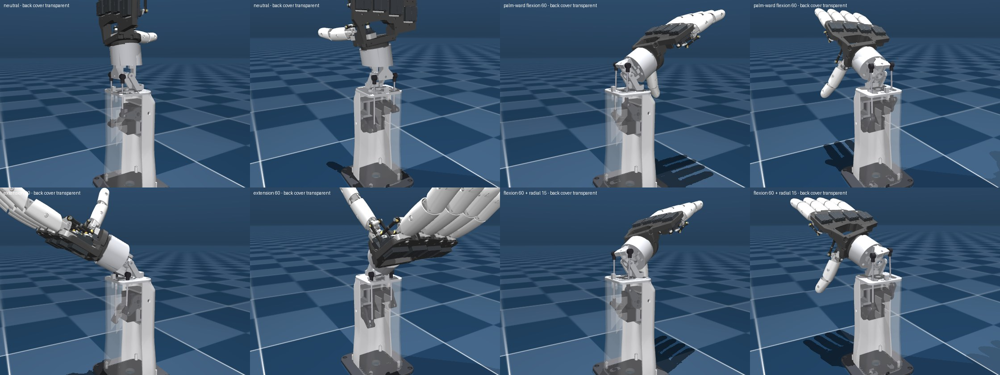
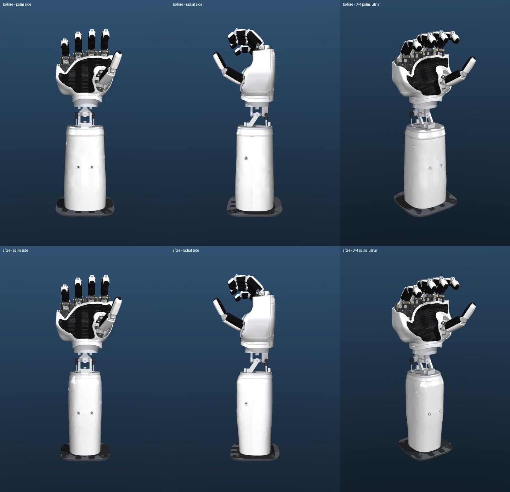
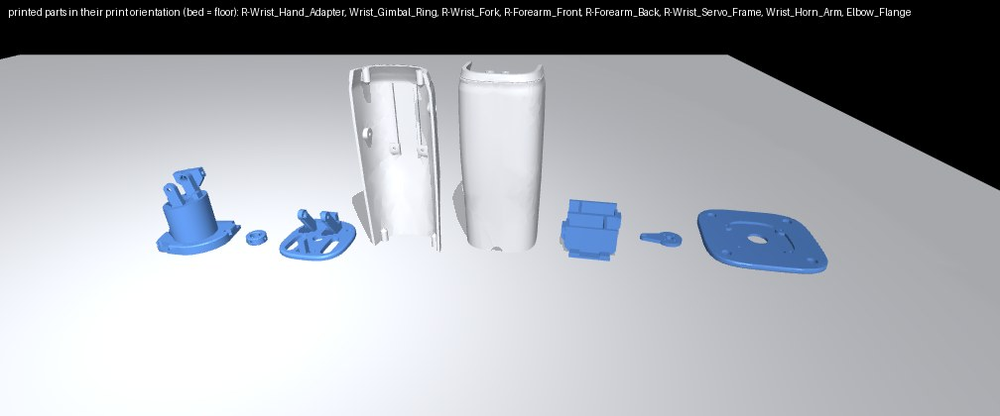

# Powered wrist and forearm base for the 5-digit AmazingHand


This adds a 2-DOF wrist (flexion/extension and radial/ulnar deviation) and a forearm base to the 5-digit hand. The hand keeps its palm plate (the thumb now mounts on it, see FIVE_FINGER.md "Thumb mount"); only the stock wrist interface is replaced, by the hand adapter, which takes over the interface's plate and continues as a Ø42 neck into the gimbal (see [Mounting the hand](#mounting-the-hand-the-adapter-replaces-the-wrist-interface)). The design is in the spirit of the Shadow hand: a slim gimbal at the wrist, the motors in the forearm, and a slim, smoothly tapered forearm shell (rounded sections that hug the parts inside, a waist and a cuff ring at the wrist) on an elbow flange.

The forearm is lined up with the middle of the four fingers, the way a human forearm lines up with the middle finger (see [Hand on the forearm](#hand-on-the-forearm)).

The wrist is driven like an AmazingHand finger. Two servos in the forearm push two rods that end behind the gimbal:

- **Flexion** comes from moving the two rods together: ≈ (m1 − m2)/2.
- **Deviation** comes from moving them against each other: ≈ (m1 + m2)/2.

Everything was designed in CadQuery, assembled in MuJoCo and checked there. **Nothing has been printed or built yet** (see [Limits](#limits-and-open-questions)).



## Files

| What | Where |
|---|---|
| Design parameters + linkage kinematics (IK/FK, Jacobian), shared by CAD, sim and control | [wrist_design.py](wrist_design.py) |
| CadQuery source: STEP + STL of every printed part, bought-part envelopes, printability / interference checks | [make_wrist.py](make_wrist.py), [step/](step/), [stl/](stl/), [stl/ref/](stl/ref/), [wrist_parts.json](wrist_parts.json), [previews/](previews/) |
| MuJoCo model (generated, do not edit) | [AH_Right_5F_Wrist/mjcf/](../../../Demo/AHSimulation/AHSimulation/AH_Right_5F_Wrist/mjcf/) |
| Generator, mass model, checks, renders | [build_wrist_model.py](../../../Demo/AHSimulation/wrist/build_wrist_model.py), [hand_mass_model.py](../../../Demo/AHSimulation/wrist/hand_mass_model.py), [verify_wrist_model.py](../../../Demo/AHSimulation/wrist/verify_wrist_model.py), [check_thumb_rule.py](../../../Demo/AHSimulation/wrist/check_thumb_rule.py), [render_wrist_model.py](../../../Demo/AHSimulation/wrist/render_wrist_model.py), [render_forearm_before_after.py](../../../Demo/AHSimulation/wrist/render_forearm_before_after.py), [render_heel_before_after.py](../../../Demo/AHSimulation/wrist/render_heel_before_after.py), [wrist_sim.py](../../../Demo/AHSimulation/wrist/wrist_sim.py) |
| Reports and renders | [reports/](../../../Demo/AHSimulation/wrist/reports/), [renders/](../../../Demo/AHSimulation/wrist/renders/) |
| Control code: AHControl patch + TOML, Python demo | [control/](../../../Demo/AHSimulation/wrist/control/) |

The STEP/STL files are in mm, in the hand's CAD part-studio frame (x from index to pinky, y along the fingers, z towards the back), at the neutral wrist pose. In that frame the forearm parts are turned 10.5° about z (see [Hand on the forearm](#hand-on-the-forearm)). Each part prints as exported, in the orientation listed under [Printing](#printing). The `L-*` files are the left-hand versions: the `R-*` parts mirrored about x = −50 mm, the same rule that maps the stock R parts onto the L parts. The ring, horn arm and elbow flange are their own mirror images. There is no left-hand sim model. The STLs are meshed with an absolute 0.01 mm chordal deflection (`make_wrist.export_stl`), so every one is within 0.02 mm of its STEP and can be printed as is.

## View it

```bash
.venv/bin/python -m mujoco.viewer --mjcf=Demo/AHSimulation/AHSimulation/AH_Right_5F_Wrist/mjcf/scene_shells.xml
.venv/bin/python -m mujoco.viewer --mjcf=Demo/AHSimulation/AHSimulation/AH_Right_5F_Wrist/mjcf/scene.xml
```

In the viewer, `wrist_motor1` / `wrist_motor2` (the last two sliders) are servo angles, not wrist angles. To pose the wrist in wrist angles, use `wrist_design.servo_ik(phi, psi)`.

Regenerate everything (from the repo root, after the 5F steps in [FIVE_FINGER.md](../../../FIVE_FINGER.md)):

```bash
.venv/bin/python cad/five_finger/wrist/make_wrist.py                     # CAD + checks  (~70 s)
.venv/bin/python cad/five_finger/make_5f_shells.py                       # palm shells   (~2 min; they fit the adapter and the wrist cut)
.venv/bin/python Demo/AHSimulation/five_finger/build_5f_model.py          # copies the shells and the adapter's interface plate into AH_Right_5F
.venv/bin/python Demo/AHSimulation/five_finger/build_5f_model.py --side left   # ... and into AH_Left_5F
.venv/bin/python Demo/AHSimulation/slim_fingers/build_slim_model.py       # AH_Right_5F_Slim (uses AH_Right_5F's palm meshes)
.venv/bin/python Demo/AHSimulation/ultimate_finger/build_models.py --no-finger   # AH_Right_5F_3S (copies them again)
.venv/bin/python Demo/AHSimulation/wrist/build_wrist_model.py --keyframe   # MJCF          (~15 s)
.venv/bin/python Demo/AHSimulation/wrist/build_wrist_model.py --hand AH_Right_5F_Slim --keyframe   # slim-finger variant
.venv/bin/python Demo/AHSimulation/wrist/build_wrist_model.py --hand AH_Right_5F_3S --keyframe     # 3-phalanx variant
.venv/bin/python Demo/AHSimulation/wrist/verify_wrist_model.py             # checks        (~5 min)
.venv/bin/python Demo/AHSimulation/wrist/verify_wrist_model.py --model AH_Right_5F_3S_Wrist
.venv/bin/python Demo/AHSimulation/wrist/check_thumb_rule.py               # thumb map     (~1 min)
.venv/bin/python Demo/AHSimulation/wrist/render_wrist_model.py             # renders       (~2 min)
.venv/bin/python Demo/AHSimulation/wrist/render_forearm_before_after.py --before-rev <rev> --model AH_Right_5F_3S_Wrist \
    --out Demo/AHSimulation/five_finger/renders/before_after_forearm_slim.jpg      # forearm vs an older revision
.venv/bin/python Demo/AHSimulation/wrist/render_heel_before_after.py   # heel: stock interface + d56 adapter (ff5a133) vs the d42 neck
```

## Architecture and why

```
 hand: palm plate legs ══ 4 screws ══ R-Wrist_Hand_Adapter (the stock interface's plate without the thumb seat + a d42 neck)
                                                                 │  deviation axis (z), F683ZZ + d3 pins
                                                          Wrist_Gimbal_Ring (d11 cable bore)
                                                                 │  flexion axis (x), F683ZZ + d3 pins
 forearm:  R-Wrist_Fork (cap + fork) ── R-Forearm_Front / R-Forearm_Back ── Elbow_Flange ── stand
              2 x STS3215 in R-Wrist_Servo_Frame ── horn arms (r 26) ── M3 push rods ── lever bar on the adapter
```

### Hand on the forearm

The stock AmazingHand fans its fingers towards the pinky side. The index points straight along the hand plate's y axis, and each next finger is turned 7.5° further out (measured: 0.3°, 6.3°, 13.8° and 21.3°). The stock wrist interface is centred under the index and middle fingers. With a fourth finger added, a forearm on that interface would sit about 24 mm towards the index from the middle of the fingers, and the hand would lean about 11° towards the pinky. That makes the pinky look stuck on.

So the wrist frame W is turned instead:

- **Angle.** The forearm axis (W y) is turned **10.5°** from CAD y towards the pinky (`wrist_design.HAND_YAW`). That is the mean finger direction, so the fingers fan symmetrically about the forearm: index −10.2°, middle −4.2°, ring +3.3° and pinky +10.8°.
- **Position.** The axis passes through the centroid of the four knuckle pivots, CAD (48.32, −13.82) mm (`KNUCKLE_CENTRE`; `build_wrist_model.py` checks it against the hand model). That is between the middle and ring knuckles, like the human middle-finger axis.
- **Knuckle arc.** Measured along the forearm, the index and middle knuckles are level and the ring is 4.9 mm lower. The pinky is 14.2 mm lower, which is the human pattern.

**The hand adapter takes up the angle.** The adapter's interface plate sits on the palm plate's legs (CAD axes), and its neck's underside and everything below it are in W. So the neck is a wedge: its Ø42 cylinder runs along the interface axis (CAD y) from the plate down to the W plane 18.5 mm above C, about 35 mm long at the radial side and 43 mm at the ulnar side.

**Longer palm.** The wrist sits `PALM_EXT` = 20 mm further from the hand than the adapter needs, and the palm shells reach down to it. The thumb therefore sits higher above the wrist, as on a human hand: palm length (knuckle centroid to the shell's wrist edge) is 113 mm for an 87 mm finger, a ratio of 0.77, as in a human hand. The adapter's neck is hollow to keep it light: a 4 mm wall and a 45° conical roof down to the cable bore, so it prints plate-down without supports. As a side effect, the thumb no longer reaches the forearm at any wrist angle, so the thumb interlock is gone (see [Verification](#verification)). The gimbal, rods, servos and forearm are unchanged, only turned. Every part is generated in W and placed with `x_cad = C + R_W2CAD · x_w`. The sim stands the forearm upright (`WORLD_QUAT`), so there the hand leans 10.5° instead.

### Gimbal

The gimbal is a ring Cardan joint. Its two axes cross at the wrist centre C, CAD (22.58, −152.69, −11.5) mm. That is on the forearm axis, `PALM_EXT` below the highest point the adapter wedge allows: the adapter's underside is 18.5 mm above C, as at zero yaw.

- **Flexion axis (proximal).** The axis is along W x. The fork on the forearm carries it. Flexion is the large motion (±60°), and putting its fork at the sides lets the hand swing without meeting a fork arm.
- **Deviation axis (distal).** The axis is along W z (= CAD z). The hand adapter's front and back lugs carry it.
- **Cable path.** The ring has an 11 mm bore. The hand's bus cable runs through the adapter: the interface plate's 34 mm bore, the neck and its Ø18 bore (on the interface axis, which passes 2 mm from the gimbal centre), then the ring and the fork cap, then down the back of the forearm. It crosses the wrist on both axes, so it barely changes length.
- **Bearings.** Each of the four pins is a 3 mm dowel pressed into the ring. It turns in an F683ZZ flanged bearing in the outer lug.

The gimbal is deliberately compact: everything on the flexion axis stays inside |x| < 16 mm. At the palm-ward + deviation corners, a push rod (at |x| ≈ 19–21 mm) comes close to the flexion axis: 2.5 mm on the full ±60 × ±25° rectangle and 5.4 mm on the operating ROM. At the stop corners it crosses the axis. My first, larger gimbal (Ø34 ring, F684 bearings, lugs at |x| 17.5–24.5) was hit there by the rods at 11 of 143 ROM poses. `verify_wrist_model.py` reports this rod-to-axis distance and the clearance to the compact fork lugs: 3.6 mm on the ROM, 1.7 mm at the stops. See [Verification](#verification).

### Drive

The drive uses two parallel push rods. Each Feetech STS3215 in the forearm turns a 26 mm horn arm in a vertical plane: the servo axis is along x and the horn faces outwards. The arm pushes an M3 rod with a ball link at each end. The rods end on ball studs at the ends of a lever bar behind the gimbal, on the hand adapter:

- the bar's stud balls sit at (x, y, z) = (±21, 0, 21.25) mm from C;
- 21.25 mm is the flexion lever and 21 mm the deviation lever;
- the rod lengths between ball centres are 66.0 mm (motor1) and 96.0 mm (motor2).

Every ball stud points along x. All the arm's out-of-plane rod tilt is therefore about the stud axes. The bottom ball links see ≤ 1.7° of misalignment and the top ones ≤ 26.7°, which comes from the deviation itself.

**Parallel, not serial.** I chose a parallel two-servo drive over a serial gimbal with one servo on each axis because:

1. **Both servos share every load.** Per N·m at the joint, each servo needs 0.61 N·m (flexion) or 0.62 N·m (deviation) at the neutral pose. That rises to at most 1.02 (flexion) or 1.18 (deviation) at the corners of the operating ROM. In a serial gimbal one servo always carries the whole axis, and the distal servo also rides on the proximal one.
2. **Looks and inertia.** The 55 g servos sit in the forearm. Only the adapter's neck + ring (≈ 43 g) and the 11 g of rods move with the hand besides the hand itself, and the wrist stays a slim Ø42 neck, as on the Shadow hand.
3. **Same principle as the AmazingHand finger.** The finger is also a two-servo parallel drive with ball-jointed rods, and the motor sign convention is the finger's: motor1 = ulnar (pinky-side) servo, motor2 = radial (index-side) servo; palm-ward flexion is (+, −) like CloseHand, and radial deviation is (+, +) like abducting toward the index.
4. **Cost.** The control is coupled, so it needs the IK in [wrist_design.py](wrist_design.py) (closed form, about 20 lines). The leverage also drops at the combined corners.

**Linearisation at the neutral pose.**

- flexion ≈ 1.224 · (m1 − m2)/2
- radial deviation ≈ 1.238 · (m1 + m2)/2

The wrist moves about 1.2× faster than the servos.

**Servo packaging.** The servo bodies lie lengthwise, front to back (gear end towards the back), and are stacked 30 mm apart (motor1 upper at y = −66, motor2 lower at y = −96 mm from C). The arm studs point inwards. The two arms then work in separate planes on opposite sides, and neither rod passes the other servo. One printed frame holds both servos.

### Range of motion

The operating ROM is coupled, like a human wrist. `wrist_design.clamp_wrist()` enforces it, and every command should go through it.

| | |
|---|---|
| flexion / extension | −60 … +60° |
| radial / ulnar deviation | ±25° up to ±40° of flexion, tapering linearly to ±15° at ±60° |
| servo angles needed | ≤ 54.9° (ctrlrange ±75°) |
| hard stops | flexion ≈ ±66°: the rim of the adapter's neck lands on two pads on the fork cap. Deviation ≈ ±31°: two pads under the neck land on the fork's bearing bosses. The sim joint limits are ±65 / ±30°. |

The linkage alone could do the full ±60 × ±25° rectangle. Towards its last corners, though, a push rod dips onto its own servo's gear-end envelope: at |flexion| ≥ 50° with |deviation| = 25°, and within 0.1 mm at (±60°, ±20°). Hence the taper, which keeps ≥ 1.4 mm.

### Forearm pronation / supination (3rd DOF)

I recommend against it for this build:

- **It would be heavy.** It would need a roll stage under the elbow flange (a third STS3215 with a crossed-roller or lazy-susan bearing) that carries the whole forearm + hand (≈ 0.95 kg) off-axis.
- **Cabling gets harder.** It needs either a slip ring or a ±180° cable loop for the 10 A hand supply and the bus.
- **Little gain on a fixed stand.** Most robot arms that would carry this (e.g. SO-100, Reachy) already have a wrist roll.

If needed, the elbow flange (4 × M5 on an 80 mm square, Ø20 centre hole) is the interface where a roll module would go. It is not designed here.

## Servo choice and torque budget

**Mass model** ([hand_mass_model.py](../../../Demo/AHSimulation/wrist/hand_mass_model.py)). Every hand mesh is integrated (trimesh) with a material density:

- PLA 1.15 g/cm³;
- TPU 1.10 g/cm³;
- steel 7.85 g/cm³;
- igus bushings 1.46 g/cm³;
- SCS0009 13.2 g each;
- +30 g of unmodelled screws and cables.

The PLA value is **calibrated**: the same model gives the stock hand (AH_Right + stock shells) 397 g, against the 400 g in the README. With 1.00 g/cm³ it would be 375 g.

Results:

- **5-digit hand with shells and pad:** 498 g (with the adapter's interface plate, 25.5 g, and the thumb's unit on the palm plate), CoM 109–118 mm from the wrist centre (CloseHand to OpenHand).
- **Everything the wrist moves:** the adapter's neck and the ring (with pins, bearings, studs and screws) add 43 g, for 541 g with the CoM 108 mm from C (64 g and 556 g with the Ø56 adapter and the stock thumb mount). The rods weigh 4.8 / 6.4 g.
- **Payload case:** 200 g placed at the OpenHand fingertip centroid of index…pinky, 227 mm from C.
- **Inertia about the axes:** 0.0080 / 0.0083 kg·m² (flexion / deviation), and 0.0183 / 0.0186 kg·m² with the payload.

**Static torque per servo**, over the whole operating ROM, for six ways of mounting the forearm. The sim (servo outer loop settled) matches the analytic Jacobian model to within 0.08 N·m.

| load | worst pose / mounting | worst per-servo torque | neutral wrist, worst mounting |
|---|---|---|---|
| hand only | (−60°, −15°), forearm horizontal, thumb up/down | **0.69 N·m** | 0.34 N·m |
| hand + 200 g at the fingertips | (−60°, −15°), forearm horizontal, thumb up/down | **1.20 N·m** | 0.62 N·m |

**The same worst case as a share of each candidate servo:**

| servo | stall | hand only | + 200 g |
|---|---|---|---|
| STS3215 C001 (7.4 V version) on the hand's 6 V rail | 1.62 N·m | 43 % | 74 % |
| STS3215 C001 at 7.4 V | 1.91 N·m | 36 % | 63 % |
| **STS3215 C018 (12 V version)**, chosen | **2.94 N·m** | **24 %** | **41 %** |
| STS3250 at 12 V | 4.9 N·m | 14 % | 24 % |

**Dynamic** (sim, minimum-jerk moves, C018 servo model, forearm horizontal palm-down / vertical hand-up):

- **±60° flexion sweep in 2.0 s:** ≤ 1.51 N·m peak (51 % of stall).
- **Same sweep in 1.2 s:** ≤ 2.14 N·m (73 %).
- **Same sweep in 0.8 s:** reaches the torque limit for 302 ms with the payload; tracking error 17.1°.
- **±25° deviation sweep in 0.6 s:** ≤ 2.27 N·m (77 %).

Most of the dynamic torque is the motor's own back-EMF / gear damping at speed. Inertia × acceleration is small: 0.37 N·m at 20 rad/s² even with the payload. So the realistic speed limit is about one full flexion sweep per ~1.2 s.

**Decision: 2 × Feetech STS3215 C018 (12 V, 30 kg·cm, 1:345, magnetic encoder, 55 g).** With the 200 g payload, in the worst pose and mounting, it runs at ≈ 41 % of stall, i.e. 1.2× its rated torque: fine in passing, but for holding a payload at full extension for minutes the STS3250 (same size) is the safer choice. That leaves a 3× margin to stall for dynamics. The 7.4 V C001 on the hand's 6 V rail would carry the hand alone everywhere (≤ 43 %), but not the payload at the extremes (≈ 74 % of stall continuously).

Same size, same 25T horn, same protocol and registers: a C001 drops in for hand-only use with no CAD change. The sim uses the `sts3215_345` values that Pollen identified for the Open Duck Mini (kp 17.11 N·m/rad, damping 0.56, armature 0.027, frictionloss 0.068), with the force limit set to the datasheet stall of 2.94 N·m.

**Position sag.** A Feetech servo is a P controller. With the hand up and the wrist at 60°, its compliance plus the linkage gain let the wrist sag 2.2–4.0° from the command. The controller should therefore run a small outer loop on the servo angles (read `present_position`, nudge `goal_position` by 0.1 × error at 20–50 Hz). In the sim this brings every ROM pose to within 0.06° of the command. Do not run that loop faster than the servo's own ~3 Hz position loop: a gain of 0.4 at 50 Hz oscillated in the sim.

## Mounting the hand: the adapter replaces the wrist interface

The stock `R-Wrist_Interface` (a 67 × 56 mm plate under the palm plate, a Ø49 / Ø34 ring spigot below it with a 6 × Ø2.4 robot-mount pattern on a 42 mm circle) set the size of the heel: a Ø56 adapter flange had to bolt to its spigot. `R-Wrist_Hand_Adapter` now replaces it and is one printed part:

- **Interface plate** (CAD y −85 … −95): the stock interface's plate, cut from `R-Wrist_Interface.step` at its underside (`MOUNT_Y`) and unchanged where the hand uses it:
  - the four palm-plate leg screws (the stock 2.5 × 6 thermoplastic screws, from below into the legs at x = −6 / 55, z = −7.5 / 10.5);
  - the two back-shell screw holes (re-drilled flat-bottomed).

  The stock thumb's seat (its finger frames' seat and screws, the thumb servo pockets and window, the bushing recess) is gone: the thumb is re-mounted on the palm plate ([FIVE_FINGER.md, Thumb mount](../../../FIVE_FINGER.md#thumb-mount-a-thinner-thenar)), so `remove_thumb_seat()` fills the pockets and holes solid (outside the bore) and trims the plate below to CAD z = −33, the depth of the Ø42 neck: the plate no longer reaches down to z = −40.3 at the heel. With `layout.THUMB_MOUNT = "stock"` the plate keeps the seat, and the hand keeps exactly the stock interface's clearances (finger frames seated, thumb servos 0.08 mm, thumb pivot washer 0.40 mm over a 7 × 7 grid of the thumb's motors).

  The unused robot-mount and robot-plate pilot holes are filled.
- **Neck** (`ADAPTER_R` = 21 mm, Ø42): a hollow cylinder on the interface axis from the plate down to the gimbal, with the deviation lugs, the lever bar and the deviation-stop pads under it. Above the bar the back lug block steps in at 50°, so everything prints on the neck's footprint. The gussets over the bar are trimmed to 26.5 mm from C, and the fork's flexion-stop pads start 27.5 mm from the flexion axis, so in extension only the neck's rim reaches the back pad, deviated or not.

The neck is 7 mm inside the old Ø56 flange all round. Below the interface plate (W y < 51) the parts the palm shell encloses at the heel now span u = W x −28.3 … +19.9 and CAD z −32.5 … +9.5 (Ø42), against −34.8 … +27.0 and −39.5 … +16.5 before (Ø56). Above W y ≈ 51 the interface plate (without the thumb seat) spans u down to −42.9 and CAD z −33.4 … +15.6 (with the stock thumb seat: −40.1 … +15.6); the thumb's servo pack is no longer there (it sits on the palm plate's radial edge).

There is no bolted joint between the hand and the wrist any more. The hand plus 200 g hangs on the palm plate's four leg screws, as it did on the stock interface. Assembly: screw the adapter to the palm plate's legs (four screws from below, beside the neck), then fit the gimbal. The sim keeps the split: the interface plate is the hand models' root mesh (`stl/ref/R-Wrist_Hand_Adapter_palm.stl`, copied into AH_Right_5F / AH_Left_5F by `build_5f_model.py`), and the neck (`stl/ref/R-Wrist_Hand_Adapter_neck.stl`) rides on the deviation joint.

## Forearm base



- **Shape.** A slim, smoothly tapered shell, lofted through superellipse sections: |x/a|ⁿ + |(z − zₘ)/b|ⁿ = 1, with n = 2.6–3.2 and separate exponents for the palm side and the back. There are no flat faces and no square corners outside. The sizes are `wrist_design.FOREARM_KEYS`, blended along the forearm by a monotone cubic:

  | where (W y from C) | width × depth (mm) | first restyle |
  |---|---|---|
  | waist under the cap (−32) | 69 × 73 (71 × 75 over the cuff) | 86 × 82 |
  | top servo (−66) | 79 × 84 | 90 × 86 |
  | lower servo (−96) to −124 | 79 × 84 | 93 × 87 to 95 × 89 |
  | electronics bay (−170) | 76 × 78 | 100 × 92 |
  | elbow end (−215) | 74 × 74 | 98 × 90 |

  In the servo region the section hugs the parts: the horn-arm tips at the back corners ((±31, 25.7) mm at θ = 0) and the servos' horn-side palm corners ((±23.5, −40) mm). It keeps 0.25 mm more than the required clearances (1 mm for the arms, 1.25 mm for the rods, 0.25 mm for the frame). Those parts are about 62 × 68 mm, so the section is deeper than wide. Below the servos the bay tapers to the elbow. Above them the forearm waists in to the cap; the front flare is ≤ 40°, so the cavity prints standing.
- **What the layout allows** (smallest section at the servos, n ≤ 3.2; see the [options study](#forearm-layout-options)): the parts as they were need about 80 × 84.5 mm. Shorter side screw blocks and chamfered palm-side corners on the servo frame bring that to about 78 × 84, which is what is built.
- **Wrist cuff.** From the cap down to 8 mm below it, the skin stands 1 mm proud. It blends back into the forearm over 3 mm (≤ 27°, so it prints standing). A 1 mm wide, 0.5 mm deep V panel line runs round the cuff just above its lower edge; its upper flank is ≤ 45°. The fork cap has the cuff's outline and a 2.5 mm rounded top edge, so cap + cuff read as one ring.
- **Wall.** 2.5 mm (`WALL`) measured normal to the skin, also through the wrist flare: the cavity sections are inset by WALL·√(1 + slope²). The CAD distance between skin and cavity is ≥ 2.53 mm, and ≥ 3.0 mm in the cuff band. The shells are split front/back at the servos' back face (z = −10 mm from C), as before.
- **Servo mounting.** `R-Forearm_Front` holds the printed servo frame.
  - The frame's base (|x| ≤ 20.5) lies on two seat ribs and two screw pads (z = −42.5 mm). Its palm-side corners are chamfered at 51°, clear of the servos.
  - Its side blocks end at |x| = 30.5, just outside the horn arms, and face two d12 bosses on the side walls.
  - It is held by 4 countersunk M3×8: 2 through the palm side and 2 through the side walls, into heat-set inserts. The heads seat in d7.5 teardrop spot faces, 1.5–2.9 mm (palm side) and 1.2–3.0 mm (sides) below the curved skin.
  - `R-Forearm_Back` is a cover. Four 50° struts from its back wall keep the servos seated in the frame.
- **Fork.** `R-Wrist_Fork` (cap + fork) carries the flexion bearings, the rod slots (computed from the rod sweep over the full stop rectangle + 4.5 mm), the flexion-stop pads and the Ø12 cable hole. Its cap is the top of the cuff ring (71 × 75 mm). The rod slots keep ≥ 4.8 mm of cap round them. It screws to both shells with 4 × M3×10.
- **Elbow flange.** `Elbow_Flange` is a 116 × 116 × 6 mm superellipse plate (exponent 4), centred under the forearm. It carries 4 × Ø5.5 counterbored holes on an **80 mm square** for M5 into a plate, table or aluminium extrusion frame (`make_wrist.STAND_SQUARE`; 100 mm before the slimming). The screw centres are 10 mm outside the shells' skin, so the heads stay reachable from above, and the counterbores are 7.5 mm from the plate's edge. It has a Ø20 cable hole, and a 3 mm deep pocket inside the shells' footprint. The shells screw onto it from below (4 × M3×10).
- **Electronics bay.** Below the servos there is an 85 mm tall bay, 69 × 69 mm inside at the elbow end, with room for the bus adapter and power distribution. A Ø12 cable notch at the back of the elbow end leads out.
- **Cable channel.** The hand cable comes down the back centre, between the rods and the cap screws.

### Forearm layout options

What each change buys at the servos (the smallest superellipse section, n ≤ 3.2, same clearances; analytic envelope of the parts):

| change | servo-region section (W × D, mm) | cost | done? |
|---|---|---|---|
| first restyle (sections wider than deep) | 90–93 × 86–87 | – | replaced |
| same parts, deeper than wide | ≈ 80 × 84.5 | none | yes |
| side screw blocks shortened to the horn arms, 51° chamfer on the frame's palm-side corners, base \|x\| ≤ 20.5 | ≈ 78 × 84 | frame reprint | yes |
| horn-arm tip on a heat-set insert (r 4.5 → 3.5) | −1.5 mm W | 1.5 mm of plastic round the insert carries the rod load (110 N at stall) | no |
| 4.5 mm ball stud on the horn arm (servos 1.5 mm further in) | −2 mm W, −3 mm D | non-standard ball stud (hollow Ø5.8 ball on an M3 screw) | no |
| squarer sections (n 3.5 / 4) | −2 / −4 mm W, −1 / −2 mm D | reads as the old box again | no |
| servos with their long axis along the forearm | – | not possible: the arm balls sweep ±55° (±67° at the stops) in the servos' own yz plane and would hit the bodies from about ±50° | – |
| servo bodies turned 30–60° about their shafts | ≤ −5 mm D, only past 45° | the bodies hit the ball sweep and each other | no |
| servos further apart along the forearm | – | the shaft positions are rod geometry (66 / 96 mm rods) | – |
| M5 stand screws on an 80 mm square (was 100 mm) | flange 138 × 130 → 116 × 116, −25 g | changes the stand / roll-module interface (nothing built yet) | yes |

## Printing

Results from `make_wrist.py`:

- Every part is one valid, watertight solid.
- At the 1st percentile, local wall thickness is ≥ 1.25 mm on every part, and < 1 % of the surface samples are under 1.2 mm (edges and chamfers). The forearm skin itself is ≥ 2.5 mm everywhere (the CAD distance between skin and cavity is ≥ 2.53 mm).
- Overhangs > 45°, in mm², and horizontal ceilings (short bridges):
  - forearm front: 101 and 55. The overhangs are the roofs of the four teardrop spot faces (exactly 45°) and the tops of the countersinks;
  - forearm back: 32 and 51;
  - fork: 67 and 12;
  - servo frame: 24 and 178 (the chamfer trimmed the ~47° undersides of the side blocks, which were 242);
  - elbow flange: 296 and 96. The overhang is the 1 mm × 45° chamfer round the bottom edge, which is the first layer;
  - hand adapter: 365 and 18 (386 with the stock thumb seat, whose servo pocket floors were the ceilings; 603 and 821 for the Ø56 one). The overhang is the lever block's underside behind the gimbal (≈ 160 mm², carried by the gussets) and the cone roof of the neck's cavity (≈ 170 mm², exactly 45°);
  - ring: 58 and 13.

  The inner pads, ribs and struts of the shells have ≥ 50° undersides. The ceilings are the webs under the cap-screw bosses and the tops of the blind insert holes and counterbores. Each part's report is in [previews/cad_checks.txt](previews/cad_checks.txt).



| Part | g (1.0 g/cm³) | Print | Material |
|---|---|---|---|
| R-Wrist_Hand_Adapter | 51.8 | interface plate down (its face on the palm plate), neck and lugs up; gussets carry the lever bar | PETG (load path) |
| Wrist_Gimbal_Ring | 1.6 | flat | PETG |
| R-Wrist_Fork | 25.7 | cap face down, fork up; teardrop bearing seats | PETG |
| R-Forearm_Front | 60.2 | standing on the elbow end | PLA |
| R-Forearm_Back | 71.9 | standing on the elbow end | PLA |
| R-Wrist_Servo_Frame | 28.3 | base down | PLA |
| Wrist_Horn_Arm ×2 | 2 × 2.4 | flat, stud face down | PETG |
| Elbow_Flange | 61.9 | flat | PLA |
| **Total** | **≈ 306 g** | | |

The forearm parts (fork, both shells, flange) weigh 220 g: 264 g for the first restyle, 239 g for the old rounded box. The adapter includes the interface plate (20.5 g) and replaces the stock wrist interface (26.4 g), so the printed parts add ≈ 280 g to the hand.

PLA works for every part. I suggest PETG for the four gimbal and linkage parts because they carry sustained loads (creep).

## BOM delta (right hand; the left is the same with L- parts)

| Item | Qty | Notes |
|---|---|---|
| Feetech STS3215 **C018** (12 V, 30 kg·cm) + its 25T disc horn and horn screw | 2 | IDs 21/22. A C001 (7.4 V) fits for hand-only use |
| F683ZZ flanged ball bearing 3×7×3 | 4 | pressed into the four lugs |
| Dowel pin Ø3×10, ISO 8734 | 4 | pressed into the ring; push out from the bore to remove |
| Shim washer DIN 988 3×6×0.5 | 4 | optional, takes up axial play at the ring |
| M3 ball stud, Ø5.8 ball, ball centre 6.5 mm above the seat | 2 | lever bar (heat-set inserts) |
| M3 ball stud, Ø5.8 ball, ball centre 6.0 mm above the seat | 2 | horn arms (M3 nut in the arm) |
| M3 ball link for Ø5.8 balls, **swivel ≥ ±30°** | 4 | the top links see up to 26.7° |
| M3 threaded rod, stainless | 2 | adjust to 66.0 and 96.0 mm between ball centres; 4 × M3 jam nuts |
| M3 heat-set insert (Ø4.0 hole) | 14 | adapter 2, shells 8, servo frame 4 |
| stock R-Wrist_Interface | −1 | replaced by the adapter. The hand's own 4 plate-leg screws go into the adapter (the thumb frame now screws to the palm plate) |
| M3×10 socket head | 8 | fork cap 4, elbow flange 4 |
| M3×8 countersunk | 4 | servo frame (2 through the palm side, 2 through the side walls) |
| M2.5×6 | 8 | horn arm → disc horn (holes drawn on a 14 mm circle at 45°: **check your horn**, `make_horn_arm()`) |
| M3 nut | 2 | arm studs |
| M5 screws + T-nuts / nuts | 4 | elbow flange → stand |
| 3-wire servo cable, ~0.35 m | 1 | hand bus cable through the wrist (crimp its connector after threading the Ø11 ring bore) |
| 12 V supply ≥ 6 A + buck 12→6 V ≥ 10 A (or keep the hand's 6 V supply) | 1 | see [Power](#power) |
| Optional: 2nd USB-TTL bus adapter for the wrist | 1 | see [Control](#control-code-changes) |

Added mass: printed parts ≈ 280 g net (306 g, less the 26 g stock interface the adapter replaces), servos 110 g, hardware ≈ 35 g, for ≈ 0.43 kg of wrist + forearm. Of that, only ≈ 43 g (the adapter's neck + ring) plus the 11 g of rods move with the hand.

**Assembly order:**

1. **Wrist bearings.** Press the bearings into the fork and adapter lugs, flanges inwards.
2. **Hand adapter.** Take the stock wrist interface off the palm plate and screw the adapter on in its place: the four plate-leg screws, from below. The screw axes are ≥ 7.7 mm from the neck, so a driver with a ≥ 70 mm shaft reaches past it.
3. **Gimbal.** Put the ring between the fork lugs and press two pins in from outside through the Ø4 holes. Then put the adapter over the ring and press the other two pins in. The back one goes through the access hole in the lever block.
4. **Servos.** Centre each servo (goal 0 rad = raw 2048) and fit its horn arm pointing backwards (+z), square to the rod. Slide the servos into the frame from the back.
5. **Frame and shells.** Screw the frame in and fit the rods. Then close the back cover, cap screws first, then the flange.

## Servo IDs

| | right hand | left hand |
|---|---|---|
| wrist motor1 (ulnar / pinky side, upper servo) | **21** | **31** |
| wrist motor2 (radial / index side, lower servo) | **22** | **32** |

This keeps the existing rules: the hand uses 1–10 on the right and 11–20 on the left, left = right + 10, and motor1 is the odd ID. It does not clash with 1–20.

New STS servos ship as ID 1. Set the IDs one servo at a time, alone on the bus. `change_id` in AHControl only speaks SCS0009, and the STS EEPROM is lock-protected, so use the Feetech FD tool or rustypot's bus helper, which opens the lock:

```python
import rustypot
with rustypot.Bus("/dev/ttyACM0", 1_000_000, 0.1, {}) as bus:
    bus.change_id(rustypot.Sts3215PyController.definition(), 1, 21)   # then 1 -> 22 for the second servo
```

## Power

| branch | servos | voltage | moving / holding | stall (all) |
|---|---|---|---|---|
| hand (unchanged, see FIVE_FINGER.md) | 10 × SCS0009 | 5–6 V (max 7.4) | ~1.5–3 A | 10 A |
| wrist | 2 × STS3215 C018 | **12 V** | 0.18 A no-load each; ≈ 0.3–0.5 A each holding the hand | 2 × 2.7 A |

**The wrist servos cannot share the hand's 6 V rail at their rated torque,** and the SCS0009s must never see 12 V. Keep the two rails separate and share only GND and the data line. The Feetech TTL signal is referenced to GND, and its levels (high > 2 V, low < 0.45 V) do not depend on the servo supply.

Two ways to wire it:

- **(a) One adapter** feeds the hand branch as today. The wrist branch joins the data and GND lines through a splitter whose V+ pin is *not* connected, and is powered from 12 V. A 3-pin connector with the red wire cut works, labelled clearly.
- **(b) A second USB-TTL adapter** for the wrist on its own 12 V supply. Wiring is simplest, and the software then simply opens two ports.

A single 12 V ≥ 6 A supply can feed the wrist directly and the hand through a 12→6 V buck converter rated ≥ 10 A (≥ 5 A for light use). The wrist servos' own protection cuts torque at 70 °C or after 2 s at > 80 % of stall.

## Control code changes

**Library support.** rustypot supports the STS3215:

- **Python.** `rustypot` 1.12.0 (from PyPI; I installed it into `.venv` to check the API) has `Sts3215PyController` and the mixed-model `Bus`.
- **Rust.** Crate 1.12.0 has `servo::feetech::sts3215::Sts3215Controller`, with the same builder as the SCS0009 controller. AHControl's `rustypot = "1.1.0"` resolves to the latest 1.x because no Cargo.lock is committed; use `cargo update -p rustypot` if an older one is cached.

**Register layouts differ.** SCS0009 is big-endian, 1024 steps over 300°, 511 = 0 rad. STS3215 is little-endian, 4096 steps per turn, 2048 = 0 rad. So one controller cannot address both families. An STS ID in the SCS0009 sync write would get byte-swapped goals.

**Torque limit.** Set the wrist servos' `torque_limit` to 60–70 % for normal use. The ROM never needs more than 41 %, and the limit keeps the M3 ball studs well below yield if something blocks the wrist.

**Directions and zero.** Positive servo angle = increasing position = clockwise seen from the horn (datasheet). The sim and `wrist_design` use this convention. Before the first run:

1. Run `wrist_hw_demo.py --check-direction`, which moves each servo +10°. If a rod moves the wrong way, set that servo's `invert`.
2. Measure the zero offsets: with the hand held straight, read the present positions.

**Python** ([control/wrist_hw_demo.py](../../../Demo/AHSimulation/wrist/control/wrist_hw_demo.py), new):

- It drives the hand (IDs 1–10) and the wrist (21/22) on one port through `rustypot.Bus`, or the wrist on a 2nd adapter with `--wrist-port`.
- It runs IK → `clamp_wrist` → goals + outer loop.
- **Not run on hardware.**

To add the wrist to `PythonExample/AmazingHand_Demo.py` with a second adapter (option b):

```python
import sys; sys.path.insert(0, "../cad/five_finger/wrist")      # path to wrist_design.py
import wrist_design as wd
from rustypot import Sts3215PyController
w = Sts3215PyController(serial_port="COM12", baudrate=1000000, timeout=0.5)
WRIST_IDS, WRIST_ZERO, WRIST_INV = [21, 22], [0.0, 0.0], [False, False]   # your calibration (rad)

def Move_Wrist(Flex_deg, Dev_deg):            # flexion > 0 palm-ward, deviation > 0 radial
    th = wd.servo_ik(*wd.clamp_wrist(np.deg2rad(Flex_deg), np.deg2rad(Dev_deg)))
    goal = [(-1 if inv else 1) * (t + z) for t, z, inv in zip(th, WRIST_ZERO, WRIST_INV)]
    w.sync_write_goal_position(WRIST_IDS, goal)
```

…and in `main()`: `w.sync_write_torque_enable(WRIST_IDS, [True, True])`. With a single adapter (option a), the port can only be opened once: switch the whole script to `rustypot.Bus` as in `wrist_hw_demo.py`.

**AHControl (Rust/dora).**

- [control/ahcontrol_wrist.patch](../../../Demo/AHSimulation/wrist/control/ahcontrol_wrist.patch) removes the "Only SCS0009 motors are supported" rejection and accepts `SCS0009` or `STS3215` per motor.
  - It opens an `Sts3215Controller` on a `try_clone()` of the same serial port (one thread, so packets never interleave).
  - It routes each motor's goal to the controller of its family.
  - STS torque-enable takes `bool`.
  - Apply it with `git apply Demo/AHSimulation/wrist/control/ahcontrol_wrist.patch`. It is **checked to apply cleanly but not compiled**: cargo would have had to download the crates.
- [control/r_hand_5f_wrist.toml](../../../Demo/AHSimulation/wrist/control/r_hand_5f_wrist.toml) is `r_hand_5f.toml` + a `r_wrist` entry (IDs 21/22, `model = "STS3215"`). Point the dataflow's `--config` at it.
- `get_zeros` / `set_zeros` / `goto` / `change_id` still speak SCS0009 only. Use the Python snippets for the wrist servos.

**AHSimulation / dora sim node** (`mj_mink_right.py`). These changes are not made, because tracked files are left untouched here:

1. Load `AH_Right_5F_Wrist/mjcf/scene.xml`. The hand root still sits at the world origin at the neutral wrist, so the finger targets keep their positions.
2. Keep mink's finger IK off the wrist joints, `qpos[0:2]`, e.g. with a high-cost `mink.PostureTask` on those DOFs. Alternatively, solve the fingers on AH_Right_5F and copy the result.
3. Express the fingertip targets in the `r_wrist_interface` frame once the wrist moves.
4. Command the wrist from a wrist target (φ, ψ):
   - set `data.ctrl[10:12] = wrist_design.servo_ik(*wrist_design.clamp_wrist(phi, psi))`;
   - send `motor_pos = np.zeros(12)` with the wrist in `[10, 11]`;
   - add `self.metadata["r_wrist"] = [10, 11]`.
5. Hand tracking can give (φ, ψ) from the hand's orientation relative to the forearm.

## Sim model (`AH_Right_5F_Wrist`)

- **Structure.** `world → wrist_forearm` (fixed) carries the forearm, fork, frame, flange and both servos, then:
  - `wrist_gimbal_ring`: `wrist_flexion` hinge, axis root +y, > 0 palm-ward, range ±65°;
  - `wrist_hand_adapter`: `wrist_deviation` hinge, axis root −x, > 0 radial, ±30°;
  - `r_wrist_interface`: the AH_Right_5F hand subtree, copied unchanged and re-rooted.
- **Linkage bodies.** The horn bodies `wrist_horn1/2` carry the hinges `wrist_motor1/2` (axes along the servo shafts, > 0 = clockwise from the horn). The rod bodies `wrist_rod1/2` have ball joints. Each rod's upper ball is a `connect` equality to a site on the adapter.
- **Counts.** 54 bodies, 46 joints, nq = 97, nv = 80, 12 actuators, 27 equalities, 1 keyframe.
  - `qpos[0:2]` = wrist, `qpos[2:87]` = the AH_Right_5F hand in its own order, `qpos[87:97]` = linkage.
  - `ctrl[0:10]` = the finger actuators, unchanged in name and order; `ctrl[10:12]` = `wrist_motor1/2` (position, class `sts3215_12v`, ctrlrange ±75°).
- **Mass.** The hand gets a lumped inertial: the mass model (498 g with shells and the adapter's interface plate) minus the 110.6 g the finger bodies already carry, i.e. 387.2 g at root (−12.3, −6.2, 52.8) mm with a full inertia tensor. The adapter body carries the neck (31.3 cm³) plus its bearings and studs, 38.7 g. The wrist parts' inertials come from their STLs (PLA 1.0 g/cm³ + bought-part masses).
- **Closures.** The two rod closures use `solimp="0.9999 0.9999 0.001"`. With the hand's default (0.99 0.999) they stretched 0.35 mm under load (1–4° of wrist error); now ≤ 0.07 mm.
- **Keyframe.** Settled at ctrl = 0. The wrist sags 0.06° / 0.08° under gravity, and the hand's qpos matches AH_Right_5F's key to 7e-5.
- **Scenes.** `scene.xml` moves the floor under the elbow flange (z = −0.246 m). `scene_shells.xml` includes `robot_shells.xml`, which carries the 5F palm/back shells and the grip pad on the moving palm.
- **No contacts.** All geoms are visual (contype 0), as in the hand model. Collisions are checked geometrically instead; see below.

## Verification

Full log: [reports/verify_AH_Right_5F_Wrist.txt](../../../Demo/AHSimulation/wrist/reports/verify_AH_Right_5F_Wrist.txt) (+ `.json`). CAD checks: [previews/cad_checks.txt](previews/cad_checks.txt).

**Loads.** Names are unique, and the actuator order is AH_Right_5F's + `wrist_motor1/2`. The keyframe matches.

**Stability.** No NaN and no MuJoCo warnings anywhere. Sweeps run with the fingers in OpenHand and in CloseHand:

| sweep | max \|qvel\| (rad/s) | push-rod closure error, max (mm) | finger closures, max (mm) |
|---|---|---|---|
| each wrist servo alone 0 → +75° → −75° → 0 | 1.1 | 0.023 | ≤ 0.009 |
| both servos around their ±75° box (drives the wrist onto its stops) | 5.0 | 0.065 | ≤ 0.009 |
| IK around the coupled-ROM boundary with the outer loop | 1.6 | 0.006 | ≤ 0.009 |
| 60 abrupt random steps of all 12 actuators | 91 (fingers) | 0.071 | 0.86 (same as AH_Right_5F / stock) |

**ROM.**

- The whole operating ROM is reachable with ≤ 54.9° of servo travel.
- Achieved vs commanded wrist angle: ≤ 4.0° open loop (P sag) and **≤ 0.08° with the outer loop**.
- Without gravity the kinematics match the IK to within the servo friction band (≈ 0.4°).

**Torque.** See the tables above. Static, sim vs analytic: within 0.08 N·m.

**Gimbal vs rods (analytic).** The push rods come within 5.37 mm of the flexion axis on the ROM and cross it (−0.55 mm) at the stop corners. They clear the compact fork lugs by 3.63 mm on the ROM and 1.72 mm at the stops.

**CAD at the neutral pose.**

- No intersection between any two printed parts or bought-part envelopes, apart from the intended press fits (pins in the ring) and the balls in their sockets.
- The cap's rod slots are cut from the rods' sweep over the whole stop rectangle, grown by 4.5 mm around the rod centreline. The clearance figures are in the table below.

**Clearance over the ROM** (surface samples every 1 mm, refined to 0.3 mm; wrist poses on the coupled ROM × keyframe / OpenHand / CloseHand / SpreadHand, plus 8 poses at the hard stops):

| pair | min clearance on the operating ROM | at the hard stops (outside the ROM) |
|---|---|---|
| hand (palm/back shells, pad, all digits) vs forearm, fork, ring, rods | **> 5 mm**: the fork cap 11.4 mm, the forearm shells further | **6.75 mm** (back of the hand over the cap's back corner at −65 / +30°); the forearm shells keep ≥ 9.3 mm. The slimmer cap no longer reaches under the palm's wrist edge at +65 / +30° (3.55 mm with the first restyle). Same on AH_Right_5F_3S_Wrist |
| thumb over a 7×7 grid of its motors vs forearm | > 5 mm. Even with the fully over-extended thumb ((m1, m2) = (−90, +90), outside the slim mount's envelope) the hand stays ≥ 15.2 mm from the forearm at 60° of wrist flexion (9.5 mm with the stock thumb mount) ([reports/thumb_vs_forearm.txt](../../../Demo/AHSimulation/wrist/reports/thumb_vs_forearm.txt)). Without the longer palm it touched there, so `wrist_design.thumb_flexion_min()` limits the thumb only if `PALM_EXT` < 20 mm | – |
| hand adapter vs fork / forearm | 1.06 mm (the lever bar's end over the fork cap at (−60°, −15°)) | 0.09 mm: the bar's end on the cap at the (−65°, +30°) corner; the neck's rim lands on its flexion-stop pads at ≈ 66° |
| adapter ball studs vs forearm | 3.70 mm | 1.43 mm |
| hand adapter vs ring, ring vs fork (gimbal gaps) | 0.73 mm | 0.73 mm |
| push rods vs fork, shells, frame | 1.25 mm | 0.08–0.11 mm at the (±65, ±30°) corners |
| push rod vs its own servo | 1.38 mm | 0.02–0.06 mm at the (±65, ±30°) corners |
| push rod (top link) vs hand adapter | 0.68 mm (at deviation ±25°) | 0.12 mm |
| rods vs the other servo / each other / other arm; arms vs each other | > 5 mm | > 5 mm |
| horn arms vs forearm | 0.78 mm | 0.78 mm |

The bought parts are modelled as envelopes:

- each servo is a 45.2 × 24.7 × 35 mm box plus a Ø24 × 3 mm disc horn;
- each ball link is a Ø9.5 × 7 mm socket with a Ø6.5 neck;
- the studs and rods are cylinders.

The smallest ROM clearances (0.68–0.78 mm) are therefore against conservative shapes. At the combined (±65°, ±30°) stop corners, which only an out-of-ROM command can reach, the rods would brush their servo's gear end.

## Limits and open questions

- **Not built.** Nothing has been printed or assembled. Print the adapter, ring and fork first to check:
  - the press fits (F683ZZ in Ø7.0, Ø3 pins in Ø2.9);
  - the adapter's interface plate on the palm plate legs (stock geometry without the thumb seat, but now in PETG and one part with the neck);
  - the teardrop seats on your printer.
- **Assumed bought-part details:**
  - the STS3215 connector location: the frame leaves a window on the bottom face near the rear end;
  - the 25T disc horn's screw pattern (4 × M2.5 on a 14 mm circle, `make_horn_arm()`);
  - the ball-stud heights (6.0 / 6.5 mm to the ball centre);
  - the ball links' swivel: the top links need ≥ ±27°.
  
  Check these against your parts and edit the parameters in `wrist_design.py` / `make_wrist.py`.
- **Stud loads.** At servo stall a rod can push ~110 N (2.94 N·m / 26 mm). That bends the M3 ball stud close to yield. Normal loads are ≤ 40 N. Keep the STS3215 `torque_limit` at ≤ 60–70 % (the demo starts at 50 %); the worst static need is 33 %.
- **The sim is not a collision sim.** The wrist parts are visual geoms. Interference was checked geometrically on sampled poses (CAD booleans at neutral, surface-distance sweeps over the ROM).
- **Servo model.** It is borrowed from Pollen's Open Duck Mini identification of the STS3215, not identified on this wrist, so the P-sag numbers (2.2–4.0°) and dynamic margins are estimates.
- **The ROM is a software contract.** `wrist_design.clamp_wrist()` (coupled ROM) must run in the controller; `thumb_flexion_min()` is only a limit if the palm is built without its 20 mm extension.
  - The hard stops (≈ ±66° flexion, ≈ ±31° deviation) catch bad single-axis commands.
  - A combined out-of-ROM command near the stop corners can still press a rod against its servo's gear end.
  - The servos' own angle limits cannot express the coupled region.
- **Control code is untested.**
  - The AHControl patch applies cleanly but was not compiled.
  - `wrist_hw_demo.py` has not run on hardware.
  - The rotation sign (clockwise from the horn = positive) comes from the datasheet. Run `--check-direction` before anything else.
- **Mixed power.** Wiring the 12 V wrist branch onto the hand's 6 V bus is the main risk to the hand. Use a splitter with V+ cut, or a separate adapter.
- **Strength by rough hand calculation only (no FEA).** The fork stems and lugs see ≈ 10–15 MPa bending if both servos stall against a stop. The Ø3 pins and F683ZZ bearings carry ≈ 110 N with a wide margin. The adapter's neck (Ø42, 4 mm wall) sees ≈ 1–2 MPa with a stalled rod (≈ 5 N·m over a 4150 mm³ section). The hand hangs on the palm plate's four leg screws, as on the stock interface. PETG is suggested for the four load-path parts (creep).
- **Thumb re-mount.** Done: the thumb module sits on the palm plate ([FIVE_FINGER.md](../../../FIVE_FINGER.md#thumb-mount-a-thinner-thenar)), and `make_hand_adapter()` fills its old seat in the interface plate (`remove_thumb_seat()`). Its servo pack is now 25 mm shallower but reaches 35 mm further out on the radial side; the palm shells follow it.
- **Left hand.** The L-* CAD parts are mirror images and were not checked separately. There is no left-hand MJCF. Its wrist servo directions are mirrored, so check them with `--check-direction`.
- **Rod length.** A 1 mm error in a rod's ball-to-ball length tilts the neutral wrist by ~2.7°. Calibrate the zero offsets with the hand held straight.
- **Cable.** The hand's 3-wire bus cable bends through the gimbal and is not strain-relieved in the design. Use flexible silicone wire, and crimp the connector after threading the Ø11 ring bore.
